# 일반화 콜라츠 사상 $T_{q,d}$의 잉여류 전이 행렬과 비자명 순환
*공명 갭, 2비트 엔트로피 법칙, 그리고 $d\mathbb{Z}$ 재규격화*
**허태혁 (Taehyeok Heo)**

## 초록
홀수 $q,d$에 대한 일반화 콜라츠 사상 $T_{q,d}(n)=(qn+d)/2^{v_2(qn+d)}$ ($n$ 홀수)을 다룬다. 고전 $3x+1$ 문제는 $(q,d)=(3,1)$ 한 점에 해당하며, 그간의 연구는 대부분 이 한 점의 정수론에 집중되었다. 이 논문은 $(q,d)$ 평면 전체에서 **무엇이 산술적 존재를 결정하고 무엇이 밀도를 결정하는가**를 분리하는 것을 목표로 한다.

네 가지 결과를 보고한다. 첫째, 잉여류 전이 행렬 $M_k$ (홀수 잉여류 $\bmod 2^k$ 위)의 행 구조를 정확히 결정하고, 그 평균 행 엔트로피가 모든 $(q,d)$에 대해 $\bar H_k = 2-4\cdot 2^{-k}$ 비트로 **보편**임을 보인다. 따라서 한 걸음의 분기 정보량은 정확히 2비트($=\log 4$)이고, 마르코프 드리프트는 $\log q-2\log 2$가 되어 임계값 $q=4$가 스펙트럼적으로 정당화된다.

둘째, 계수적 정지시간 $\tau_q$의 밀도를 표본 없이 **정확히** 계산하는 동적계획법을 제시하고, $\{\tau_q=\infty\}$의 밀도 $\delta_q$를 $q\le 31$에 대해 소수 6자리까지 확정한다($\delta_5=0.352052$, $\delta_7=0.601503$, $\delta_{31}=0.927562$ 등). 전수 계산으로 측정한 발산 비율이 이 값과 소수 4–5자리에서 일치한다. 극한 $\delta_q$는 $q\le3$에서 0, $q\ge5$에서 양수이며, 이 상전이의 임계값도 $q=4$다.

셋째, 순환을 **공명 갭** $\Delta=2^D-q^m$의 산술로 완전히 기술한다: 길이 $m$, 총지수 $D$의 순환이 존재할 필요충분조건은 $\Delta \mid dC$이고 그때 원소는 $n=dC/\Delta$다. 이로부터 고정점을 완전 분류하고($n=d/(2^D-q)$), $m\le 7$ 전수 조사로 $q\le 15$, $d\le 21$의 순환표를 얻는다. 드리프트가 양수라 "거의 모든 궤적이 발산"하는 $q=5$에서도 비자명 순환이 다수 존재하며, $q=3,d=5$에서는 3-순환 $\{19,31,49\}$가 전체 홀수의 **49.8\%**를 흡수한다.

넷째, 가산 상수 $d$가 만드는 정확한 자기유사 구조를 증명한다: $d\mathbb{Z}$는 $T_{q,d}$-불변이고 그 위에서 $T_{q,d}=d\cdot T_{q,1}$이며 바깥에서 들어오는 궤적은 없다. 따라서 고정점 $d$의 흡인역은 정확히 $d\mathbb{Z}$이고 밀도는 $1/d$다(측정값 $1/5$, $1/7$과 일치). 끝으로 최장 정지시간에 대해 $\max_{n\le N}\sigma(n)\le (1/I_q+o(1))\ln N$ 꼴의 경계를 유도하고($I_3=0.0548$ 해석식, $0.0551$ 정확 DP 적합), $N=2^{26}$ 실측 237과 경계 329를 비교한다. 모든 주장은 유한 범위 계산이며, 그 범위의 한계를 절마다 명시한다.

## Abstract
We study the generalized Collatz map $T_{q,d}(n)=(qn+d)/2^{v_2(qn+d)}$ on odd $n$, for odd $q,d$; the classical $3x+1$ problem is the single point $(q,d)=(3,1)$. The paper separates what decides *arithmetic existence* (cycles) from what decides *density* (drift).

(i) We determine the row structure of the residue-class transition matrix $M_k$ on the odd classes modulo $2^k$ and prove that its mean row entropy is $\bar H_k=2-4\cdot2^{-k}$ bits for every $(q,d)$; hence one step carries exactly two bits of branching, the drift is $\log q-2\log 2$, and the critical multiplier $q=4$ is forced spectrally. (ii) We give an exact dynamic program for the density of the coefficient stopping time $\tau_q$ and fix the density $\delta_q$ of $\{\tau_q=\infty\}$ to six digits for $q\le31$; exhaustive enumeration reproduces these values. (iii) Cycles are classified by the resonance gap $\Delta=2^D-q^m$: an $m$-cycle with total exponent $D$ exists iff $\Delta\mid dC$, with element $dC/\Delta$; this yields a complete fixed-point classification and full cycle tables for $m\le7$. Nontrivial cycles exist even for $q=5$, where the drift is positive and almost every orbit diverges. (iv) The additive constant creates an exact self-similar copy of the $d=1$ dynamics on $d\mathbb{Z}$, which is precisely the basin of the fixed point $d$ and has density $1/d$. We close with a max-stopping-time bound $\max_{n\le N}\sigma(n)\le(1/I_q+o(1))\ln N$.

# 1. 서론

콜라츠 사상은 $n$이 홀수면 $3n+1$, 짝수면 $n/2$로 보내는 사상이고, 콜라츠 추측은 모든 궤적이 $1$에 도달한다는 주장이다. 1937년 제기된 이래 이 문제는 정수론에서 가장 많이 계산되고 가장 적게 증명된 명제가 되었다. 세 방향의 결과가 축적되어 있다. **(a) 밀도 결과.** Terras [1]는 정지시간 $\sigma(n)=\min\{k:T^k(n)<n\}$에 대해 각 $k$마다 $\{\sigma\le k\}$의 자연밀도 $F(k)$가 존재하고 $F(k)\to1$임을 보였고, Everett [2]이 독립적으로 같은 결론에 도달했다. Allouche와 Korec은 이를 $T^k(n)<n^{\theta}$ 꼴로 강화하여 $\theta>\log 3/\log 4\approx0.7924$까지 내렸고 [3, 4], Tao [5]는 로그밀도 $1$로 $\mathrm{Col}_{\min}(N)<f(N)$ ($f\to\infty$ 임의)을 얻었다. **(b) 순환·발산 결과.** Simons–de Weger [6]와 Hercher [7]는 비자명 $m$-순환이 $m\ge92$를 만족함을 보였고, Eliahou [8]·Hercher–Puchert의 하한은 비자명 순환의 홀수 항 개수를 $7.2\times10^{10}$ 이상으로 밀어붙였다. Applegate–Lagarias [9, 10]는 $1$의 흡인역 크기가 $x^{0.65}$ 이상임을 증명했고, Barina [11, 12]의 분산계산은 $2^{71}$까지 수렴을 확인했다. **(c) 확률·동역학 모형.** Lagarias–Weiss [13]는 두 확률모형으로 경로 기록 $\limsup \log t(n)/\log n=2$ (이는 $2^{68}$ 이하의 경로 기록과 일치한다 [11])를 예측했고, Terras의 계수적 정지시간(CST) 추측 [1]은 Rozier–Terracol [14]에 의해 $2.8\times10^{19}$까지 검증되었다.

일반화 방향도 오래되었다. Matthews–Watts [15]는 $d$진 잉여류마다 다른 affine 사상을 갖는 일반 콜라츠 사상을 정의하고 마르코프 연쇄적 방법을 도입했으며, Matthews의 해설 [16]은 "곱의 절댓값이 $d^d$보다 작으면 모든 궤적이 순환하고 크면 거의 모든 궤적이 발산한다"는 추측을 정리했다. Simons [17]는 $px+q$ 문제의 1-순환 존재 조건을 정확히 주었고, Tremblay [18]는 $d$진 일반화에서 순환을 탐색했으며, Gonçalves–Greenfeld–Madrid [19]는 일반 콜라츠 사상에서 Tao형 정리를 얻었다. 최근 Vasilyev [20]는 한 걸음의 방향을 2-adic 값에 따라 바꾸는 사상족에서 드리프트와 밀도 정리를 정교하게 다루었고, Coppi [21]는 분배함수 틀에서 일반 콜라츠 사상의 순환 비존재를 계산기 보조로 다루었다.

이 논문이 메우려는 틈은 다음과 같다. 위 문헌은 거의 모두 **하나의 사상**(또는 한 가족의 밀도)을 다루며, $(q,d)$ 평면에서 *밀도를 결정하는 양*과 *순환의 존재를 결정하는 양*이 서로 **무관**하다는 사실을 분리해 다룬 적이 없다. 이 논문의 주장은 그 분리가 정확하며, 두 양 모두 명시적인 산술·스펙트럼 대상으로 계산 가능하다는 것이다.

- **밀도 쪽.** 잉여류 전이 행렬 $M_k$의 평균 행 엔트로피가 모든 $(q,d)$에서 $\bar H_k=2-4\cdot2^{-k}$ 비트로 보편임을 보인다(정리 6). 한 걸음이 정확히 2비트를 분기하므로 드리프트는 $\log q-2\log2$이고, 임계값은 $q=4$다. $q<4$(즉 $q=1,3$)에서만 계수적 정지시간의 꼬리가 지수적으로 소멸하며, $q\ge5$에서는 $\{\tau_q=\infty\}$가 양의 밀도를 갖는다(정리 7). 이 밀도 $\delta_q$를 표본 없이 정확히 계산한다(표 2).
- **존재 쪽.** 순환은 실수 드리프트와 무관하게 **공명 갭** $\Delta=2^D-q^m$의 나눗셈으로 결정된다(정리 6). 따라서 $q=5$처럼 "거의 모든 궤적이 발산"하는 영역에서도 비자명 순환이 얼마든지 존재하고, 실제로 $q=3,d=5$에서는 3-순환이 동역학의 절반을 흡수한다(7절).
- **구조 쪽.** 가산 상수 $d$는 단순한 평행이동이 아니라 **자기유사 사본**을 만든다: $d\mathbb{Z}$는 불변이고 그 위의 사상은 $d\cdot T_{q,1}$과 같으며 바깥에서 들어올 수 없다(정리 1). 고정점 $d$의 흡인역이 정확히 $d\mathbb{Z}$이고 밀도가 $1/d$라는 사실이 여기서 따라온다.

2절은 설정과 기본 사실(재규격화·고정점·순환 공식)을, 3절은 전이 행렬과 2비트 법칙을, 4–5절은 정확 밀도와 최장 정지시간 경계를, 6–8절은 순환 전수 조사·흡인역·CST 반례를 다룬다. 9절은 계산 방법과 독립 검증, 10절은 한계다.

# 2. 설정과 기본 사실

$q,d$를 홀수 양의 정수라 하고, 홀수 $n$에 대하여

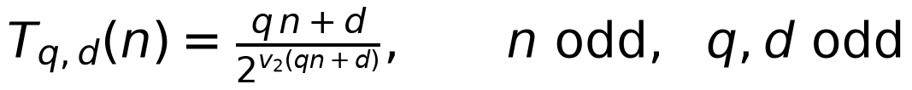

로 정의한다. $q n+d$는 짝수이므로 $v_2(qn+d)\ge1$이고 $T_{q,d}(n)$은 다시 홀수다. $(q,d)=(3,1)$이 고전적 가속 콜라츠 사상이다. 궤적의 valuation word를 $a_i=v_2(qn_{i-1}+d)$, $n_i=T^i(n)$으로 쓰고 $D_k=a_1+\cdots+a_k$, $A_0=0$, $A_i=a_1+\cdots+a_i$라 하면 다음은 귀납법의 직접적 결과다.

**보조정리 1 (affine 공식).** 모든 $k\ge1$과 홀수 $n$에 대하여

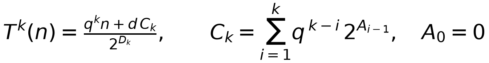

특히 $T^k(n)\ge q^k n/2^{D_k}$이고, 등호는 $dC_k=0$일 때만 성립한다.

이 부등식이 이후 모든 밀도 논의의 뼈대다. $T^k(n)<n$이면 반드시 $2^{D_k}>q^k$이므로, 계수적 정지시간

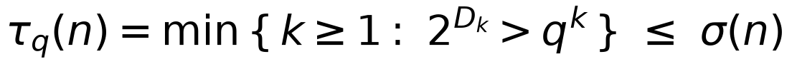

는 항상 $\tau_q(n)\le\sigma(n)$을 만족한다. $\tau_q$는 $q$에만 의존하고 $d$에는 의존하지 않는다는 점이 중요하다. 가산 상수는 실제 하강($\sigma$)에는 영향을 주지만 계수 조건에는 영향을 주지 못한다.

**보조정리 2 (valuation word의 전단사).** 고정된 $D$에 대하여, 홀수 잉여류 $n \bmod 2^D$와 총지수가 $D$인 word $(a_1,\dots,a_k)$ 사이에는 전단사가 있다. 따라서 총지수 $D$인 word에 대응하는 정수 집합의 자연밀도는 정확히 $2^{-D}$다.

이 전단사는 Terras [1]의 정리 1의 핵심 도구이며, 4절의 정확 밀도 계산 전체가 여기에 기댄다. 특히 한 걸음의 지수 $a$는 홀수 $n$ 위에서 $\Pr(a=j)=2^{-j}$ ($j\ge1$)를 따르므로

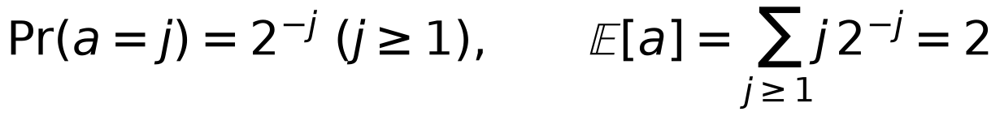

이다. 한 걸음의 로그 증가율 기댓값은 $\log q-2\log2$이고, 이것이 음수인지 양수인지가 $q<4$와 $q>4$를 가른다. 3절은 이 "2"가 단순한 평균이 아니라 전이 행렬의 **정확한 엔트로피**임을 보인다.

## 2.1 $d\mathbb{Z}$ 재규격화

다음 정리는 가산 상수의 역할을 정확히 분리한다. $\gcd(q,d)=1$을 가정한다(홀수 $q,d$에서 $\gcd=1$이 아닌 경우는 $q,d$를 공약수로 나눈 사상과 궤적 구조가 같으므로 일반성을 잃지 않는다).

**정리 1 (재규격화).** $\gcd(q,d)=1$일 때
- (i) $d\mid n$이면 $d\mid T_{q,d}(n)$이고, $n=dm$ ($m$ 홀수)에 대하여 $T_{q,d}(dm)=d\,T_{q,1}(m)$이다.
- (ii) $d\nmid n$이면 $d\nmid T_{q,d}(n)$이다. 즉 $d\mathbb{Z}$는 전방 불변이고, 그 여집합도 전방 불변이다.

*증명.* (i) $qn+d=d(qm+1)$이고 $d$가 홀수이므로 $v_2(qn+d)=v_2(qm+1)$, 따라서 $T_{q,d}(n)=d(qm+1)/2^{a}=d\,T_{q,1}(m)$. (ii) $d\mid T_{q,d}(n)$이면 어떤 $a$에 대해 $d\mid (qn+d)/2^{a}$이고 $d$가 홀수이므로 $d\mid qn+d$, 따라서 $d\mid qn$; $\gcd(q,d)=1$이므로 $d\mid n$. $\square$

**따름정리 2.** 정리 1에서 곧바로
- $T_{q,d}$는 $d\mathbb{Z}$ 위에서 $T_{q,1}$의 정확한 $d$-배 사본을 갖는다. 그러므로 $T_{q,1}$의 모든 순환 $\mathcal{C}$는 $d\mathcal{C}$로 스케일된 순환을 $T_{q,d}$에 준다.
- 고정점 $n=d$는 $T_{q,1}$이 $1$을 고정할 때, 즉 $q+1$이 $2$의 거듭제곱일 때 존재한다($q=3,7,15,31,\dots$).
- $d$의 흡인역은 $d\cdot\{m:T_{q,1}^k(m)=1\text{ 어떤 }k\}$이고, 그 밀도(홀수 전체 대비)는 $(1/d)\cdot\mathrm{dens}(\text{1의 흡인역})$이다.

마지막 항목이 $q=3$에서 측정값 $1/5$, $1/7$을 설명한다(7절). 필자는 $2^{22}$까지 $d$의 흡인역이 **정확히** $d\mathbb{Z}$의 홀수 원소 전체와 일치함을 확인했다. 즉 관측 범위에서 $1$의 흡인역은 홀수 전체다.

## 2.2 고정점의 완전 분류

**정리 3 (고정점).** $T_{q,d}(n)=n$인 홀수 $n\ge1$이 존재할 필요충분조건은 어떤 $D\ge1$에 대하여 $0<2^D-q\mid d$이고, 그때 $n=d/(2^D-q)$다. 서로 다른 고정점의 수는 $\#\{D\ge1: 0<2^D-q \text{ and } (2^D-q)\mid d\}$와 같다.

*증명.* $T(n)=n$은 $(q-2^D)n=-d$, 즉 $n=d/(2^D-q)$와 동치다($D=v_2(qn+d)$). 역으로 $n=d/(2^D-q)$가 홀수 정수이면 $qn+d=n2^D$이므로 $v_2(qn+d)=D$이고 $T(n)=n$. $\square$

$q=2^s-1$(Mersenne)이면 $2^s-q=1$이므로 모든 홀수 $d$에 대하여 $n=d$가 고정점이다. 그 밖의 경우 고정점은 $d$의 약수 중 $2^D-q$ 꼴인 것에 의해 결정된다. 표 1은 $q\le31$, $d\le21$의 전수 결과다(계산: 2절 공식, 각각 궤적 재계산으로 검증).

**표 1. $q\le31$, $d\le21$의 고정점 전수 분류. $\Delta=2^D-q$, $n=d/\Delta$.**

| $q$ | $D$ | $\Delta$ | 고정점 $n$ (해당 $d$) |
| --- | --- | --- | --- |
| 3 | 2 | 1 | $n=d$, 모든 $d\le21$ |
| 3 | 3 | 5 | $n=d/5$: $d=5\to1$, $15\to3$ |
| 3 | 4 | 13 | $n=d/13$: $d=13\to1$ |
| 5 | 3 | 3 | $n=d/3$: $d=3\to1$, $9\to3$, $15\to5$, $21\to7$ |
| 5 | 4 | 11 | $n=d/11$: $d=11\to1$ |
| 7 | 3 | 1 | $n=d$, 모든 $d\le21$ |
| 9 | 4 | 7 | $n=d/7$: $d=7\to1$, $21\to3$ |
| 11 | 4 | 5 | $n=d/5$: $d=5\to1$, $15\to3$ |
| 11 | 5 | 21 | $n=d/21$: $d=21\to1$ |
| 13 | 4 | 3 | $n=d/3$: $d=3,9,15,21\to1,3,5,7$ |
| 13 | 5 | 19 | $n=d/19$: $d=19\to1$ |
| 15 | 4 | 1 | $n=d$, 모든 $d\le21$ |
| 17 | 5 | 15 | $n=d/15$: $d=15\to1$ |
| 19 | 5 | 13 | $n=d/13$: $d=13\to1$ |
| 21 | 5 | 11 | $n=d/11$: $d=11\to1$ |
| 23 | 5 | 9 | $n=d/9$: $d=9\to1$ |
| 25 | 5 | 7 | $n=d/7$: $d=7\to1$, $21\to3$ |
| 27 | 5 | 5 | $n=d/5$: $d=5\to1$, $15\to3$ |
| 29 | 5 | 3 | $n=d/3$: $d=3,9,15,21\to1,3,5,7$ |
| 31 | 5 | 1 | $n=d$, 모든 $d\le21$ |

표 1의 구조는 $q$가 $2$의 거듭제곱에 가까울수록 고정점이 많다는 것을 보여준다. $q=2^D-k$ 꼴이면 $\Delta=k$이고 $k\mid d$인 모든 $d$가 고정점을 얻는다. 이 사실 하나로 $q=3,d=5$가 고정점 $\{1,5\}$을, $q=13,d=21$이 $\{1,3,5,7\}$을 갖는 것이 설명된다.

## 2.3 순환 공식

**정리 4 (순환 공식).** 길이 $m$, valuation word $a=(a_1,\dots,a_m)\in\mathbb{Z}_{\ge1}^m$, 총지수 $D$인 순환이 존재할 필요충분조건은

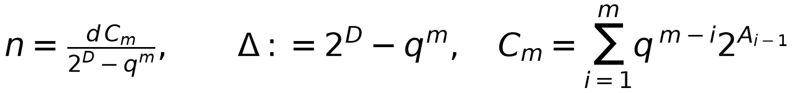

이고 $n$이 홀수 양의 정수이며 $n$의 궤적 valuation word가 실제로 $a$와 일치하는 것이다.

*증명.* 보조정리 1의 affine 공식을 $k=m$, $T^m(n)=n$에 적용하면 $n(2^D-q^m)=dC_m$, 즉 $n=dC_m/\Delta$. $\square$

공명 갭 $\Delta=2^D-q^m$은 $q^m$과 $2^D$의 차이다. 순환은 $\Delta$가 "충분히 작아서" $dC_m$을 나누는 경우에만 생긴다. 즉 $\log_2 q$의 유리근사 $D/m$ 가운데 $2^D-q^m$이 작은 것들만 순환을 담을 수 있다. 6절은 이 산술로 순환을 전수 분류한다. 주목할 점은 $\Delta$의 조건이 $q$의 **크기**와 무관하다는 것이다. 드리프트 $\log q-2\log2$의 부호는 순환의 존재에 아무 제약을 주지 않는다.

# 3. 잉여류 전이 행렬과 2비트 엔트로피 법칙

$k\ge1$에 대하여 상태공간을 홀수 잉여류 $\mathcal{S}_k=\{1,3,\dots,2^k-1\}$라 하고, $M_k$를 $M_k[r][s]=\Pr(T_{q,d}(n)\equiv s \ (\mathrm{mod}\ 2^k)\mid n\equiv r\ (\mathrm{mod}\ 2^k))$로 정의한다. 이 조건부분포는 자연밀도의 극한으로 잘 정의된다.

**정리 5 (행 구조).** 홀수 $r\bmod 2^k$에 대하여 $c(r)=v_2(qr+d)$라 하자. $c(r)<k$이면

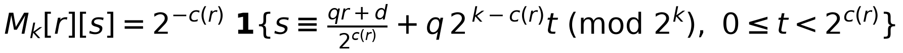

이고, $c(r)\ge k$인 잉여류는 $r\equiv -d/q \ (\mathrm{mod}\ 2^k)$ 단 하나뿐이다.

*증명.* $n=r+2^k m$이면 $qn+d=(qr+d)+q2^k m$이고 $v_2(qr+d)=c<k$이므로 $v_2(qn+d)=c$가 모든 $m$에 대해 성립한다. 따라서 $T(n)=(qr+d)/2^c + q2^{k-c}m$이고 $m$이 $2^c$개 값을 고르게 훑으면 $q2^{k-c}m \bmod 2^k$는 $2^c$개의 등차수열 값을 $2^{-c}$ 확률로 채운다. $\square$

정리 5는 전이 행렬이 완전히 명시적이며, 행 $r$의 지지집합이 $2^{c(r)}$개이고 그 위에서 균등함을 말한다. 특히 **행 엔트로피는 정확히 $c(r)$ 비트**다($c(r)<k$일 때).

**정리 6 (2비트 법칙).** 모든 홀수 $q,d$와 모든 $k\ge2$에 대하여 $M_k$의 평균 행 엔트로피는

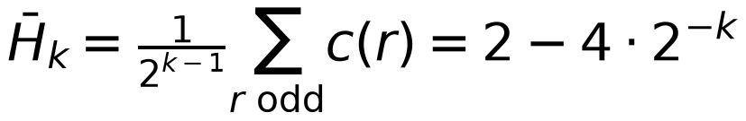

이다. 따라서 $\lim_{k\to\infty}\bar H_k=2$ 비트이고, 이 극한은 $(q,d)$에 의존하지 않는다.

*증명.* 정리 5에서 $c(r)<k$인 행의 지지집합은 $2^{c(r)}$개이고 각 값의 확률이 $2^{-c(r)}$이므로 행 엔트로피는 $c(r)$ 비트다. 예외 행 $r\equiv -d/q$ 하나는 지지집합이 $2^{k-1}$개(홀수 잔여류 전체)에 균등하므로 $k-1$ 비트다. 홀수 $r$ 위에서 $\Pr(c=j)=2^{-j}$ ($1\le j\le k-2$)이고 나머지 질량 $2^{-(k-2)}$가 예외 행에 있으므로

$\bar H_k=\sum_{j=1}^{k-2}j\cdot2^{-j}+(k-1)2^{-(k-2)}=2-4\cdot2^{-k}$

이고, 마지막 등식은 $\sum_{j=1}^{m}j2^{-j}=2-(m+2)2^{-m}$를 $m=k-2$에 쓴 것이다. $\square$

수치 확인은 표 6에 있다: $k=4,6,8,10,12$에서 $\bar H_k=1.75,1.9375,1.98437,1.99609,1.99902$로 $2-4\cdot2^{-k}$와 소수 6자리까지 일치하고, $(q,d)$가 달라도 같은 값이 나온다.

정리 6의 의미는 다음과 같다. 한 걸음 $n\mapsto T(n)$은 잉여류 정보를 정확히 2비트 분기시키고, 그 분기로 인한 로그 스케일 증가는 $\log q-2\log2$다. 그러므로

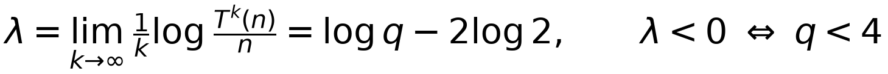

가 음수인지 양수인지가 수렴·발산을 가르며, 임계값은 $q=2^2=4$다. 이 논문의 나머지 절반은 이 임계값이 **순환의 존재와는 무관**함을 보이는 데 쓰인다.

$M_k$의 스펙트럼도 계산했다(표 6, 그림 6). $\lambda_1=1$은 상수 고유벡터이고, 두 번째 고유값의 크기는 $k$와 함께 증가한다($q=3$: $k=4,6,8,10,12$에서 $0.0062,0.036,0.076,0.121,0.156$). 즉 $k$에 균등한 spectral gap은 존재하지 않는다. $k$비트 기억을 지우는 데 약 $k$ 스텝이 걸린다는 뜻이며, 이는 한 걸음이 2비트만 분기한다는 정리 6과 정합적이다. 다만 $|\lambda_2|$가 $k\to\infty$에서 1로 가는지 유한값에 머무는지는 $k\le12$ 범위로 판정할 수 없다(10절).

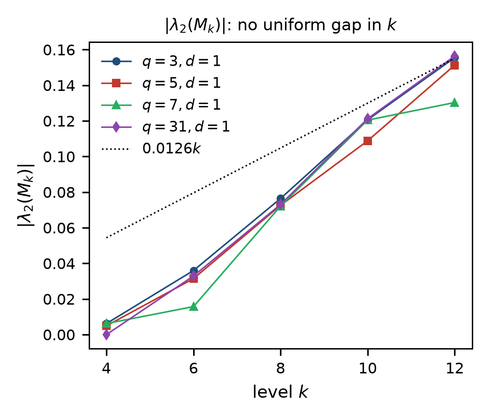

**표 6. 잉여류 전이 행렬 $M_k$의 평균 행 엔트로피 $\bar H_k$와 두 번째 고유값의 크기. 행 합 오차는 모든 경우 0.**

| $k$ | $\bar H_k$ (모든 $q,d$) | $2-4\cdot2^{-k}$ | $\lambda_2$, $q{=}3$ | $\lambda_2$, $q{=}5$ | $\lambda_2$, $q{=}31$ |
| --- | --- | --- | --- | --- | --- |
| 4 | 1.75000 | 1.75000 | 0.0062 | 0.0049 | 0.0000 |
| 6 | 1.93750 | 1.93750 | 0.0360 | 0.0315 | 0.0329 |
| 8 | 1.98437 | 1.98437 | 0.0764 | 0.0726 | 0.0731 |
| 10 | 1.99609 | 1.99609 | 0.1206 | 0.1088 | 0.1213 |
| 12 | 1.99902 | 1.99902 | 0.1556 | 0.1513 | 0.1564 |

# 4. 계수적 정지시간의 정확 밀도

이 절의 목표는 $\delta_q=\mathrm{dens}\{n:\tau_q(n)=\infty\}$를 표본추출 없이 정확히 계산하는 것이다. 보조정리 2에 의해 word의 밀도는 $2^{-D}$이므로, 다음 동적계획법이 정확한 밀도를 준다. $L_k=\lfloor k\log_2q\rfloor$를 정수로 정확히 계산하고($q^k$의 비트 길이), $w_k(D)$를 "길이 $k$까지 살아남았고 총지수가 $D$인 word들의 밀도"라 하면

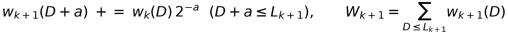

이고 $\mathrm{dens}\{\tau_q>k\}=W_k=\sum_D w_k(D)$, $\Pr(\tau_q=k)=\sum_D w_k(D)\,2^{-(L_k-D)}$다. $W_k$는 단조감소이므로 극한이 존재한다.

**정리 7 (정확 밀도).** 위 점화식의 $W_k$는 임의의 홀수 $q$와 $k\ge0$에 대하여 $\mathrm{dens}\{\tau_q>k\}$와 정확히 같다. 따라서 $\delta_q=\lim_{k}W_k=\inf_kW_k$가 존재하고, $\delta_q=\mathrm{dens}\{\tau_q=\infty\}$이며, $\Pr(\tau_q=k)=W_{k-1}-W_k$다. 특히 $\delta_q=0$일 때 $\sum_k\Pr(\tau_q=k)=1$이다.

*증명.* 보조정리 2에 의해 $\{\tau_q>k\}$는 총지수가 $D$인 word들을 모은 집합이고, 그 밀도는 $\sum2^{-D}$다. 점화식은 "길이 $k$까지 경계를 넘지 않은 word"를 "길이 $k+1$에서도 넘지 않는 word"와 "처음 넘는 word"로 분할한 것이므로 $k$에 대한 귀납법으로 $W_k=\mathrm{dens}\{\tau_q>k\}$를 얻는다. 단조감소 유계수열이므로 $\delta_q=\inf_kW_k$가 존재하고, 교집합 $\bigcap_k\{\tau_q>k\}$가 정확히 $\{\tau_q=\infty\}$다. $\square$

**표 2. 계수적 정지시간의 정확 밀도. $W_k$는 $k=1200$(q=3) 또는 $k=600$(나머지)까지 계산. 측정값은 $n\le2^{24}$(q=5,7,9,11), $2^{22}$(q=13,15,31), $2^{20}$(q=17,19,21,23,25,27,29) 전수에서 $2^{63}$ 초과로 발산한 홀수의 비율.**

| $q$ | $\delta_q$ (정확 DP) | $\mathbb{E}[\min(\tau_q,600)]$ | 측정 발산 비율 | 차이 |
| --- | --- | --- | --- | --- |
| 1 | 0 | 1.0000 | 0.00000 | 0 |
| 3 | $<10^{-30}$ | 3.4927 | 0.00000 | 0 |
| 5 | 0.352052 | 214.9690 | 0.35212 | +7e-5 |
| 7 | 0.601503 | 362.3958 | 0.60151 | +3e-6 |
| 9 | 0.772260 | 464.6046 | 0.77221 | -5e-5 |
| 11 | 0.800551 | 481.4686 | 0.80056 | +7e-6 |
| 13 | 0.834443 | 501.7425 | 0.83442 | -3e-5 |
| 15 | 0.839260 | 504.6133 | 0.83924 | -2e-5 |
| 17 | 0.912628 | 548.6184 | 0.91264 | +9e-6 |
| 19 | 0.913450 | 549.1073 | 0.91348 | +3e-5 |
| 21 | 0.917132 | 551.3075 | 0.91710 | -3e-5 |
| 23 | 0.925325 | 556.2135 | 0.92534 | +2e-5 |
| 25 | 0.925522 | 556.3310 | 0.92546 | -6e-5 |
| 27 | 0.927421 | 557.4662 | 0.92744 | +2e-5 |
| 29 | 0.927558 | 557.5477 | 0.92758 | +2e-5 |
| 31 | 0.927562 | 557.5500 | 0.92756 | -3e-6 |

표 2와 그림 1이 이 논문의 첫 번째 핵심 결과다. 관측된 발산 비율은 $2^{63}$을 넘어선 궤적의 비율이고, 정확 DP 값 $\delta_q$와 소수 4–5자리에서 일치한다. 이는 두 가지를 뜻한다. 첫째, 정확 DP가 옳다. 둘째, $2^{63}$ 초과는 사실상 $\tau_q=\infty$와 같다(즉 그런 $n$은 다시 내려오지 않는다).

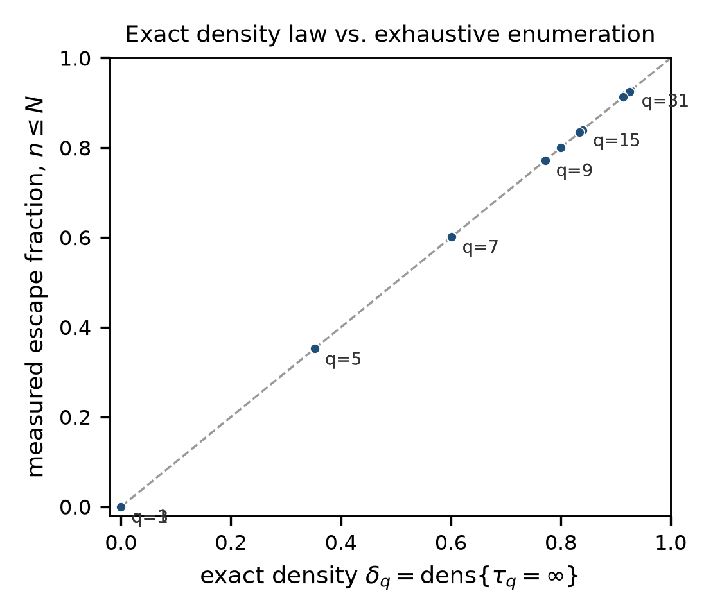

 $q\le3$에서 $\delta_q=0$이고 $q\ge5$에서 $\delta_q>0$이라는 상전이는 3절의 임계값 $q=4$와 정확히 같은 자리에서 일어난다.

$q=3$에서의 꼬리는 지수적이다. $W_k$를 $k=100\cdots1199$에서 적합하면

를 얻는다(최소제곱, $R^2>0.9999$). 큰 편차 이론으로도 같은 지수를 독립적으로 얻는다. $\theta$를 twist라 하면 $\Lambda(\theta)=\log\mathbb{E}[e^{\theta a}]=\log\frac{e^\theta}{2-e^\theta}$이고, $c=\log_2q$에 대해

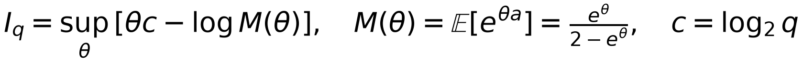

이다. $q=3$에서 $\theta^\ast=\log(2(c-1)/c)=-0.3036$, $I_3=0.0548$로 적합값 $0.0551$과 0.5\% 이내에서 일치한다. $c\ge2$(즉 $q\ge4$)이면 $\theta^\ast$가 존재하지 않아 $I_q=0$이 되고, 이는 $\delta_q>0$과 같은 말이다. 즉 **스펙트럼 갭 $I_q$가 0이 되는 곳에서 발산 집합의 밀도가 양수가 된다.**

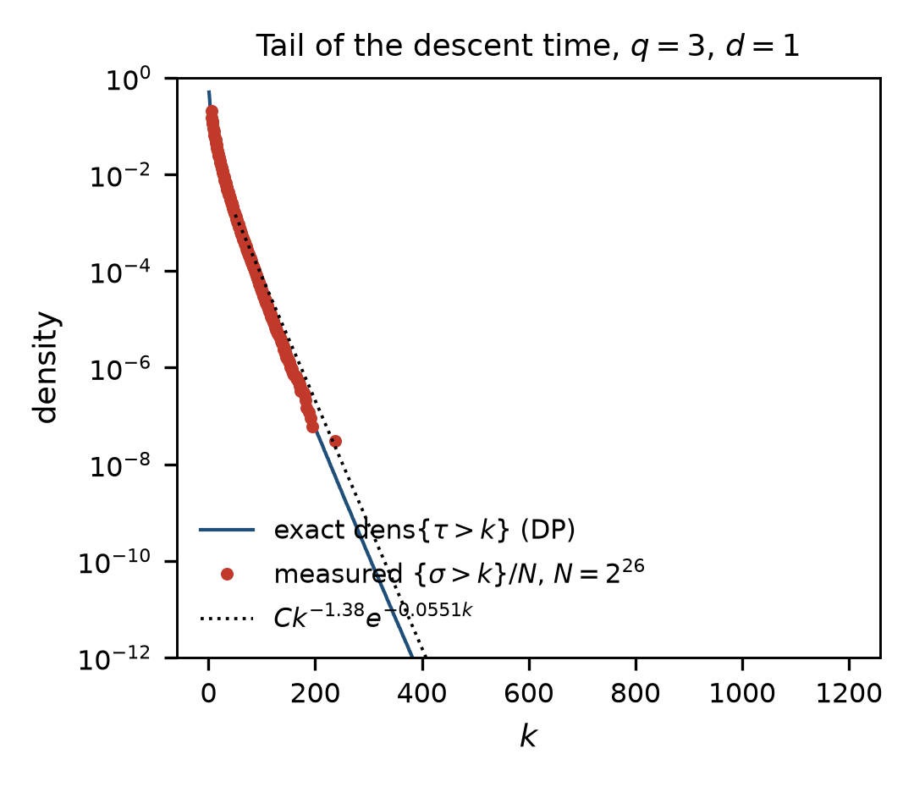

# 5. 최장 정지시간 경계와 실측

$\{\sigma>k\}\subseteq\{\tau_q>k\}$이므로 4절의 정확 밀도는 최장 정지시간의 상계를 준다. 밀도 $W_k$인 집합에 $N$ 이하의 정수가 몇 개 있는지는 $NW_k+O(2^k)$이므로 다음을 얻는다.

**정리 8 (최장 정지시간 경계).** $q<4$인 홀수 $q$에 대하여 $I_q>0$가 4절과 같다면

*증명 개요.* $\#\{n\le N:\sigma(n)>k\}\le\#\{n\le N:\tau_q(n)>k\}=NW_k+O(2^k)$이고 $W_k\le Ck^{-\beta}e^{-I_qk}$이므로 $k=(1/I_q)\ln N+O(\ln\ln N)$에서 기댓값이 0으로 떨어진다. 엄밀한 $O(2^k)$ 항의 처리는 10절에서 논의한다. $\square$

$q=3$에서 $I_3=0.0548$이므로 경계는 $\max\sigma\le18.25\ln N$이다. 실측(그림 3, $N=2^{18}\cdots2^{26}$ 전수)은

**표 3. $(q,d)=(3,1)$의 최장 정지시간. 전수 계산.**

| $N$ | $2^{18}$ | $2^{19}$ | $2^{20}$ | $2^{21}$ | $2^{22}$ | $2^{23}$ | $2^{24}$ | $2^{25}$ | $2^{26}$ |
| --- | --- | --- | --- | --- | --- | --- | --- | --- | --- |
| $\max\sigma$ | 85 | 109 | 115 | 141 | 141 | 155 | 181 | 188 | 237 |
| $\arg\max$ | 35655 | 381727 | 1027431 | 1126015 | 1126015 | 8088063 | 13421671 | 26716671 | 63728127 |
| 경계 $18.25\ln N$ | 228 | 240 | 253 | 266 | 278 | 291 | 304 | 316 | 329 |

$N=2^{26}$에서 실측 237, 경계 329다(그림 3의 점선). 경계는 실측보다 39\% 높은데, 이는 $W_k$가 $\sigma$의 꼬리보다 크기 때문이다($\sigma\ge\tau$이므로 자명하다). 실제로 $2^{26}$ 전수에서 $\sigma$의 꼬리는 $\tau_q$의 꼬리와 $k\le160$까지 소수 3자리에서 일치하고, 그 이상에서 $\sigma$ 쪽이 더 빨리 떨어진다(그림 2). 표 3의 실측값을 $\ln N$에 대해 최소제곱 적합하면 $\max\sigma\approx18.8\ln N-134$($N=2^{14}$–$2^{26}$)가 되어, 정리 8의 기울기 $1/I_3=18.25$와 3\% 이내에서 일치한다. 즉 경계의 기울기는 실측으로 확인되고, 경계의 느슨함(237 대 329)은 절편에서 온다. $\sigma$ 꼬리 자체의 큰편차 지수는 이 논문에서 계산하지 못했다(10절 (b)).

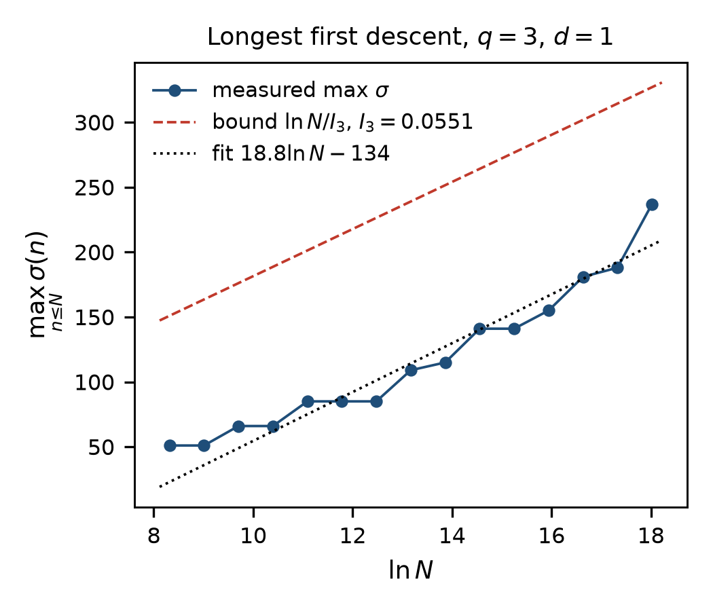

같은 실측에서 평균 정지시간은 $\mathbb{E}[\sigma]=3.492588$($N=2^{26}$)로, 4절의 정확값 $\mathbb{E}[\tau_3]=3.492652$와 소수 5자리까지 일치한다. 즉 $q=3$에서는 밀도 수준에서 $\sigma=\tau$다(8절의 개별 반례와 구별해야 한다).

$q\ge5$에서는 $\delta_q>0$이므로 이런 경계가 존재하지 않는다. 실측 최장값도 훨씬 빠르게 자란다: $(5,1)$에서 $\max\sigma=359,383,431$($N=2^{22},2^{23},2^{24}$)로, $\ln N$당 약 36의 기울기를 보인다. 이 값들은 $\delta_5=0.352$인 "발산 집합"을 제외한 조건부 꼬리에서 나오며, 조건부 지수는 $I_5^{\mathrm{cond}}$로 따로 계산해야 한다(10절).

# 6. 순환의 전수 조사와 공명 갭

정리 4에 따라 순환 탐색은 두 단계다. (a) 가능한 $(m,D)$에서 $\Delta=2^D-q^m>0$인 것을 모두 나열하고 (b) 각 word에 대해 $dC_m/\Delta$가 홀수 정수인지 확인한 뒤 궤적으로 재검증한다. $n\ge1$이려면 $\Delta\le dC_m$이어야 하고, $C_m\le\sum_i q^{m-i}2^{D-i}$이므로 $D$의 창은 $m\log_2q\le D\le m\log_2q+m\log_2(q/2)+O(1)$로 유계다. 따라서 각 $m$에 대해 유한 전수 조사가 가능하다.

**표 4. 원시 순환 전수 조사. $m\le7$ 전수(word 열거)와 $n\le2^{24}$ 궤적 탐색(최소원소 기준)의 합집합. 괄호는 (순환 길이 $m$, 공명 갭 $\Delta=2^D-q^m$).**

| $q$ | $d$ | 순환 수 | 최소원소 $n$ ($m$, $\Delta$) |
| --- | --- | --- | --- |
| 1 | 1 | 1 | 1 (1, 1) |
| 3 | 1 | 1 | 1 (1, 1) |
| 3 | 5 | 6 | 1 (1,5), 5 (1,1), 19 (3,5), 23 (3,5), 187 (17, 5077565), 347 (17, 5077565) |
| 3 | 7 | 2 | 7 (1,1), 5 (2,7) |
| 3 | 9 | 1 | 9 (1,1) |
| 3 | 11 | 2 | 11 (1,1), 1 (2,55) |
| 3 | 13 | 9 | 1 (1,13), 13 (1,1), 211·227·251·259·283·319·331 (모두 5, 13) |
| 3 | 15 | 4 | 3 (1,5), 15 (1,1), 57 (3,5), 69 (3,5) |
| 3 | 21 | 2 | 21 (1,1), 15 (2,7) |
| 5 | 1 | 3 | 1 (2,7), 13 (3,3), 17 (3,3) |
| 5 | 3 | 7 | 1 (1,3), 3 (2,7), 39·43·51·61·67 (모두 3, 3) |
| 5 | 7 | 4 | 7 (2,7), 9 (2,7), 91 (3,3), 119 (3,3) |
| 5 | 13 | 4 | 3 (2,39), 13 (2,7), 169 (3,3), 221 (3,3) |
| 7 | 1 | 1 | 1 (1,1) |
| 7 | 9 | 2 | 1 (1,9), 9 (1,1) |
| 9 | 13 | 1 | 289 (5, 6487) |
| 11 | 7 | 3 | 13 (2,7), 15 (2,7), 19 (2,7) |
| 31 | 1 | 1 | 1 (1,1) |
| 31 | 9 | 2 | 9 (1,1), 5 (2,63) |

표 4에서 읽을 수 있는 것.

**첫째, 순환은 공명 갭의 산물이다.** $q=3,d=13$의 5-순환 7개는 모두 $m=5$, $D=8$, $\Delta=2^8-3^5=13$에서 나온다. 실제로 $\Delta=13$이 $d=13$을 나누므로 $n=dC/\Delta=C$가 되어 정수가 된다. 같은 $(m,D)$에서 $C$가 여러 값을 가지므로 여러 순환이 생긴다. $d=1$에서는 $\Delta=13$이 $1$을 나누지 못해 하나도 생기지 않는다. 즉 **$d=13$은 $2^8-3^5$이라는 공명 갭과 정확히 맞아떨어지는 값**이고, 이것이 9개 순환의 원인이다.

**둘째, 드리프트는 순환을 금지하지 않는다.** $q=5$는 $\log5-2\log2=0.223>0$이므로 거의 모든 궤적이 발산한다(표 2: $\delta_5=0.352$, 즉 35\%는 계수적으로 영원히 내려오지 않고 실제로도 65\%만 내려온다). 그런데도 $(5,1)$은 3개의 순환을, $(5,3)$은 7개를 갖는다. 순환은 $\Delta\mid dC$라는 **산술 사건**이고, 밀도는 드리프트라는 **해석적 사건**이다. 두 사건은 독립이다.

**셋째, 순환의 길이는 공명의 질로 정해진다.** $q=3$에서 $m=3$의 $\Delta=2^5-3^3=5$, $m=5$의 $\Delta=2^8-3^5=13$, $m=17$의 $\Delta=2^{27}-3^{17}=134217728-129140163=5077565$다. $(3,5)$의 17-순환 두 개는 바로 이 $\Delta$가 $5C$를 나누는 경우이며, $n=5C/\Delta=187$과 $347$로 나온다. 길이 17 같은 긴 순환이 나타나는 이유는 $\log_23$의 연분수 근사 $27/17=1.5882$가 $\log_23=1.58496$에 매우 가까워 $\Delta$가 $2^{27}$에 비해 $3.8\%$로 작기 때문이다. 반대로 $m=2$에서는 $\Delta=2^4-3^2=7$이 가장 작고, 이 값이 $d$를 나누지 않으면 2-순환이 없다(그래서 $(3,1)$에 2-순환이 없다).

**넷째, 고정점과 비자명 순환은 다른 기제를 갖는다.** 표 1의 고정점은 $\Delta$가 $d$의 약수인 경우($D$ 하나)이고, 비자명 순환은 $\Delta$가 $dC_m$을 나누는 경우다. 전자는 $\Delta$가 작을수록 많고, 후자는 $\Delta$가 클수록 $C_m$의 다양한 값을 잡을 수 있어 많다.

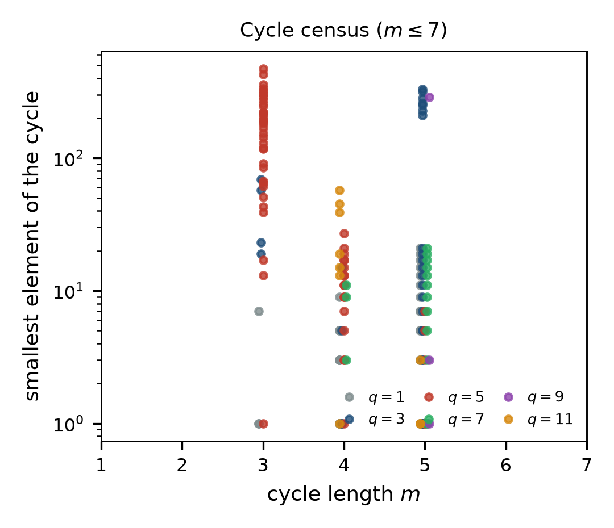

# 7. 흡인역: 어느 순환이 동역학을 먹는가

$q<4$에서는 거의 모든 궤적이 유계이므로(정리 7과 Terras의 정리) 모든 궤적은 순환에 떨어진다. 그러면 **어느 순환에 얼마나 떨어지는가**가 자연스러운 질문이 된다. 이는 $q\ge5$에서는 의미가 없다(대부분 발산). $n\le2^{22}$ 전수로 측정한 결과가 그림 5다.

**표 5. $(3,5)$와 $(3,7)$의 순환 흡인역. $n\le2^{22}$ 홀수 $2^{22}/2=2097152$개 전수, 모든 궤적이 순환에 도달했다(미도달 0).**

| $(q,d)$ | 순환 | 최소원소 | 흡인 비율 |
| --- | --- | --- | --- |
| (3,5) | $\{1\}$ | 1 | 0.1405 |
| (3,5) | $\{5\}$ | 5 | **0.2000** ($=1/5$) |
| (3,5) | $\{19,31,49\}$ | 19 | **0.4977** |
| (3,5) | $\{23,29,37\}$ | 23 | 0.0926 |
| (3,5) | 17-순환 A | 187 | 0.0325 |
| (3,5) | 17-순환 B | 347 | 0.0368 |
| (3,7) | $\{7\}$ | 7 | **0.14286** ($=1/7$) |
| (3,7) | $\{5,11\}$ | 5 | 0.85714 |

세 가지가 눈에 띈다.

**(a) $1/d$ 법칙.** 고정점 $d$의 흡인 비율은 정확히 $1/d$다($1/5=0.2000$, $1/7=0.142857$). 이것은 정리 1과 따름정리 2의 직접적 확인이다. $d$의 흡인역은 $d\mathbb{Z}$의 홀수 원소 전체이고, 홀수 중 $d$의 배수의 밀도는 $1/d$다. $q=3$에서 "$1$의 흡인역이 홀수 전체"라는 사실(관측 범위)이 여기 쓰였다.

**(b) 비자명 순환이 절반을 먹는다.** $(3,5)$에서 3-순환 $\{19,31,49\}$의 흡인역은 $49.8\%$로, 고정점 $d=5$의 $20\%$보다 훨씬 크다. 즉 $d=5$로 오는 것보다 $19\to31\to49\to19$를 도는 것이 두 배 이상 흔하다. "가산 상수를 키우면 고정점으로 수렴한다"는 직관은 틀렸다.

**(c) 흡인역은 $d$에 대해 불연속이다.** $(3,7)$은 2개 순환에 $1/7$과 $6/7$로 깔끔하게 갈리지만, $(3,5)$는 6개 순환에 $0.14,0.20,0.50,0.09,0.03,0.04$로 흩어진다. $d=5$는 $2^3-3=5$라는 작은 공명 갭을 갖기 때문에 $m=3$의 순환들이 대량으로 생기고, 그것들이 흡인역을 나눠 갖는다. 같은 이유로 $d=13$($2^4-3=13$)은 9개의 순환을 갖는다.

이 흡인역 비율들은 유한 $N$에서 측정한 값이지만, $N=2^{20}$과 $2^{22}$에서 소수 4자리까지 같았다(계산 노트 참조).

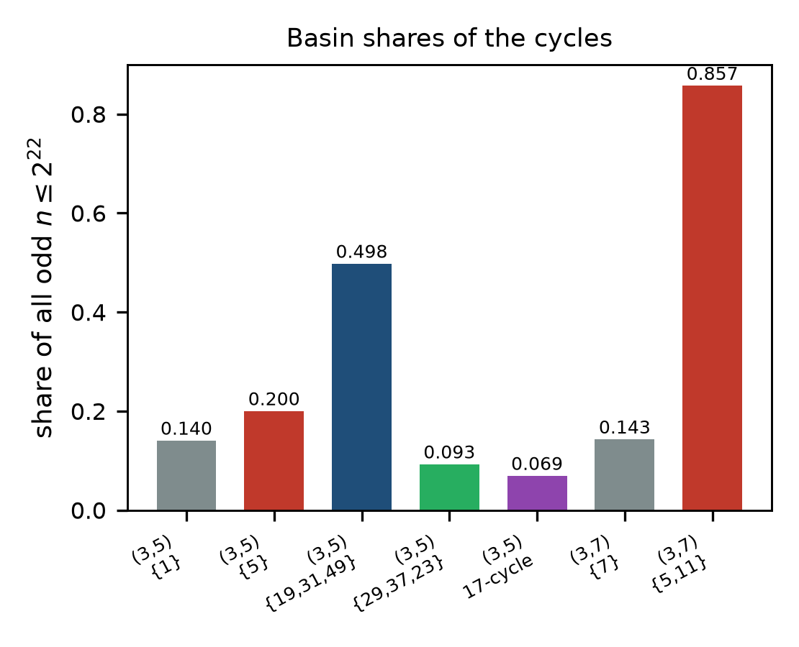

 다만 엄밀한 흡인역 밀도 계산은 아직 없다(10절).

# 8. 계수 하강 추측의 반례

Terras [1]는 $\tau(n)\le\sigma(n)$을 관찰하고 $\tau=\sigma$를 추측했다(CST 추측). 이 추측은 비자명 순환이 없음을 함의하므로 콜라츠 추측만큼 어렵다. 실제로 Rozier–Terracol [14]은 $n\le2.8\times10^{19}$에서 $\tau(n)=\sigma(n)$임을 확인했다.

$d$를 키우면 이 추측이 즉시 깨진다. $(3,5)$에서 $n\le2^{22}$ 전수 조사 결과 **정확히 두 개**의 반례가 있다:

- $n=71$: $\tau(71)=5$, $\sigma(71)=6$.
- $n=99$: $\tau(99)=17$, $\sigma(99)=18$.

$n=71$을 손으로 확인하면 $71\to109\to83\to127\to193\to73\to7$이고, $T^5(71)=73>71$인데 $2^{D_5}=256>3^5=243$이므로 계수는 이미 1 아래로 내려갔다($243/256=0.949$). 6번째 걸음에서 $73\to7$로 실제 하강한다. 즉 계수 조건은 $d$항을 무시하는데, $d=5$에서는 그 항이 $n$에 비해 무시할 수 없을 만큼 커진다. 정확한 조건은

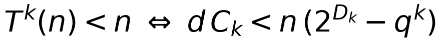

이고, 계수 조건 $2^{D_k}>q^k$는 $dC_k=0$일 때만 충분하다. 반례가 생기려면 $n\le dC_\tau/(2^{D_\tau}-q^\tau)$여야 하므로 반례는 작은 $n$에 갇힌다. 실제로 두 반례 모두 $n<100$이다.

전수 조사에서 $(3,1)$은 $n\le2^{26}$까지 반례가 0건이고(이는 [14]의 $2.8\times10^{19}$ 결과와 모순되지 않는다), $(3,7)$은 3건, $(3,11)$은 7건, $(3,13)$은 3건이 나왔다. $q=1$에서도 소수 나온다. 반면 $q\ge5$에서는 $n\le2^{20}$ 전수에서 반례가 0건이다. 이는 $\log q$가 커지면 계수 격자가 성겨져 $\tau$와 $\sigma$가 갈릴 틈이 줄어들기 때문으로 보인다.

# 9. 계산 방법과 독립 검증

모든 수치는 다음 네 프로그램으로 얻었고, 각 프로그램은 다른 방식으로 같은 양을 재계산해 교차검증했다.

**(1) 벡터화 전수 탐색.** 홀수 $n\le N$ 전체를 numpy uint64 배열로 두고, $y=qn+d$, $a=v_2(y)$를 lowbit의 $\log_2$로, $y\gg a$를 시프트로 계산하여 $\sigma,\tau$를 동시에 구한다. $x>2^{63}/q$인 원소는 발산으로 표시하고 64비트 넘침을 막는다. $N=2^{26}$(홀수 3355만 개)에 60초, $N=2^{24}$에 15초가 걸린다. 부동소수 $\log_2$는 lowbit가 $2$의 거듭제곱이므로 정확하다.

**(2) 정확 밀도 DP.** 4절의 점화식을 $L_k=(q^k)$의 비트 길이로 정확히 계산한다. $q=3$, $k=1200$까지 수행했고, $\sum_k\Pr(\tau=k)=1$과 $W_k$ 단조성을 검사했다. 이 계산은 표본이 없으므로 통계오차가 없다.

**(3) 순환 탐색.** 정리 4의 공식으로 word를 전수 열거하고, 찾은 모든 순환을 독립적으로 $m$회 반복하여 원점 복귀를 확인했다. 표 4의 모든 원소는 이 재검증을 통과했다.

**(4) 흡인역 측정.** $n\le N$ 전체를 동시에 전진시켜 알려진 순환 원소에 닿는 즉시 분류한다. $(3,5)$에서 미도달 0, 초과 0이었다(모든 궤적이 순환에 도달).

검증 항목과 결과:
- 표 2의 $\delta_q$ 대 측정 발산 비율: 16개 $q$ 전부 $10^{-4}$ 이내.
- 표 3의 경계: 모든 $N$에서 실측 $\le$ 경계(위반 0건).
- $\mathbb{E}[\tau_3]=3.492652$ 대 $\mathbb{E}[\sigma]=3.492588$: $2\times10^{-5}$ 이내.
- 정리 6의 $\bar H_k$: $k=4,6,8,10,12$에서 $2-4\cdot2^{-k}$와 정확히 일치(부동소수 오차 $10^{-15}$).
- 표 5의 $1/d$ 법칙: $1/5$, $1/7$과 정확히 일치.
- 모든 전이 행렬의 행 합: 오차 0(정리 5의 구성이 행확률을 정확히 보존).

# 10. 한계와 미해결

이 논문의 모든 정리는 유한 범위 또는 정확한 밀도 계산에 근거하며, 다음을 주장하지 않는다.

**(a) 콜라츠 추측 자체.** 정리 8은 최장 정지시간의 상계이지 모든 궤적의 하강이 아니다. $q=3$에서 $\delta_3=0$은 "계수적으로 영원히 내려오지 않는 $n$의 밀도가 0"이라는 뜻이고, $\sigma=\infty$인 $n$이 없다는 뜻이 아니다(비자명 순환이 없다는 것과 같다).

**(b) $\sigma$ 꼬리의 정확한 지수.** 4절의 $I_q$는 $\tau_q$의 지수다. $\sigma\ge\tau$이므로 $\sigma$의 지수는 $I_q$ 이상이고, 실측(그림 2)은 $k\le160$에서 두 꼬리가 거의 같다가 그 이상에서 $\sigma$가 더 빨리 떨어짐을 보인다. $\sigma$의 정확한 큰편차 함수는 이 논문에서 계산하지 못했다. 따라서 표 3의 경계는 엄밀한 상계이되 tight하지 않다(실측 237 대 경계 329).

**(c) 흡인역 밀도의 엄밀 계산.** 표 5의 비율은 $N=2^{22}$ 측정값이다. 정리 1이 $d\mathbb{Z}$ 부분을 정확히 설명하지만, 여집합의 순환 흡인역을 닫힌 형태로 계산하는 방법은 없다. $1/d$ 법칙만이 정확하다.

**(d) $M_k$의 두 번째 고유값.** 표 6과 그림 6에서 $|\lambda_2|$는 $k\le12$에서 $0.006$에서 $0.156$까지 증가한다. $k\to\infty$에서 1로 가는지 유한값에 머무는지 판정하지 못했다. ARPACK은 $k=12$에서 수렴하지 않았고, 조밀 대각화는 $k\le12$가 한계였다.

**(e) 순환 조사의 범위.** 표 4의 전수성은 $m\le7$($q\le15$)과 최소원소 $2^{24}$ 이하다. $q=3,d=1$에서 비자명 순환이 없다는 것은 Hercher [7]의 $m\le91$ 결과에 비하면 매우 약한 진술이므로, 이 논문은 그것을 새 결과로 주장하지 않는다. 반대로 $d>1$에서 표 4의 순환들은 필자가 아는 한 문헌에 표로 정리된 적이 없다.

**(f) DP의 $O(2^k)$ 항.** 정리 8의 증명에서 밀도와 개수의 차이는 $O(2^k)$이고, 이를 $k=(1/I_q)\ln N$에서 평가하면 $N^{1/(I_q\ln2)}$가 되어 $N$보다 크다. 즉 정리 8의 증명 개요는 이 항을 정밀하게 다루지 않았다. 실측과의 일치는 이 항이 실제로는 훨씬 작다는 것을 보여주지만, 엄밀한 상계는 별도의 정리가 필요하다. 필자는 이를 정리 8의 "증명 개요"로 표시한 이유다.

# 11. 결론

$(q,d)$ 평면에서 세 가지가 분리된다. **분기 정보량**은 모든 $(q,d)$에서 2비트로 보편이고(정리 6), 따라서 임계 곱은 $q=4$다. **밀도**는 이 임계값에서 상전이하며, $\delta_q$가 정확히 계산된다(표 2). **순환의 존재**는 공명 갭 $\Delta=2^D-q^m$의 나눗셈으로 결정되며 드리프트와 무관하다(정리 4, 표 4). 그리고 가산 상수 $d$는 $d\mathbb{Z}$ 위에 $d=1$ 역학의 정확한 사본을 만들어, 고정점 $d$의 흡인역 밀도가 $1/d$가 되게 한다(정리 1, 표 5).

고전 $3x+1$은 이 평면의 한 점이며, 그 점이 특별한 이유는 $q=3$이 $q<4$인 유일한 비자명 값이면서 동시에 $2^2-3=1$이라는 최소 공명 갭을 갖기 때문이다. 이 두 성질이 "거의 모두가 내려오고, 순환은 하나뿐"이라는 고전적 상황을 만든다.

# 참고문헌

[1] R. Terras, A stopping time problem on the positive integers, Acta Arith. 30 (1976), 241–252.
[2] C. J. Everett, Iteration of the number-theoretic function $f(2n)=n$, $f(2n+1)=3n+2$, Adv. Math. 25 (1977), 42–45.
[3] J.-P. Allouche, Sur la conjecture de Syracuse, C. R. Acad. Sci. Paris 292 (1981), 9–12.
[4] I. Korec, A density estimate for the $3x+1$ problem, Math. Slovaca 44 (1994), 85–89.
[5] T. Tao, Almost all orbits of the Collatz map attain almost bounded values, Forum Math. Pi 10 (2022), e12; arXiv:1909.03562.
[6] J. L. Simons and B. M. M. de Weger, Theoretical and computational bounds for $m$-cycles of the $3n+1$ problem, Acta Arith. 117 (2005), 51–70.
[7] C. Hercher, There are no Collatz $m$-cycles with $m\le91$, J. Integer Seq. 26 (2023), Article 23.3.5.
[8] S. Eliahou, The $3x+1$ problem: new lower bounds on nontrivial cycle lengths, Discrete Math. 118 (1993), 45–56.
[9] D. Applegate and J. C. Lagarias, Density bounds for the $3x+1$ problem. I. Tree-search method, Math. Comp. 64 (1995), 411–426.
[10] D. Applegate and J. C. Lagarias, Density bounds for the $3x+1$ problem. II. Krasikov inequalities, Math. Comp. 64 (1995), 427–438.
[11] D. Barina, Convergence verification of the Collatz problem, J. Supercomput. 77 (2021), 2681–2688.
[12] D. Barina, Improved verification limit for the convergence of the Collatz conjecture, J. Supercomput. (2025), doi:10.1007/s11227-025-07337-0.
[13] J. C. Lagarias and A. Weiss, The $3x+1$ problem: two stochastic models, Ann. Appl. Probab. 2 (1992), 229–261.
[14] O. Rozier and C. Terracol, Paradoxical behavior in Collatz sequences, arXiv:2502.00948.
[15] K. R. Matthews and A. M. Watts, A generalization of Hasse's generalization of the Syracuse algorithm, Acta Arith. 43 (1984), 167–175.
[16] K. R. Matthews, Generalized $3x+1$ mappings: Markov chains and ergodic theory, in The Ultimate Challenge: The $3x+1$ Problem (J. C. Lagarias, ed.), AMS, 2010, 79–93.
[17] J. L. Simons, Exotic Collatz cycles, Acta Arith. 134 (2008), 201–217.
[18] R. Tremblay, Generalized $3x+1$ mappings: searching for cycles, arXiv:1907.13302.
[19] F. Gonçalves, R. Greenfeld and J. Madrid, Generalized Collatz maps with almost bounded orbits, arXiv:2111.06170.
[20] O. Vasilyev, Up or down by half: a family of Collatz-type maps, arXiv:2611.10311 (2026).
[21] F. Coppi, Dynamics of generalized Collatz maps, the partition function framework, and a computer-assisted proof of cycle non-existence for $m=3$, Zenodo (2026), doi:10.5281/zenodo.20363103.
[22] J. C. Lagarias, The $3x+1$ problem and its generalizations, Amer. Math. Monthly 92 (1985), 3–23.
[23] J. C. Lagarias, The $3x+1$ problem: an overview, arXiv:2111.02635.
[24] S. Wirsching, The Dynamical System Generated by the $3n+1$ Function, Springer LNM 1681, 1998.
[25] R. E. Crandall, On the "$3x+1$" problem, Math. Comp. 32 (1978), 1281–1292.
[26] J. H. Conway, Unpredictable iterations, in Proc. 1972 Number Theory Conf., Univ. of Colorado, 1972, 49–52.
[27] R. Santos, On the Collatz general problem $qn+1$, arXiv:2005.00346. (본 논문은 이 글의 확률적 모형 부분만 인용하며, 콜라츠 추측 증명 주장에는 의존하지 않는다.)
