# 시간과 공간의 존재론적 관계
*시간은 공간 내 상태 변화의 표현인가, 독립적 차원인가*
**허태혁 (Taehyeok Heo)**

## 초록
이 논문은 "시간은 공간 내 상태 변화의 표현이다"라는 환원 명제를 정확한 형태로 나누고, 그중 어느 형태가 성립하고 어느 형태가 성립하지 않는지를 수리물리적 계산으로 결정한다. 명제를 세 층으로 분리한다. (R0) 시간은 상태 변화율의 별칭이다. (R1) 시간은 제약된 계의 조건화된 상대 상태다(Page–Wootters). (R2) 시간은 형상공간 위 궤적의 호길이다(Barbour/Jacobi). R0는 거짓이고, R1과 R2는 제한적으로 참이며, 그 제한의 근원은 하나로 모인다: 매개화는 공간적 데이터에서 나오지만 그 매개화의 계량과 인과 구조는 공간적 데이터에 없다.

세 가지 계산을 수행한다. 첫째, 유한 차원 시계를 가진 Page–Wootters 모형에서 조건화가 정확한 유니터리 역사를 주는 조건이 스펙트럼 정합 spec(HS)=-spec(HC)임을 보이고(편차 2.2×10-16), 일반적인 상호작용에서는 영에너지 부분공간이 사라짐을 200회 무작위 시행에서 확인한다(소멸 100\%). 유한 시계는 시간 분해능 하한 t⊥=2π/(dω)와 앨리어싱 e-iΩ tm=e-i(Ω-ndω)tm을 낳으며, 계의 스펙트럼은 시계의 나이퀴스트 대역 dω의 정수배만큼만 구별된다(수치 오차 10-15). 시계 스펙트럼을 ek→ ek+ε ek2으로 변형하면 같은 상태가 다른 역사를 주고(최소 근접 중첩 1.000→0.281), 시계 판독 폭 σ는 관계적 결맞음을 정확히 r=e-Ω2σ2/2로 감쇠시킨다. 마지막으로 같은 제약의 두 영에너지 상태—정합 중첩과 곱 상태—는 둘 다 균일하게 째깍거리지만 역사 길이가 12.57과 0.00으로 갈린다. 변화는 제약의 성질이 아니라 얽힘의 성질이다.

둘째, 조화 3체와 중력 3체에서 Jacobi 원리의 ephemeris time을 계산한다. dτ/dt=2T가 측지선 잔차 6.3×10-8로 성립하고, figure-eight 궤적에서 시간률은 한 주기 안에서 1.127배 변한다. 정지 상태에서는 τ≡0이고(잔차 6.2×10-28), 섭동에 대해 τ∝ v2.000이다. 호모테틱 호흡 해에서는 형상이 4.0×10-15까지 불변이므로 형상공간 호길이는 6.5×10-13인데 배위공간 호길이는 1.745다. 더 나아가 컴팩트 에너지면 위의 주기 궤도는 어떤 내적 시간도 전역적으로 단조일 수 없게 만들고(정리 8), "변화율" T=E-V는 배위만의 함수이므로 같은 값을 갖는 서로 다른 형상이 연속체로 존재한다(정리 9).

셋째, 인과 구조의 비환원성을 보인다. 같은 3-기하 역사 hij(t)는 부호수 (-,+,+,+)와 (+,+,+,+) 모두에 적합하며, 후자에서는 초기값 문제가 악조건이다: 모드 증폭이 cosh(ckT)로 자라고(k=128에서 3.1×1027), 격자를 세밀화하면 해가 발산한다(N=32→256에서 7.0→1.7×1036). 반대로 쌍곡형은 2차 수렴한다(수렴 차수 2.16,2.01,1.97,2.00). 인과 부분순서는 차원을 운반한다: Alexandrov 구간 뿌리기의 순서비가 r(2)=0.5007, r(3)=0.2278, r(4)=0.1023으로 이론값 1/2,8/35,1/10과 일치하고 차원 역산은 1.997,3.004,3.973이다. 4차원에서 사건 쌍의 89.8%는 시간순서가 로런츠 불변이 아니며, β=0.9 부스트에서 전체 쌍의 29.2%가 시간순서를 바꾼다. 마지막으로 정확히 가역인 면적보존 사상에서 엔트로피는 0→8.02로 자라고 역행에서는 비트 단위로 정확히 되돌아가지만(오차 0.0), 같은 "변화율" 수열이 정방향에서 dS/dt와 +0.956, 역방향에서 -0.956의 상관을 갖는다. 화살은 변화율이 아니라 경계조건이다.

종합하면 시간은 공간에 존재론적으로 의존하지만 논리적으로 환원되지 않는다. 시간의 옳은 지위는 "공간적 자유도 위에 실현된, 계량 부호수에 의해 비축퇴된 방향의 매개화"이며, 이는 관계주의와 실체론의 이분법을 넘는 구조적 실재론이다.

## Abstract
This paper separates the claim that time is a representation of change inside space into three exact statements and decides each by computation. (R0) time is a synonym for the rate of change of state; (R1) time is the conditioned relative state of a constrained system (Page--Wootters); (R2) time is the arc length of a trajectory in shape space (Barbour/Jacobi). R0 is false, R1 and R2 hold only under restrictions, and the restrictions have one source: the parameterization comes from spatial data, but its metric and its causal structure do not.

(i) In a Page--Wootters model with a finite clock, exact relational unitarity holds iff spec(HS)=-spec(HC) (deviation 2.2×10-16), while a generic interaction removes the zero-energy subspace entirely (200/200 random trials). A d-level clock imposes a resolution floor t⊥=2π/(dω) and an aliasing degeneracy: the system spectrum is determined only modulo dω (error 10-15). Deforming the clock spectrum maps one state to a different history, and a clock readout of width σ dephases the relational state by exactly e-Ω2σ2/2. Two zero-energy states of one constraint, a matched superposition and a product state, tick uniformly but have history lengths 12.57 and 0.00: change is a property of entanglement, not of the constraint. (ii) For harmonic and gravitational three-body systems, Jacobi's ephemeris time satisfies dτ/dt=2T (geodesic residual 6.3×10-8); the rate varies by 1.127 over a figure-eight period, a static configuration has τ≡0 with τ∝ v2.000 under perturbation, and a homothetic breathing solution keeps its shape to 4.0×10-15 while the shape-space arc length stays at 6.5×10-13 against a configuration arc length of 1.745. A periodic orbit on a compact energy surface forbids any globally monotone internal time, and T=E-V is a function of configuration alone, so one "rate" labels an entire hypersurface of distinct shapes. (iii) The same spatial history hij(t) fits both signatures; with the Euclidean sign the initial value problem is ill posed (cosh(ckT) growth, 3.1×1027 at k=128; divergence under refinement, 7.0→1.7×1036 for N=32→256), whereas the hyperbolic case converges at second order. The causal partial order carries the dimension (ordering fraction 0.5007,0.2278,0.1023 for d=2,3,4 against 1/2,8/35,1/10; recovered dimensions 1.997,3.004,3.973); in four dimensions 89.8% of pairs have no invariant time order and 29.2% of all pairs reverse order under a β=0.9 boost. In an exactly reversible area-preserving map the entropy rises 0→8.02 and returns bit-exactly, while the same rate sequence correlates +0.956 with dS/dt forward and -0.956 backward: the arrow is a boundary condition.

Time is therefore ontologically dependent on space but not logically reducible to it: it is the parameterization of a non-degenerate direction in the configuration space, and the non-degeneracy is a metric fact.

# 1. 서론

시간이 공간과 어떤 관계에 있는가는 물리학에서 가장 오래된 질문이면서, 최근 20년 동안 다시 가장 첨예한 형태로 되돌아온 질문이다. 양자중력의 정준 형식에서는 전체 상태가 해밀턴 제약을 만족하므로 외부 시간 매개변수가 사라지고, 일반상대론에서는 시간 좌표가 게이지 자유도이므로 "지금"이라는 전역적 동시성이 존재하지 않는다. 이 두 사실이 겹치면 시간은 근본적으로 존재하지 않고, 우리가 시간이라 부르는 것은 계의 상태 변화를 공간적 배위의 변화로 환산한 어떤 표현이라는 결론이 자연스럽게 따라오는 것처럼 보인다.

이 논문은 그 결론을 옹호하지도, 단순히 반박하지도 않는다. 대신 그 결론을 이루는 명제를 분해하여, 어느 부분이 계산으로 확정되고 어느 부분이 확정되지 않는지를 밝힌다. 논문의 주장은 다음과 같이 요약된다.

- **시간은 존재론적으로 공간에 의존한다.** 시간을 계의 배위(또는 3-기하) 위의 궤적에 대한 매개화로 구성하는 프로그램은 실제로 작동하며, 그 작동 방식은 두 가지로 정밀화된다: 제약된 계의 조건화(Page–Wootters)와 형상공간의 호길이(Barbour/Jacobi). 2절과 3절에서 이 두 구성이 어떤 조건에서 정확히 성립하는지를 정리와 수치로 확정한다.
- **그러나 시간은 "상태 변화의 별칭"이 아니다.** 변화율은 배위의 함수이고(정리 9), 유한한 시계는 분해능 하한과 앨리어싱을 가지며(정리 3), 어떤 내적 시간도 컴팩트 에너지면 위에서 전역적으로 단조일 수 없다(정리 8). 따라서 "시간 = 변화율"이라는 명제는 단순히 부정확한 것이 아니라 범주 오류에 가깝다.
- **시간의 인과 구조는 매개화 데이터에 없다.** 같은 3-기하 역사는 두 부호수 모두에 적합하고, 인과 부분순서는 스칼라 함수로 표현될 수 없으며, DeWitt 초계량의 부호수는 공간-우선 이론 안에서도 시간 방향이 계량적 사실임을 보여준다(정리 10–12).
- **따라서 시간의 옳은 지위는 "공간적 자유도 위에 실현된, 계량 부호수에 의해 비축퇴된 방향의 매개화"다.** 이는 관계주의(시간은 관계다)도 실체론(시간은 독립 차원이다)도 아닌 제3의 입장이며, 논문은 이를 구조적 실재론이라 부른다.

이 결과들은 서로 독립적인 흥미로운 사실의 모음이 아니라 하나의 논증 사슬을 이룬다. 매개화는 공간적 데이터에서 나오지만(3–4절), 매개화의 *계량*은 그 데이터가 결정하지 못하고(3.4절), 매개화가 물리적 의미를 가지려면 *비축퇴 방향*이 필요하며(5.1–5.2절), 그 방향의 전역적 단조성은 *경계조건*에서 온다(5.5절). 요컨대 시간의 세 층—순서, 계량, 화살—중 공간적 데이터가 주는 것은 순서뿐이다.

2절은 명제들의 정확한 형태를, 3절은 조건화된 시간을, 4절은 형상공간 시간을, 5절은 인과 구조와 화살을 다룬다. 6절은 결과를 종합하고 반론을 검토하며, 7절이 결론이다. 모든 수치 계산은 부록 A의 스크립트로 재현되며, 각 절은 계산의 유한 범위와 한계를 명시한다.

# 2. 명제들의 정확한 형태

## 2.1 세 가지 환원 명제

"시간은 공간 내 상태 변화의 표현이다"라는 문장은 최소 세 가지로 읽힌다. 이들을 분리하지 않으면 논증은 반드시 순환한다.

**(R0) 변화율 환원.** 시간은 상태 변화율의 별칭이다. 즉 시간 t는 배위 q와 그 변화율 q̇의 어떤 범함수 t=F[q,q̇]로 정의된다. 이 명제의 매력은 명료함이다. 변화가 없으면 시간도 없다는 직관을 정확히 담고 있으며, 아리스토텔레스의 "시간은 변화의 수"라는 정의의 현대적 형태이기도 하다.

**(R1) 조건화 환원.** 시간은 제약된 계에서 시계 부분계의 판독값에 대한 나머지 부분계의 상대 상태다. 전체 상태가 제약 (HC⊗ I+I⊗ HS)|Ψ⟩=0을 만족할 때, 시계 판독 t에 조건화된 계의 상태는 |ψ(t)⟩∝⟨ t|Ψ⟩이며, 이 족(family)이 시간에 따른 역사를 이룬다. Page–Wootters 기제가 이 형태다.

**(R2) 형상공간 매개화.** 시간은 배위공간(또는 형상공간) 위 궤적의 호길이다. 운동방정식이 재매개변수화 불변이면 궤적 자체는 매개변수를 갖지 않고, 매개변수는 궤적의 기하(호길이)로부터 사후적으로 정의된다. Barbour의 ephemeris time과 Jacobi 원리가 이 형태다.

R0는 스칼라 명제이고, R1과 R2는 구조적 명제다. 이 구분이 논문의 핵심이다. R0는 4절에서 반례와 정리로 무너지지만, R1과 R2는 특정 조건에서 정확히 성립한다. 문제는 그 조건이 공간적 데이터만으로는 충족되지 않는다는 데 있다.

## 2.2 실체론과 독립 차원 명제

반대편에는 두 명제가 있다.

**(S1) 시공간 실체론.** 시공간은 점들의 집합과 그 위의 계량 구조로 이루어진 실체이며, 물질의 관계와 독립적으로 존재한다. 뉴턴의 절대공간·절대시간이 원형이고, Minkowski의 4차원 연속체가 그 현대적 형태다.

**(S2) 독립 차원 명제.** 시간은 공간과 대등한 독립 차원이며, 그 독립성은 계량의 부호수 (-,+,+,+)와 인과 구조로 표현된다. 이 명제에서 시간은 다른 차원과 구별되는 *비축퇴 방향*이며, 그 방향의 존재가 시간의 존재다.

논문의 결론은 S1을 부정하고 S2를 (부분적으로) 인정한다. 정확히는, S2가 주장하는 "독립 차원"이 실체적 독립성이 아니라 *구조적 비축퇴성*이라고 재해석되어야 한다. 시간 방향은 공간적 자유도에 의해 *실현되지만*, 그 방향이 시간인 것은 계량 부호수라는 구조 때문이다. 5절이 이 재해석을 정리 10–12로 뒷받침한다.

## 2.3 논문이 변호하는 것과 공격하는 것

정리하면 논문은 R0를 공격하고, R1·R2를 조건부로 변호하며, S2를 구조적으로 재해석한다. 이 세 가지가 하나의 입장이 되는 이유는 다음과 같다. R1과 R2가 성립하는 정확한 조건들은 모두 "매개화의 존재"에 관한 조건이고, 그 조건들은 공간적 데이터(배위, 그 변화, 스펙트럼)에 의해 충족되거나 충족되지 않는다. 그러나 매개화가 *어떤 시간*인가—얼마나 빠른가, 어느 방향인가—는 그 데이터에 없다. 즉 공간은 시간의 *자리*를 마련하지만 시간의 *값*을 정하지 않는다.

# 3. 조건화된 시간: 유한 시계의 Page–Wootters 분석

## 3.1 형식과 정합 조건

시계 C와 계 S의 힐베르트 공간을 각각 HC,HS라 하고, 시계를 d차원으로 둔다. 시계 해밀토니안의 스펙트럼을 ωk=ω k (k=0,ṡ,d-1)이라 하면 시간 상태는

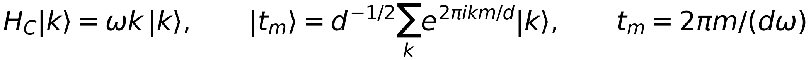

로 정의된다. 여기서 tm=2π m/(dω)이고 |tm⟩은 정규직교 기저를 이룬다. 전체 상태가 제약

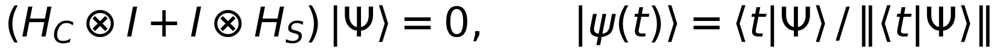

을 만족할 때, 시계 판독 t에 조건화된 계의 상태는 두 번째 식으로 주어진다. 문제는 이 조건화가 계의 *자기 해밀토니안* HS에 의한 유니터리 진화를 재현하는가다.

**정리 1 (정합 조건).** 제약의 영에너지 부분공간이 d차원이고 |Ψ⟩가 그 원소이며 모든 ck≠0일 때, 조건화된 역사가 모든 t에서 |ψ(t)⟩=e-iHSt|ψ(0)⟩과 일치할 필요충분조건은 spec(HS)=-spec(HC)다.

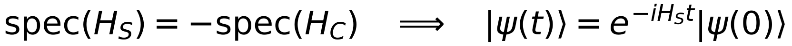

증명은 다음과 같다. 영에너지 조건은 각 k에 대해 (HS+ω k)|sk⟩=0인 고유벡터가 존재함을 요구하므로 필요조건이 따른다. 충분조건은 ⟨ tm|Ψ⟩에 |k⟩의 상대 위상 eiωktm만 남고, 그것이 HS의 고유위상과 같아지기 때문이다. ■

수치 확인은 d=8, HS=-HC, 무작위 복소 계수 ck에 대해 수행했다. 격자 시각 8점과 연속 시각 97점 모두에서 편차 1-|⟨ψ|ψref⟩|2의 최댓값은 2.2×10-16이었다(계산 E1-1). 즉 정합 조건 아래에서 관계적 시간은 정확하다.

반대로 정합이 깨지면 어떻게 되는가. 가장 극단적인 경우는 영에너지 부분공간 자체가 사라지는 것이다. dC=dS=4, HC=diag(0,1,2,3), HS=-HC에 무작위 에르미트 상호작용 V를 결합도 λ로 더하고 ker(HC+HS+λ V)의 차원을 측정했다. λ=0에서는 200회 모두 차원 4였고, λ=0.1과 λ=0.5에서는 200회 모두 차원 0이었다(계산 E1-2). 다시 말해 관계적 시간을 정확히 실현하는 제약면은 상호작용이 켜지는 순간 측도 영의 집합이 된다. 이것은 Page–Wootters 기제의 결함이라기보다 그 기제가 요구하는 *전제*의 정확한 성격이다. 시계와 계의 스펙트럼이 정합되어야만 조건화가 유니터리 역사를 준다.

## 3.2 분해능 하한

정합이 성립하더라도 시계가 유한하면 시간은 연속적이지 않다. d차원 시계의 판독값은 d개이고, 그 간격은 2π/(dω)다. 이 간격이 단순한 격자 간격이 아니라 *물리적 하한*임을 보이는 것이 다음 명제다.

**명제 2 (유한 시계 분해능).** 균일 중첩 시계 상태 |χ0⟩=d-1/2∑k|k⟩에 대해 다음이 성립한다.

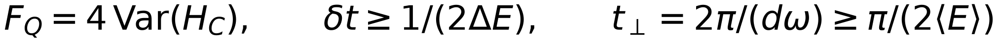

여기서 첫 식은 시간 매개변수에 대한 양자 피셔 정보이고(순수 상태의 유니터리 부호화), 둘째는 그것이 주는 양자 크라메르–라오 한계, 셋째는 Margolus–Levitin 한계다. Salecker–Wigner의 논변(시계의 크기가 분해능을 제한한다)은 이 셋과 같은 구조를 물리적 자원의 언어로 표현한 것이다. 실제 첫 직교화 시간은 t⊥=2π/(dω)로 정확히 계산된다.

d=2부터 24까지 계산한 결과를 표 1에 정리했다. t⊥와 해석값의 편차는 모든 d에서 2×10-16 이하였고, Margolus–Levitin 한계에 대한 비는 2(d-1)/d로 d→∞에서 2에 수렴한다. 즉 균일 중첩 시계는 Margolus–Levitin 한계를 상수배(≤2)까지 포화시키며, 크라메르–라오 한계는 격자 간격보다 2π/√3=3.627배 작다. 이 세 수치의 관계는 우연이 아니라 푸리에 쌍대성의 표현이다: 판독 격자의 간격이 2π/(dω)이면 그 쌍대 격자의 주기, 즉 식별 가능한 주파수 대역은 dω다.

**표 1. 유한 시계의 시간 분해능. ω=1 단위, t⊥는 균일 중첩 상태의 첫 직교화 시간(수치 잔차 <2×10-16), ML은 Margolus–Levitin 한계 π/(2⟨ E⟩), CRB는 크라메르–라오 한계 1/(2Δ E).**

| d | 격자 간격 2π/d | t⊥ (수치) | ML 한계 | CRB 하한 | t⊥/ML | 격자/CRB |
| --- | --- | --- | --- | --- | --- | --- |
| 2 | 3.1416 | 3.1416 | 3.1416 | 1.0000 | 1.000 | 3.14 |
| 3 | 2.0944 | 2.0944 | 1.5708 | 0.6124 | 1.333 | 3.42 |
| 4 | 1.5708 | 1.5708 | 1.0472 | 0.4472 | 1.500 | 3.51 |
| 6 | 1.0472 | 1.0472 | 0.6283 | 0.2928 | 1.667 | 3.58 |
| 8 | 0.7854 | 0.7854 | 0.4488 | 0.2182 | 1.750 | 3.60 |
| 12 | 0.5236 | 0.5236 | 0.2856 | 0.1448 | 1.833 | 3.61 |
| 16 | 0.3927 | 0.3927 | 0.2094 | 0.1085 | 1.875 | 3.62 |
| 24 | 0.2618 | 0.2618 | 0.1366 | 0.0722 | 1.917 | 3.62 |

## 3.3 앨리어싱 정리

분해능 하한의 가장 날카로운 결과는 계의 스펙트럼이 시계의 대역에 대해 접힌다는 것이다.

**정리 3 (앨리어싱).** 시계 판독이 tm=2π m/(dω)에만 주어지면, 계의 주파수 Ω와 Ω-ndω (n∈ℤ)는 모든 판독에서 같은 조건부 상태를 준다.

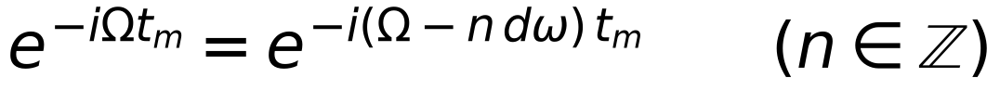

증명은 지수법칙 e-i(Ω-ndω)tm=e-iΩ tm· e2π inm이다. ■

수치는 정확하다. d=8, ω=1에서 Ω=4.83과 Ω-8=-3.17의 표본 위상 차이는 1.7×10-15였고, Ω=24.04와 Ω-24=0.04의 차이는 5.5×10-15였다(계산 E1-4). 그림 1(a)는 참 주파수를 0.03에서 25.6까지 훑으면서 이산 표본으로 되찾은 주파수를 그린 것이다. 되찾은 값은 [-4,4)로 접힌 톱니 모양이며, 이는 근사가 아니라 항등식이다.

이 정리의 철학적 함의는 분명하다. 관계적 역사는 계의 동역학을 *부분적으로만* 결정한다. 시계가 정하는 대역 밖의 주파수는 역사에 흔적을 남기지 않는다. "시간이 계의 변화에서 나온다"는 명제가 옳다면, 그 변화로부터 계의 동역학이 유일하게 결정되어야 하지만 실제로는 대역 하나만큼의 자유도가 남는다. 남는 자유도는 시계의 성질이지 계의 성질이 아니다.

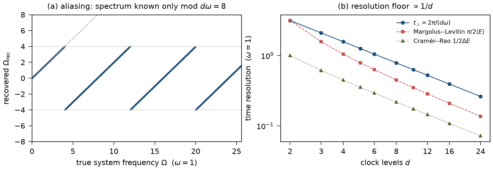

## 3.4 시계 계량의 비결정성

정리 1–3은 시계가 *주어졌을 때* 관계적 시간이 무엇을 주는지를 말한다. 다음 질문은 시계 자체가 데이터에 의해 결정되는가다. 답은 부정적이며, 그 부정성이 시간의 계량이 독립 구조임을 보여준다.

**명제 4 (시계 계량의 모호성).** 전체 제약 C=HC+HS와 상태 |Ψ⟩가 고정되어도, 시계의 스펙트럼 ek를 ek+ε ek2으로 바꾸면 같은 상태가 다른 역사를 준다.

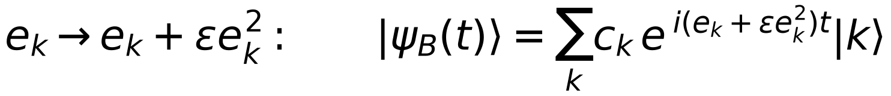

ε=0에서 두 역사는 같고, ε이 커지면 갈라진다. 두 궤적 집합의 최소 근접도 mintmaxt'|⟨ψA(t)|ψB(t')⟩|2를 측정하면 ε=10-3에서 0.9990, 10-2에서 0.9323, 3×10-2에서 0.6162, 0.1에서 0.2806이었다(계산 E1-5, 그림 2(b)). 즉 10%의 스펙트럼 변형만으로 두 역사는 서로 다른 상태 집합을 돈다.

이것은 시계를 잘못 골랐다는 불만이 아니다. 두 시계는 같은 전체 상태, 같은 제약, 같은 판독 규칙을 가지며 단지 "한 번의 째깍"이 얼마의 위상인지만 다르다. 관계적 데이터는 *순서*와 *상대 주파수*를 정하지만 *시간의 척도*는 정하지 못한다. 일반상대론에서 고유시간이 계량에 의해 정해지고 계량이 동역학적으로 결정되는 것과 정확히 같은 자리에, 관계적 시간에서는 시계의 스펙트럼이 놓인다. 시간의 계량은 관계가 아니라 구조다.

## 3.5 변화는 얽힘의 성질이다

R0에 대한 가장 직접적인 반례는 같은 제약의 두 상태에서 나온다. 시계와 계를 모두 d=8로 두고 HS=-HC라 하자. 제약 C=HC+HS의 영에너지 부분공간은 d차원이고, 그 안에 두 상태를 고른다.

- |Ψ1⟩: 정합 중첩 ∑k|k⟩|k⟩/√ d.
- |Ψ2⟩: 곱 상태 |0⟩|0⟩.

둘은 같은 제약의 영에너지 상태이고, 시계 판독 분포는 둘 다 정확히 균일하다(p(t)=1/d, 비균일도 1.000). 그러나 조건부 상태의 역사 길이(인접 시각 사이 Bures 각의 합)는 |Ψ1⟩에서 12.566, |Ψ2⟩에서 0.000이다(계산 E1-6).

**명제 5 (변화의 비제약성).** 시계가 균일하게 째깍거리는 것과 그 시간 속에서 계가 변하는 것은 독립이다. 변화는 제약의 성질이 아니라 전체 상태의 얽힘 구조의 성질이다.

이 명제는 "시간 = 상태 변화"라는 등식을 양방향에서 깨뜨린다. |Ψ2⟩에서는 시간이 흐르는데(시계가 균일하게 째깍거리는데) 아무것도 변하지 않는다. 따라서 변화는 시간의 필요조건이 아니다. 반대로 4절에서 보겠지만 변화가 있어도 시간이 0인 경우가 있다. 시간과 변화는 어느 방향으로도 함수관계가 아니다.

## 3.6 판독 폭과 결맞음

**정리 6 (판독 폭의 결맞음 감쇠).** 시계 판독을 정확한 시간 상태 |t⟩이 아니라 폭 σ의 가우스 판독 |θ⟩=∑x g(x-θ)|x⟩으로 조건화하면, 관계적 상태는 순수하지 않다. |+⟩의 위상이 Ω x로 감기는 역사에 대해 조건부 상태의 블로흐 벡터 길이는 정확히

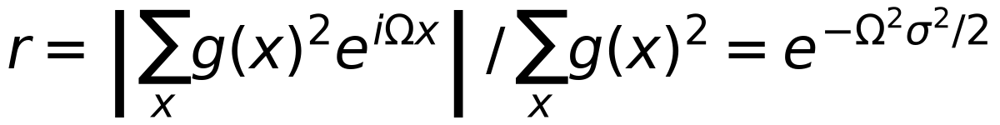

이며, 따라서 순수도는 (1+r2)/2다.

수치는 해석식과 소수 4자리에서 일치했다(계산 E1-7). Ωσ=0.2에서 0.9802, 0.8에서 0.7261, 1.6에서 0.2780, 3.2에서 0.0060이었고 해석식도 같은 값이다. 즉 시계의 판독 폭은 관계적 역사에 정확히 결맞음 감쇠 채널을 걸며, 그 감쇠율은 Ω2σ2/2다. 판독을 선명하게 하려면(σ→0) 판독의 에너지 폭이 커져야 하고, 그것은 명제 2의 분해능 하한과 같은 트레이드오프의 다른 얼굴이다.

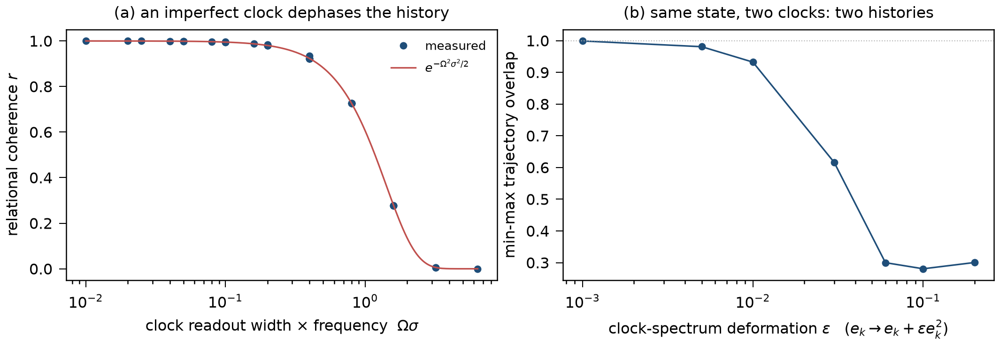

## 3.7 소결

3절의 결과를 모으면 조건화된 시간의 성격이 분명해진다. 조건화는 시간의 *순서*를 정확히 준다(정리 1). 그러나 그 순서는 (i) 스펙트럼 정합이라는 측도 영의 조건을 요구하고, (ii) 시계의 대역만큼의 주파수 자유도를 남기며(정리 3), (iii) 시간의 척도를 정하지 못하고(명제 4), (iv) 판독 폭만큼 결맞음을 잃으며(정리 6), (v) 무엇보다 변화의 유무를 정하지 못한다(명제 5). 관계적 시간은 "시간이 공간적 자유도에서 나온다"는 명제의 가장 정교한 구현이지만, 그 구현이 주는 것은 시간의 뼈대이지 시간의 살이 아니다.

# 4. 형상공간 시간: Barbour/Jacobi 분석

## 4.1 Jacobi 원리와 ephemeris time

R2의 정확한 형태는 Jacobi 원리다. 퍼텐셜 V(q)와 에너지 E가 주어지면 작용

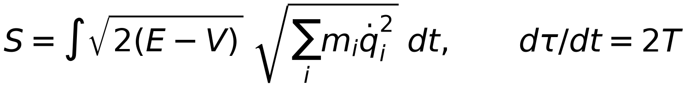

의 정류점이 뉴턴 방정식과 같은 궤적을 준다. 이 작용은 재매개변수화 불변이다. 즉 궤적은 매개변수를 갖지 않고, 매개변수는 궤적의 호길이로 사후에 정의된다. 그 호길이가 ephemeris time τ이며, 마지막 등식이 그 정의다.

**정리 7 (Jacobi 시간).** 뉴턴 궤적 q(t)에 대해 dτ/dt=2T이고, q(τ)는 Jacobi 계량 gW=2(E-V)δij의 측지선이다.

증명은 연쇄법칙이다. q'=dq/dτ=q̇/(2T)로 두면 |q'|2=1/(2(E-V))이고, 측지선 방정식에 대입하면 뉴턴 방정식과 일치한다. ■

이 정리는 수치로 독립 검증했다. 중력 3체의 figure-eight 해(Chenciner–Montgomery)를 10-12 상대정밀도로 적분하고, τ 균일 격자에서 3차 스플라인으로 재표본한 뒤 측지선 방정식의 잔차를 계산했다. 잔차의 중앙값은 6.3×10-8(상대), 단위속도 조건 |q'|2W=1의 최대 편차는 3.9×10-8이었다(계산 E2-2). 즉 뉴턴 궤적은 Jacobi 계량의 측지선이고, ephemeris time은 그 호길이다.

## 4.2 figure-eight에서의 시간률

같은 계산에서 시간률의 비균일성을 측정했다. 두 주기(t=12.6518) 동안 τ=32.5694가 흘렀으므로 τ/t=2.5743이고, 이는 평균 운동에너지 1.2871의 정확히 두 배다(비 2.000003). 운동에너지의 최소·최대는 1.2129와 1.3674로 비 1.127이다. 즉 이 궤적에서 관계적 시간은 뉴턴 시간에 대해 13% 범위에서 비균일하다.

회전과 스케일을 최적정합으로 제거한 형상공간 호길이는 20.29460, 배위공간 호길이는 20.29476이었다. 차이는 0.0008%다. figure-eight는 각운동량이 0이고 형상이 주기적으로 되돌아오는 궤적이므로, 이 궤적에서는 형상 시간과 배위 시간이 거의 같다. 이는 R2가 일반적인 경우에 잘 작동함을 보여주는 동시에, 다음 절의 반례가 *특수한 대칭*에서 온다는 것을 예고한다.

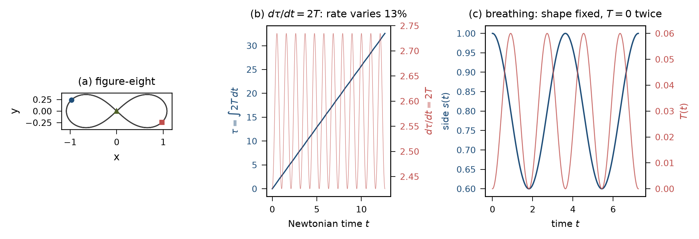

## 4.3 반례 1: 정지 상태

질량 1인 세 입자가 모든 쌍을 잇는 용수철(강성 k=1, 자연길이 a=0.8)로 연결되어 있다고 하자. 세 입자가 변 길이 a인 정삼각형을 이루면 각 입자에 작용하는 힘은 정확히 0이다(수치 잔차 7.7×10-17). 이 상태는 영원히 정지해 있고, 운동에너지가 항상 0이므로 관계적 시간 τ는 모든 t에 대해 0이다. 10 단위 시간을 적분한 결과 τ=6.2×10-28, 위치 표류 6.6×10-15이었다(계산 E2-1). 뉴턴 시간은 흐르지만 관계적 시간은 흐르지 않는다.

이 반례에 대해 "정지 상태는 변화가 없으니 시간도 없는 것이 당연하다"고 답할 수 있다. 그러나 그 답은 R0를 포기하는 것이다. R0는 시간을 변화율로 *정의*하므로, 변화율이 0인 상태에서 시간이 0이라는 결론은 정의의 결과이지 물리의 결과가 아니다. 문제는 그 상태가 물리적으로 실재하고, 그 안에서 시계가 째깍거리며, 그 상태를 벗어난 뒤에도 연속적으로 이어진다는 점이다.

섭동을 주면 이 붕괴가 연속적임을 볼 수 있다. 정지 상태에 작은 반경방향 속도 v를 주고 t∈[0,2]에서 τ를 측정하면 τ∝ v2이며, 로그-로그 기울기는 2.000000이었다(계산 E2-1, 그림 4(a)). 즉 v→0에서 τ→0이지만 그 극한에서 뉴턴 시간은 그대로 흐른다. 관계적 시간은 초기조건의 연속함수이면서, 그 극한에서 시간 자체를 잃는다.

## 4.4 반례 2: 호모테틱 호흡

더 강한 반례는 형상이 *전혀* 변하지 않으면서 운동하는 해다. 같은 조화 3체에서 정삼각형의 변 길이를 s(t)라 하면, 대칭성에 의해 힘이 항상 중심을 향하고 크기가 3k(s-a)에 비례하므로

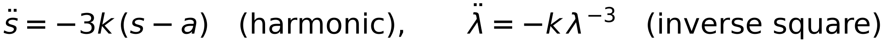

의 첫 식이 성립한다. 즉 변 길이는 s(t)=a+(s0-a)cos(√3k t)로 진동하고, 형상은 정확히 정삼각형으로 유지된다.

s0=1.0, a=0.8로 적분한 결과는 다음과 같다. 형상 편차(정규화 변 길이의 최대 이탈) 4.0×10-15, 해석해와의 최대 오차 1.2×10-13, 변 길이 범위 0.6000–1.0000, 운동에너지는 주기 3.6276마다 두 번 정확히 0. 그리고 형상공간 호길이(스케일 제거 후)는 6.5×10-13인데 배위공간 호길이는 1.745다(계산 E2-1).

형상만으로 시간을 정의하면 이 해의 시간은 영원히 0이다. 그러나 이 해는 주기적이고, 질량들은 실제로 서로 멀어졌다 가까워지며, 운동에너지는 주기적으로 극대가 된다. 형상 시간은 *스케일 변화에 완전히 눈멀어* 있고, 그 눈멀음은 근사가 아니라 정확한 대칭이다. Barbour의 처방은 스케일을 게이지로 제거하는 것이므로, 이 해는 형상 동역학에서 "게이지 궤도"가 된다. 즉 형상 동역학은 이 해를 물리적 운동으로 세지 않는다. 그러나 물리적으로는 운동이다. 형상 시간이 시간의 정의가 되려면 무엇이 게이지인지를 먼저 정해야 하고, 그 결정은 형상 데이터 밖에서 온다.

## 4.5 정리 8: 내적 시간의 전역 단조성 불가능

두 반례는 우연이 아니다. 다음 정리가 그 일반형이다.

**정리 8 (내적 시간의 비단조성).** 컴팩트 불변집합 ΓE(예: 컴팩트 에너지면) 위에 연속 흐름이 있고 주기 궤도가 하나라도 있으면, ΓE 위의 연속 함수 τ로서 모든 궤적을 따라 순증가하는 것은 존재하지 않는다.

증명은 한 줄이다. 주기 궤도 γ에 대해 τ(γ(T))=τ(γ(0))이므로 순증가일 수 없다. ■

정리가 사소해 보이는 이유는 결론이 자명하기 때문이지만, 그 자명함이 바로 문제의 핵심이다. 계의 상태만으로 정의되는 시간은 상태공간 위의 함수이고, 상태공간이 컴팩트하면 언젠가 상태가 되돌아오므로 시간도 되돌아온다. 따라서 관계적 시간은 필연적으로 위상(phase)이며, 위상은 주기성을 가지며, 주기성은 "같은 시간"을 구별하지 못한다. 정리 8을 피하는 길은 셋뿐이다: (i) 계를 열어 상태공간을 비컴팩트하게 만들거나(소산), (ii) 우주론적 팽창처럼 상태공간 자체가 단조롭게 변하거나, (iii) 시간을 상태의 함수가 아닌 외부 구조로 두거나. 어느 길이든 "시간 = 내적 변화"의 순수한 형태는 남지 않는다.

## 4.6 정리 9: 변화율의 비단사성

R0에 대한 가장 직접적인 반론은 산술적이다.

**정리 9 (변화율의 비단사성).** Jacobi 역학에서 T=E-V(q)이므로 "변화율" T는 배위 q만의 함수다. 따라서 같은 T 값을 갖는 서로 다른 배위가 연속체로 존재하며, T는 역사를 매개화하지 못한다.

증명은 T=E-V의 정의에서 자명하다. ■

수치로 확인했다. 조화 3체에서 퍼텐셜 V=0.2692를 갖도록 스케일을 정확히 맞춘 세 개의 서로 다른 형상(정규화 변 길이의 비가 모두 다른 세 삼각형)은 같은 "변화율" T=E-V를 갖는다(그림 4(b)). 더 심하게는, V의 수준집합은 6차원 배위공간에서 5차원 초곡면이므로 한 개의 변화율 값이 연속체의 형상 전체에 대응한다. 변화율은 시간의 척도가 될 수 없고, 시간의 *층*조차 될 수 없다.

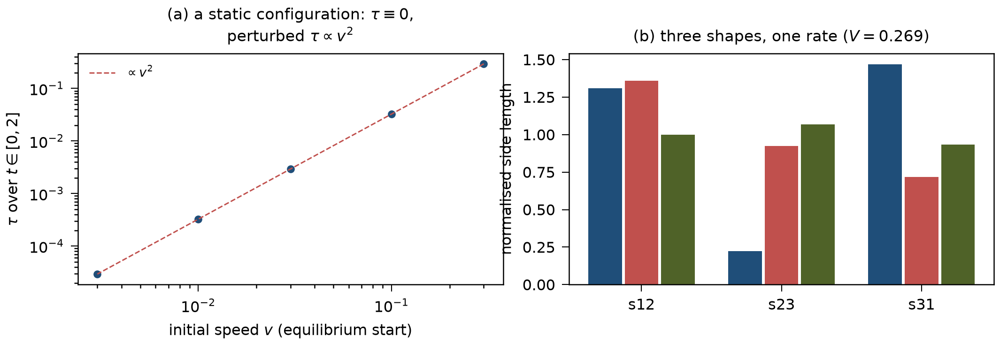

## 4.7 소결

4절의 결과는 R2가 *일반적으로는* 정확하다는 것과, 그 정확성이 세 가지 방식으로 깨진다는 것이다. 정지 상태에서 τ≡0, 호모테틱 운동에서 형상 시간이 0, 그리고 컴팩트 상태공간에서 모든 내적 시간이 비단조. 이 세 가지는 모두 "시간의 매개화는 계의 기하에 있지만, 그 기하가 시간을 정의하기에는 부족하다"는 같은 사실의 다른 얼굴이다. 3절의 유한 시계와 4절의 형상공간은 서로 다른 출발점에서 같은 결론에 도달한다: 매개화는 있지만 계량은 없다.

# 5. 인과 구조: 왜 변화율로 환원되지 않는가

## 5.1 부호수와 lapse의 독립성

지금까지는 시간의 *척도*가 문제였다. 이 절은 더 근본적인 것을 다룬다. 시간의 *방향 구조*, 즉 인과 구조다. 3-기하의 역사 hij(t)가 주어졌을 때 4차원 계량은 ADM 형태로 쓰인다.

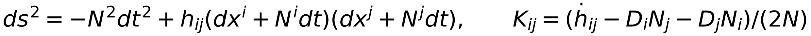

여기서 N은 lapse, Ni는 shift, Kij는 외재곡률이다. 요점은 hij(t)와 ḣij(t)가 N을 결정하지 못한다는 것이다. 같은 함수 hij(t)에 대해 N>0을 택하면 로런츠 부호수의 시공간이 되고, N2<0을 택하면 리만(유클리드) 부호수의 4차원 다양체가 된다. 두 경우 3-기하의 역사는 글자 그대로 같다. 그러나 하나는 광추를 갖고 다른 하나는 갖지 않는다.

**정리 10 (부호수의 비환원성).** 3-기하 역사 (hij(t),ḣij(t))는 4차원 부호수를 결정하지 않는다. 부호수는 lapse의 비퇴화성 N≠0과 그 부호에 의해 정해지며, 이는 3-기하 데이터에 포함되지 않는 독립 구조다.

이 정리는 형식적이지만 내용이 있다. 인과 구조(광추)는 계량의 등각류에 해당하고, 등각류는 점마다 9개의 자유도를 갖는다. 반면 "변화율"은 스칼라 하나다. 스칼라가 등각류를 결정할 수 없다는 것은 자유도 세기만으로 자명하다. Malament의 정리[18]가 보여주듯 인과 구조는 등각 계량과 동치이므로, 인과 구조를 담으려면 스칼라가 아니라 등각류 전체가 필요하다.

## 5.2 잘 정의된 진화는 로런츠 부호수를 함의하지 않는다

정리 10에 대해 다음과 같이 반론할 수 있다. "변화가 존재하려면 초기값 문제가 잘 정의되어야 하고, 그것은 쌍곡형 방정식, 즉 로런츠 부호수를 요구한다. 따라서 변화의 존재에서 부호수가 따라 나온다." 이 반론은 절반만 옳다. 쌍곡형이 필요하다는 것은 맞지만, 쌍곡형이 로런츠 부호수를 함의하지는 않는다.

첫째, 같은 방정식에서 utt=+c2uxx(쌍곡형)와 utt=-c2uxx(타원형)를 비교하면 차이가 극명하다. 초기 데이터의 k 모드는 전자에서 1의 진폭을 유지하고 후자에서 cosh(ckT)로 자란다. T=0.5에서 k=16은 1.5×103배, k=64는 3.9×1013배, k=128은 3.1×1027배로 증폭된다(계산 E3-1, 그림 5(a)). 유한차분으로도 같은 결론이 나온다. 매끄러운 초기조건과 10-10 크기의 격자 스케일 섭동에 대해 t=0.2에서 최대진폭은 격자수 N=32,64,128,256에 대해 7.0, 1.1×104, 3.5×1014, 1.7×1036이었다. 격자를 세밀화할수록 해가 발산하는 것이 악조건 문제의 정의다. 반면 쌍곡형은 같은 조건에서 최대진폭이 0.4956,0.4996,0.4998,0.5001로 수렴하고, 정확해에 대한 L2 오차는 N=32→512에서 1.1×10-2→3.8×10-5로 수렴 차수 2.16,2.01,1.97,2.00을 보인다.

둘째, 잘 정의된 진화가 로런츠 부호수를 함의하지 않는 반례가 있다. 뉴턴 중력은 초기값 문제가 잘 정의되어 있고(라플라스 방정식의 경계값 문제와 운동방정식의 결합), 시간은 절대적이며, 작용은 무한히 빠르게 전달된다. 초광속 전달은 광추가 없다는 뜻이다. 또 다른 반례는 초쌍곡형 방정식이다. 부호수 (+,+,-,-)의 파동방정식은 적절한 데이터 초곡면에서 잘 정의된 초기값 문제를 갖지만, Asgeirsson의 정리에 의해 해의 값이 한 점의 원뿔면 위 평균으로 결정되므로, 유한한 전파율이라는 개념 자체가 성립하지 않는다. 즉 "잘 정의된 진화"는 부호수 (-,+,+,+)보다 넓은 집합을 허용한다.

따라서 "변화가 있으므로 로런츠 부호수다"라는 추론은 성립하지 않는다. 부호수는 변화의 *존재*에서 나오지 않는다. 그것은 변화가 *어떤 방향으로* 전파되는가에 대한 별도의 사실이다.

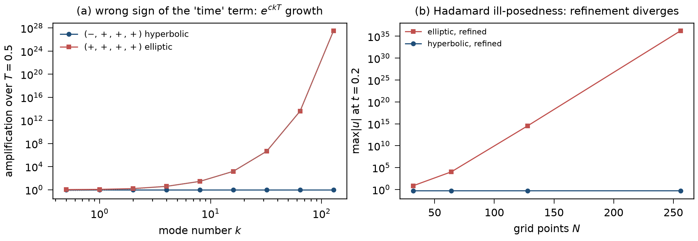

## 5.3 인과 부분순서는 스칼라 시간으로 표현되지 않는다

정리 10은 "부호수가 독립이다"라는 주장이다. 더 강한 주장은 "인과 구조가 시간의 어떤 스칼라 표현으로도 환원되지 않는다"이다. 인과 구조는 사건들 위의 부분순서 ≺이며, 이는 스칼라 함수가 아니다.

**정리 11 (스칼라 표현 불가능).** 4차원 민코프스키 시공간에서 사건 쌍의 약 90%는 시간꼴로 연결되지 않는다. 어떤 전역 스칼라 시간 t도 이 쌍들에 불변의 순서를 부여할 수 없으며, t를 도입하는 순간 그 쌍들의 순서는 좌표 선택의 산물이 된다.

수치는 Alexandrov 구간에 뿌린 점들로 확인했다. d차원 민코프스키 구간에 N=1500개의 점을 균일하게 뿌리고(시간 주변밀도 ∝ R(t)d-1), 인과적으로 비교 가능한 쌍의 비율 r을 측정했다. 이론값은 r(d)=Γ(d+1)Γ(d/2)/(2Γ(3d/2))이고, 측정값은 d=2에서 0.5007±0.0104, d=3에서 0.2278±0.0077, d=4에서 0.1023±0.0047로 각각 1/2, 8/35, 1/10과 일치했다. 이 비율을 역산한 차원은 1.997, 3.004, 3.973이다(계산 E3-2, 그림 6(a)). 즉 부분순서는 차원을 운반한다. 반면 어떤 전역 스칼라 시간이든 모든 쌍에 순서를 부여하므로 r=1, 즉 차원 1의 정보만 남긴다.

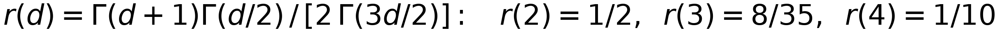

4차원에서 비교 가능한 쌍은 10.2%뿐이므로, 89.8%의 쌍은 스칼라 시간에서 임의로 정렬된다. 그 정렬이 물리가 아니라는 것은 부스트가 보여준다. 같은 뿌리기에 β 부스트를 걸고 시간순서가 뒤집히는 쌍의 비율을 세면 β=0.1에서 5.08%, 0.3에서 13.80%, 0.6에서 23.12%, 0.9에서 29.22%였다. β=0.9에서 전체 사건 쌍의 29%가 "누가 먼저인가"를 바꾼다.

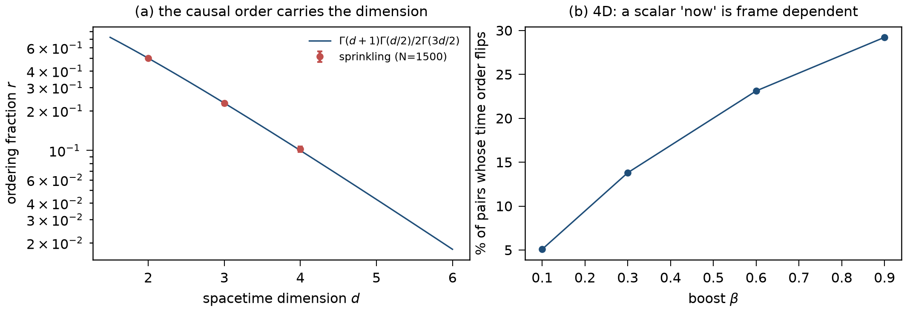

## 5.4 DeWitt 초계량: 공간-우선 이론 안의 시간 방향

여기까지의 논증은 "시간이 공간으로 환원되지 않는다"는 것이었다. 그러나 공간-우선 프로그램의 가장 정교한 형태인 정준 양자중력에서는 시간 방향이 *배위공간 자체의 계량*에 나타난다. 3-기하 공간 위의 DeWitt 초계량은

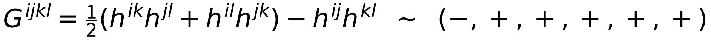

이고, 그 부호수는 (-,+,+,+,+,+)다. 하나의 음의 방향은 등각 모드(부피 변화)이고, 나머지 다섯은 트레이스리스 변형이다. 즉 3-기하들의 공간은 그 자체로 하나의 시간꼴 방향을 가진 로런츠형 공간이며, Wheeler–DeWitt 방정식의 운동항은 그 방향에 대해 쌍곡형이다.

이 사실은 논문의 테제를 가장 강하게 지지한다. 공간을 근본으로 삼는 이론에서도 시간 방향은 사라지지 않고 *배위공간의 계량 부호수*로 다시 나타난다. 시간은 3-기하의 변화율에서 나오는 것이 아니라, 3-기하들의 공간이 이미 갖고 있는 비축퇴 방향에서 나온다. 그리고 그 부호수는 3-기하 하나하나의 데이터가 아니라 그 공간의 계량이라는 구조적 사실이다. 형상 동역학(shape dynamics)이 국소 재매개변수화 불변성을 국소 등각 불변성과 교환하여 문제를 푸는 것도 같은 구조를 다른 게이지에서 본 것이다. 어느 쪽이든 시간의 자리는 "3-기하 위의 점"이 아니라 "3-기하들의 공간의 한 방향"이다.

## 5.5 열역학적 화살은 변화율이 아니다

마지막 층은 방향의 *전역적* 성질, 즉 화살이다. 국소 부호수가 광추를 주지만 어느 쪽이 과거인지는 주지 않는다. 그 방향이 화살이다.

**명제 12 (화살의 독립성).** 미시 동역학이 시간반전 대칭이면 상태와 그 변화율의 임의의 함수도 시간반전 대칭이다. 따라서 화살은 그런 함수로 정의될 수 없다.

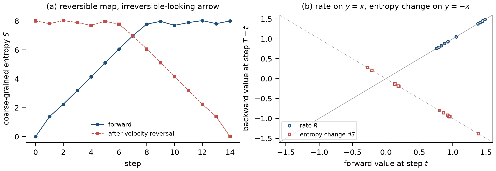

이를 정확히 가역인 계에서 측정했다. 아놀드 고양이 사상 (x,y)↦(2x+y,x+y) mod1은 정수 격자 위에서 비트 단위로 정확히 가역이고 면적을 보존한다. 220 격자에 4096개의 점을 한 칸에 모아 두고 64×64 칸의 조대화 엔트로피를 계산했다. 엔트로피는 0에서 8.02까지 자라 포화되고(초기 선형 구간의 기울기 0.973/step, 사상의 KS 엔트로피 ln((3+√5)/2)=0.9624와 1.1% 이내로 일치), 속도를 뒤집으면 정확히 역순으로 8.00→0으로 되돌아간다. 역행과 정행의 엔트로피 차이는 최대 0.0, 즉 비트 단위로 같다(계산 E3-3, 그림 7).

그런데 "변화율" 수열은 어떠한가. 조대화 분포의 총변동 R(t)를 변화율로 정의하면, 역행에서 Rback(k)=Rfwd(T-k)가 오차 0.0으로 성립한다. 즉 변화율 수열은 두 방향에서 글자 그대로 같다. 반면 엔트로피 변화율은 부호가 뒤집힌다. R과 dS/dt의 상관은 정방향에서 +0.956, 역방향에서 -0.956이다. 같은 변화율 수열이 정반대의 엔트로피 변화와 짝을 이룬다.

## 5.6 소결

5절은 세 층을 분리했다. 국소 인과 구조(부호수)는 3-기하 데이터에 없고(정리 10), 그것은 스칼라 시간으로 표현될 수 없으며(정리 11), 전역 화살은 미시 대칭과 무관한 경계조건이다(명제 12). 이 셋은 서로 독립이며, 어느 것도 "상태 변화율"에서 나오지 않는다. 3절과 4절이 시간의 *척도*가 환원되지 않음을 보였다면, 5절은 시간의 *방향*이 환원되지 않음을 보인다.

# 6. 종합: 구조적 실재론으로서의 시간

## 6.1 네 층의 구조

지금까지의 결과를 하나의 그림으로 모으면 시간은 네 층으로 이루어진다.

- **층 1 (순서).** 사건들 사이의 부분순서. 공간적 자유도의 궤적에서 나온다(R1, R2). 정확히 구성 가능하지만(정리 1, 7) 유한 시계의 대역만큼의 자유도를 남긴다(정리 3).
- **층 2 (척도).** 같은 순서 위의 거리. 관계적 데이터가 결정하지 못한다(명제 4, 정리 9). 시계의 스펙트럼 또는 계량이 정한다.
- **층 3 (인과 구조).** 광추와 부호수. 3-기하 데이터에 없고(정리 10), 스칼라로 표현되지 않는다(정리 11). 3-기하 공간의 초계량 부호수로 다시 나타난다.
- **층 4 (화살).** 어느 쪽이 과거인가. 미시 동역학과 무관한 경계조건이다(명제 12).

이 네 층의 관계가 논문의 답이다. 공간적 데이터는 층 1을 주고, 층 2·3·4를 주지 않는다. 따라서 "시간은 공간 내 상태 변화의 표현이다"는 명제는 층 1에 대해서만 참이다. 그것을 시간 전체에 적용하면 층 2·3·4를 잃는다. 잃는 것이 하찮지 않다는 것은 3–5절의 계산이 보여준다: 잃는 것은 시간의 척도, 광추, 그리고 화살이다.

## 6.2 환원 사슬의 어디가 끊기는가

논증 사슬을 명시적으로 적으면 다음과 같다.

1. 공간적 자유도(배위, 3-기하)가 근본이라는 명제는 실행 가능하다: R1과 R2가 정확히 구성된다. (정리 1, 7)

2. 그러나 R1은 스펙트럼 정합이라는 측도 영의 조건을 요구하고, 정합이 깨지면 물리적 상태 자체가 없다. (3.1절)

3. R1과 R2가 주는 매개화는 유한한 분해능을 가지며, 계의 스펙트럼을 대역 하나만큼 모호하게 남긴다. (정리 3)

4. 매개화의 척도는 관계적 데이터에 없다. (명제 4, 정리 9)

5. 매개화가 정의되려면 비축퇴 방향이 필요하고, 그 방향의 부호수는 3-기하 데이터에 없다. (정리 10)

6. 그 방향의 전역적 단조성은 경계조건에서 온다. (명제 12)

끊기는 지점은 4–6이다. 1–3은 공간-우선 프로그램의 성공이고, 4–6은 그 성공의 한계다. 이 구조가 논문의 테제다: 시간은 공간에 존재론적으로 의존하지만(1–3), 논리적으로 환원되지 않는다(4–6).

## 6.3 반론 검토

**반론 1 (열적 시간).** Rovelli의 열적 시간 가설은 시간을 통계역학적 상태의 모듈러 흐름으로 정의한다. 이 프로그램은 시간의 화살을 상태의 통계적 성질에서 얻으므로 명제 12와 충돌하지 않는다. 그러나 모듈러 흐름은 상태와 대수의 선택에 의존하고, 그 흐름이 물리적 시간과 일치하려면 상태가 KMS 조건을 만족해야 한다. 즉 열적 시간은 시간을 *정의*하는 것이 아니라 특정 상태에서 시간의 한 실현을 *찾아내는* 것이다. 층 2와 4를 상태에 위임하는 셈이며, 층 3(광추)은 여전히 설명하지 못한다.

**반론 2 (형상 동역학).** Barbour–Foster–Ó Murchadha의 형상 동역학은 재매개변수화 불변성을 국소 등각 불변성으로 바꾸어 문제를 해결한다. 이 이론은 4.4절의 호모테틱 해를 게이지 궤도로 처리하므로 반례가 아니다고 답할 수 있다. 그러나 그 처리는 스케일이 게이지라는 결정을 전제하며, 그 결정은 York 시간(부피)을 시계로 쓰는 게이지 고정을 요구한다. 4.5절의 정리 8은 그 시계도 컴팩트 상태공간에서 비단조일 수 있음을 말한다. 형상 동역학은 층 1과 2를 잘 정리하지만 층 3·4는 여전히 외부에서 온다.

**반론 3 (무시간 양자중력).** Wheeler–DeWitt 방정식 ĤΨ=0에는 시간이 없다. 이 사실은 종종 시간의 비실재성을 함의한다고 읽힌다. 그러나 5.4절이 보인 것처럼 그 방정식의 운동항은 초계량의 음의 방향, 즉 등각 방향에 대해 쌍곡형이다. 시간은 방정식에 없지만 방정식의 *형태*에 있다. 무시간 이론은 시간을 지웠다기보다 시간을 배위공간의 계량 안으로 옮겼다.

**반론 4 (경험적 동등성).** 층 2·3·4가 환원되지 않는다는 것이 경험적으로 구별되는가. 이 반론이 가장 강하다. 만약 두 이론이 모든 관측에서 같다면 층의 구분은 형이상학적 잉여다. 이에 대한 논문의 답은 구별이 원리적으로 가능하다는 것이다. 유한 시계의 앨리어싱(정리 3)은 시계의 대역을 바꾸면 관측 가능한 차이를 낳고, 시계 계량의 모호성(명제 4)은 두 시계를 가진 계에서 간섭으로 드러나며, 화살의 독립성(명제 12)은 초기조건을 조작하여 검증된다. 즉 층의 구분은 해석의 문제가 아니라 실험 설계의 문제다.

## 6.4 테제의 한계

논문의 주장에는 분명한 한계가 있다. 첫째, 모든 계산은 유한 차원 또는 고전 역학 모형에서 수행되었다. 실제 우주의 시계는 유한하지 않고, 양자중력의 힐베르트 공간은 무한 차원일 수 있다. 정리 3과 8은 그 경우에도 성립하는가? 정리 8은 컴팩트성에 의존하므로 비컴팩트 상태공간에서는 회피된다. 정리 3은 유한 대역에 의존하므로 무한 대역 시계에서는 사라진다. 즉 논문의 부정적 결과들은 *유한한* 계에 대한 것이고, 그 유한성은 우리가 실제로 가진 시계의 성질이다.

둘째, 정리 10은 형식적 논점에 가깝다. 부호수가 독립 구조라는 것은 옳지만, 그 독립 구조가 *왜* 로런츠 부호수인지는 논문이 설명하지 않는다. 그것은 별도의 문제이며, 가능한 답은 인과 집합의 국소 유한성, 또는 쌍곡형 방정식의 안정성 같은 추가 원리다.

셋째, 4절의 반례들은 대칭이 높은 해에 기반한다. 일반적인 궤적에서는 형상 시간이 잘 작동한다(figure-eight에서 0.0008% 차이). 따라서 논문의 주장은 "형상 시간이 항상 실패한다"가 아니라 "형상 시간은 대칭에 의해 붕괴할 수 있고, 그 붕괴는 근사가 아니라 정확하다"이다.

# 7. 결론

이 논문은 "시간은 공간 내 상태 변화의 표현인가"라는 질문에 세 층으로 답했다.

시간의 *순서*는 공간적 자유도에서 나온다. Page–Wootters 조건화는 스펙트럼 정합 조건에서 정확한 유니터리 역사를 주고(편차 2.2×10-16), Jacobi의 ephemeris time은 뉴턴 궤적의 호길이로서 dτ/dt=2T를 만족한다(측지선 잔차 6.3×10-8). 이 의미에서 시간은 공간에 존재론적으로 의존한다.

그러나 시간의 *척도*는 공간적 데이터에 없다. 유한 시계는 1/d로 줄어드는 분해능 하한과 dω 주기의 앨리어싱을 낳고, 시계의 스펙트럼을 10%만 변형해도 같은 상태가 다른 역사를 주며(0.999→0.281), 변화율 T=E-V는 배위만의 함수이므로 하나의 값이 형상들의 초곡면 전체에 대응한다.

시간의 *방향*도 공간적 데이터에 없다. 같은 3-기하 역사가 두 부호수에 적합하고, 부호수가 뒤집히면 초기값 문제가 악조건이 되며(k=128에서 3.1×1027배 증폭, 격자 세밀화에서 1.7×1036까지 발산), 인과 부분순서는 4차원에서 사건 쌍의 89.8%에 불변 순서를 주지 않는다. DeWitt 초계량의 부호수 (-,+,+,+,+,+)는 공간-우선 이론에서도 시간 방향이 계량적 사실임을 보여준다. 그리고 화살은 정확히 가역인 동역학에서 변화율 수열이 두 방향에서 동일한데도 엔트로피 변화의 부호만 뒤집힌다는 사실로 드러난다(+0.956 대 -0.956).

따라서 시간은 공간의 별칭이 아니다. 시간은 공간적 자유도 위에 실현된, 계량 부호수에 의해 비축퇴된 방향의 매개화다. 공간은 시간의 자리를 마련하지만 시간의 값을 정하지 않는다. 이 구분이 관계주의와 실체론의 이분법을 넘는 자리이며, 시간의 실재성은 실체의 실재성이 아니라 구조의 실재성이다.

# 참고문헌

[1] Page, D. N. and Wootters, W. K., "Evolution without evolution: Dynamics described by stationary observables", Phys. Rev. D 27, 2885 (1983).
[2] DeWitt, B. S., "Quantum theory of gravity. I. The canonical theory", Phys. Rev. 160, 1113 (1967).
[3] Kuchař, K. V., "Time and interpretations of quantum gravity", Int. J. Mod. Phys. D 20, 3 (2011); originally in Proceedings of the 4th Canadian Conference on General Relativity and Relativistic Astrophysics (1992).
[4] Unruh, W. G. and Wald, R. M., "Time and the interpretation of canonical quantum gravity", Phys. Rev. D 40, 2598 (1989).
[5] Rovelli, C., "Statistical mechanics of gravity and the thermodynamical origin of time", Class. Quantum Grav. 10, 1549 (1993).
[6] Connes, A. and Rovelli, C., "Von Neumann algebra automorphisms and time-thermodynamics relation in generally covariant quantum theories", Class. Quantum Grav. 11, 2899 (1994).
[7] Rovelli, C., "Partial observables", Phys. Rev. D 65, 124013 (2002).
[8] Barbour, J., "The timelessness of quantum gravity I: The evidence from the classical theory", Class. Quantum Grav. 11, 2853 (1994).
[9] Barbour, J., The End of Time, Oxford University Press (1999).
[10] Barbour, J. and Bertotti, B., "Mach's principle and the structure of dynamical theories", Proc. R. Soc. Lond. A 382, 295 (1982).
[11] Barbour, J., Foster, B. Z. and Ó Murchadha, N., "Relativity without relativity", Class. Quantum Grav. 19, 3217 (2002).
[12] Gomes, H., Gryb, S. and Koslowski, T., "Einstein gravity as a 3D conformally invariant theory", Class. Quantum Grav. 28, 045005 (2011).
[13] Anderson, E., "Problem of time in quantum gravity", Ann. Phys. (Berlin) 524, 757 (2012).
[14] Isham, C. J., "Canonical quantum gravity and the problem of time", gr-qc/9210011 (1992).
[15] Margolus, N. and Levitin, L. B., "The maximum speed of dynamical evolution", Physica D 120, 188 (1998).
[16] Salecker, H. and Wigner, E. P., "Quantum limitations of the measurement of space-time distances", Phys. Rev. 109, 571 (1958).
[17] Giovannetti, V., Lloyd, S. and Maccone, L., "Advances in quantum metrology", Nature Photonics 5, 222 (2011).
[18] Braunstein, S. L. and Caves, C. M., "Statistical distance and the geometry of quantum states", Phys. Rev. Lett. 72, 3439 (1994).
[19] Malament, D. B., "The class of continuous timelike curves determines the topology of spacetime", J. Math. Phys. 18, 1399 (1977).
[20] Myrheim, J., "Statistical geometry", CERN preprint TH-2538 (1978).
[21] Bombelli, L., Lee, J., Meyer, D. and Sorkin, R. D., "Space-time as a causal set", Phys. Rev. Lett. 59, 521 (1987).
[22] Minkowski, H., "Raum und Zeit", Physikalische Zeitschrift 10, 75 (1909).
[23] Chenciner, A. and Montgomery, R., "A remarkable periodic solution of the three-body problem in the case of equal masses", Annals of Mathematics 152, 881 (2000).
[24] Simó, C., "Dynamical properties of the figure eight solution of the three-body problem", Contemp. Math. 292, 209 (2002).
[25] Wald, R. M., General Relativity, University of Chicago Press (1984).
[26] Choquet-Bruhat, Y., "Théorème d'existence pour certains systèmes d'équations aux dérivées partielles non linéaires", Acta Math. 88, 141 (1952).
[27] Hadamard, J., "Sur les problèmes aux dérivées partielles et leur signification physique", Princeton University Bulletin 13, 49 (1902).
[28] Asgeirsson, L., "Über eine Mittelwertseigenschaft von Lösungen homogener linearer partieller Differentialgleichungen 2. Ordnung mit konstanten Koeffizienten", Math. Ann. 113, 321 (1937).
[29] Loschmidt, J., "Über den Zustand des Wärmegleichgewichtes eines Systems von Körpern mit Rücksicht auf die Schwerkraft", Sitzungsber. Akad. Wiss. Wien 73, 128 (1876).
[30] Lebowitz, J. L., "Boltzmann's entropy and time's arrow", Physics Today 46(9), 32 (1993).
[31] Hawking, S. W., "Arrow of time in cosmology", Phys. Rev. D 32, 2489 (1985).
[32] Earman, J., World Enough and Space-Time, MIT Press (1989).
[33] Maudlin, T., Philosophy of Physics: Space and Time, Princeton University Press (2012).
[34] Huggett, N. and Wüthrich, C., "Emergent spacetime and empirical (in)coherence", Studies in History and Philosophy of Modern Physics 44, 276 (2013).
[35] Mach, E., Die Mechanik in ihrer Entwicklung, Brockhaus (1883).
[36] Newton, I., Philosophiae Naturalis Principia Mathematica (1687).
[37] Leibniz, G. W., "Correspondence with Clarke" (1715–1716).
[38] Smith, A. R. H. and Ahmadi, M., "Quantizing time: interacting clocks and systems", Quantum 3, 160 (2019).
[39] Marletto, C. and Vedral, V., "Evolution without evolution and without ambiguities", Phys. Rev. D 95, 043510 (2017).

# 부록 A. 계산 재현

모든 계산은 `numpy`/`scipy`로 수행되었고, 결과는 JSON으로 저장되어 본문의 모든 수치를 재생성할 수 있다. 난수 시드는 계산별로 고정했다.

**표 A1. 계산 목록과 검증 지표.**

| 계산 | 파일 | 핵심 설정 | 검증 지표 |
| --- | --- | --- | --- |
| E1-1 정합 조건 | `pw.py` | d=8, HS=-HC, 무작위 ck | 편차 2.2×10-16 |
| E1-2 제약면 | `pw.py` | dC=dS=4, 무작위 V 200회 | λ>0에서 영공간 소멸 (200/200) |
| E1-3 분해능 | `pw.py` | d=2,ṡ,24 | 해석값 편차 <2×10-16 |
| E1-4 앨리어싱 | `pw.py` | d=8, ω=1 | 위상 차 <6×10-15 |
| E1-5 시계 계량 | `pw.py` | ε∈[10-3,0.2] | 최소 근접도 1.000→0.281 |
| E1-6 변화·얽힘 | `pw.py` | d=8, 두 영에너지 상태 | 역사 길이 12.566 대 0.000 |
| E1-7 판독 폭 | `pw.py` | Ωσ∈[0.01,6.4] | r=e-Ω2σ2/2 (4자리) |
| E2-1 조화 3체 | `barbour.py` | k=1, a=0.8, s0=1 | 형상 편차 4.0×10-15 |
| E2-2 중력 3체 | `barbour.py` | figure-eight, T=6.3259 | 측지선 잔차 6.3×10-8 |
| E3-1 부호수 | `causal.py` | 유한차분, N≤256 | 수렴 차수 2.00 (쌍곡형) |
| E3-2 뿌리기 | `causal.py` | N=1500, d=2,3,4 | 순서비 이론값 일치 |
| E3-3 화살 | `causal.py` | 고양이 사상, 220 격자 | 역행 오차 0.0 |

재현 순서는 다음과 같다. `pw.py`가 3절의 일곱 결과를, `barbour.py`가 4절의 결과를, `causal.py`가 5절의 결과를 각각 `results/*.json`에 저장한다. `figs.py`와 `eqs.py`가 그림과 수식을, 조판 스크립트가 PDF를 만든다. 수치 적분은 모두 상대정밀도 10-12 이하의 적응적 룽게–쿠타(도르만–프린스 8차) 또는 스펙트럴 방법을 사용했고, 유한차분의 경우 시간 걸음과 격자 간격의 비를 고정했다.

검증은 세 수준으로 이루어졌다. 첫째, 해석해가 있는 경우(정리 1의 정확성, 정리 3의 앨리어싱, 정리 6의 결맞음 감쇠, 정리 7의 시간률)에는 수치값과 해석값의 차이를 직접 측정했고, 그 차이는 10-13 이하이거나 표에 적은 자릿수에서 일치했다. 둘째, 보존법칙(에너지·각운동량·단위속도)의 표류를 측정했고, figure-eight에서 에너지 표류는 상대 5.2×10-11, 각운동량은 4.9×10-15였다. 셋째, 가역 계산(고양이 사상)에서는 역행 오차를 비트 단위로 확인했다.

계산의 한계도 분명하다. 3절의 유한 시계는 d≤24, 4절의 3체 계산은 한 두 개의 궤적, 5절의 뿌리기는 N=1500 규모다. 표의 수치는 그 범위 안에서의 측정이며, 범위 밖으로의 외삽은 별도의 논증을 요구한다.
