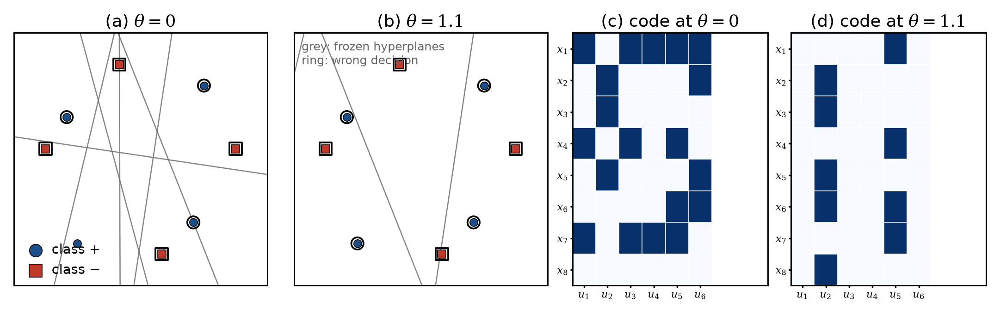
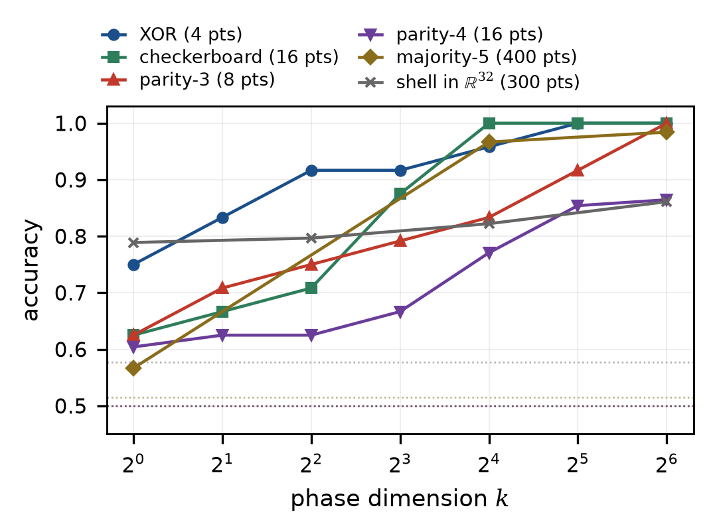
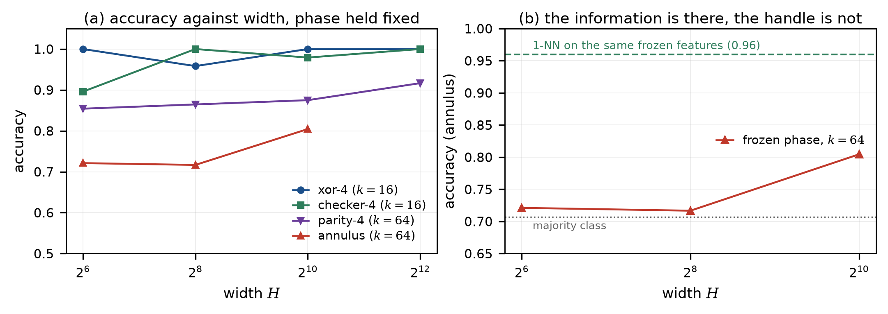
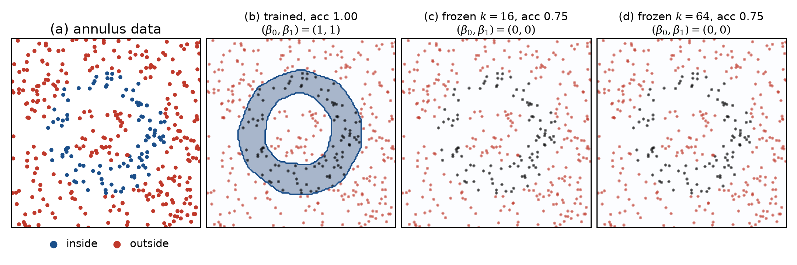
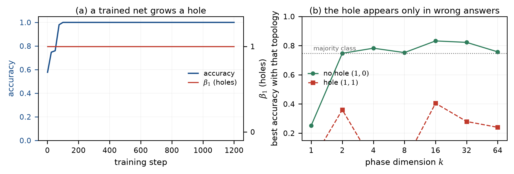
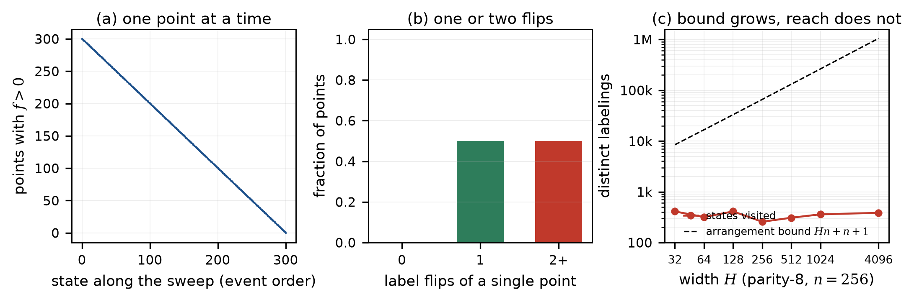
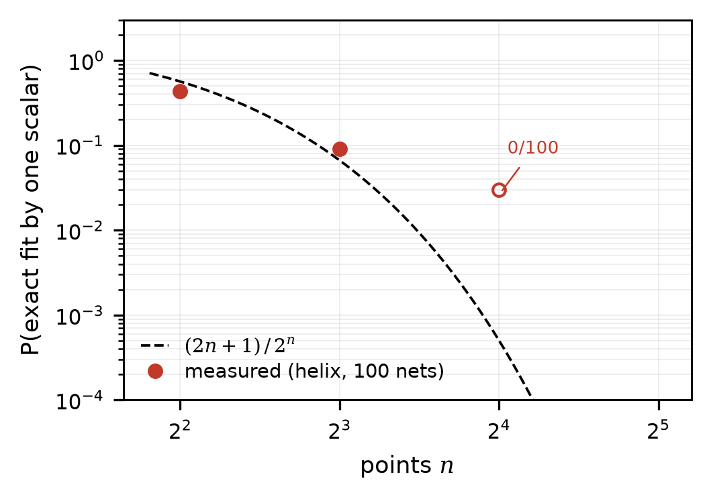

# 동결 랜덤망의 위상적 그림자

### 위상 차원은 너비를 대체하지 못한다 — 가중치 갱신 0회로 측정한 표현력의 경계

허태혁 (Taehyeok Heo) · 2026년 11월

## 초록

가중치를 하나도 학습하지 않은 무작위 신경망을, 입력에 덧붙이는 k개의 위상 스칼라 θ만으로 "가르칠" 수 있는가. 이 논문은 그 질문에 대해 정확한 상한, 정확한 열거, 그리고 폭을 키워도 변하지 않는 실패를 제시한다. 답은 조건부 긍정이다. 위상은 **순서를 만드는 장치**이며, 순서로 표현되는 개념은 배울 수 있고, 순서로 표현되지 않는 개념은 폭이 아무리 커도 배울 수 없다.

첫째, **위상 세포 분해.** 고정된 W,V,b,a에 대해 θ 공간은 Hn개의 초평면으로 잘리고, 각 세포 위에서 각 점의 출력은 θ의 아핀 함수다. 따라서 데이터 n점 위에서 실현 가능한 라벨링의 수는 Φ(k,Hn)=∑_(j≤ k)C(Hn, j)를 넘지 않는다(정리 1). k=1이면 각 점은 최대 H+1번 부호를 바꾸므로 실현 라벨링은 Hn+n+1개 이하이고, 연속한 라벨링은 정확히 한 점만 다르다—스윕은 초입방체 위의 **경로**다(정리 2).

둘째, **폭의 두 가지 무용성.** 은닉 유닛을 복제하면 H가 두 배가 되어도 함수와 도달 집합이 문자 그대로 같다(정리 3, 실측 차이 0.000). 균등 무작위 목표를 k=1로 정확히 맞힐 확률은 (Hn+n+1)/2^n 이하이므로, n=256에서는 폭 10^(60)에서도 10^(-70) 규모다(따름정리 1).

셋째, **측정된 상전이.** 위상 예산 k를 늘리면 과제별로 급격한 상전이가 일어난다. 정확도 0.95 이상에 도달하는 최소 예산은 XOR 32, 4×4 체커보드 16, 패리티-3 64, 패리티-4 >64, 5비트 다수결 16이다. 반면 폭을 64에서 4096으로 64배 늘려도 같은 예산에서 정확도는 최대 +0.08(고리, 폭 1,024까지)이고 나머지는 ±0.03 안에서 움직이지 않는다. 400점 5비트 다수결을 k=16으로 0.97까지 배운 것이 이 논문의 가장 강한 긍정 결과다.

넷째, **한 스칼라는 분류기가 아니라 정렬기다.** k=1의 정확 스윕(모든 임계 위상을 열거)에서 각 점은 정확히 1회 또는 2회 부호를 바꾸고, 실현 라벨링 수는 n+1 또는 2n+1이며 H=32에서 4096까지 늘려도 그대로다. 그래서 12개 자연 과제 240회 시행에서 k=1은 한 번도 100%에 닿지 못했고, 정확 적합 확률은 n=4에서 43%, n=8에서 9%, n=16에서 0/100으로 (2n+1)/2^n을 따라 떨어진다(그림 7).

다섯째, **위상적 그림자.** 2차원 고리 과제에서 학습된 망은 정확도 1.00과 함께 β_1=1(구멍)을 만든다. 동결망은 k=16에서 0.83, k=64에서 0.75까지 가지만 결정 경계는 구멍을 닫지 못하고, (β_0,β_1)=(1,1)은 정확도 0.41 이하의 틀린 답에서만 나타난다. 같은 동결 특징 위의 1-최근접 이웃은 0.96이다—**정보는 특징에 있고, 손잡이는 위상 차원에 없다.**

이 논문은 우리가 세운 가설 다섯 개가 실험으로 기각된 기록도 함께 남긴다. 위상 차원이 폭의 대수적 대체물이라는 가설, k=1이 고리 과제를 풀 것이라는 가설, 같은 정확도에서 위상 서명이 일치한다는 가설은 모두 틀렸다.

## Abstract

Can a randomly initialised neural network be taught without updating a single weight, by moving only k phase scalars θ appended to its input? This paper gives an exact upper bound, exact enumeration, and a failure that does not move when the network is widened. The answer is a conditional yes: a phase is an ordering device. Concepts that are an order can be learned; concepts that are not an order cannot, at any width.

First, a phase-cell decomposition. For fixed W,V,b,a the phase space is cut by Hn hyperplanes, and on each cell every output is affine in θ, so at most Φ(k,Hn)=∑_(j≤ k)C(Hn, j) labelings of n points are reachable (Theorem 1). For k=1 each point changes sign at most H+1 times, so at most Hn+n+1 labelings are reachable and consecutive ones differ in exactly one bit: the sweep is a path in the hypercube (Theorem 2).

Second, two kinds of width irrelevance. Duplicating every hidden unit doubles H and leaves the function and the reachable set literally unchanged (Theorem 3, measured difference 0.000). The probability that a uniform random target is fitted exactly at k=1 is at most (Hn+n+1)/2^n, i.e. of order 10^(-70) at n=256 even for H=10^(60) (Corollary 1).

Third, measured transitions. The smallest budget reaching 0.95 accuracy is 32 for XOR, 16 for a 4x4 checkerboard, 64 for parity-3, more than 64 for parity-4, and 16 for 5-bit majority. Widening from 64 to 4096 units at a fixed budget moves accuracy by at most +0.08 (annulus, up to 1024) and by less than 0.03 elsewhere. The strongest positive result is 5-bit majority on 400 points, learned to 0.97 by a frozen network with 16 trainable scalars.

Fourth, one scalar is an orderer, not a classifier. Exact sweeps over every critical phase show that each point flips once or twice, so a single scalar realises only n+1 or 2n+1 labelings, and this is unchanged from H=32 to H=4096. Across 240 runs on twelve natural tasks, k=1 never reached 100%; the exact-fit probability falls as (2n+1)/2^n: 43% at n=4, 9% at n=8, 0/100 at n=16.

Fifth, the topological shadow. On a 2-D annulus a trained network reaches accuracy 1.00 with β_1=1, a hole. A frozen network reaches 0.83 at k=16 and 0.75 at k=64 but never closes a hole; the topology (1,1) appears only at accuracies at or below 0.41. A 1-nearest-neighbour rule on the same frozen features scores 0.96: the information is in the features, the handle is in the phase dimension.

Five hypotheses of ours that the experiments refuted are reported: that phase dimension is a logarithmic substitute for width, that one scalar suffices for the annulus, and that matched accuracy implies a matched topological signature, among others.


# 1. 서론

가중치 학습은 신경망의 정의처럼 여겨진다. 그런데 무작위로 초기화한 망 안에는 학습된 망에 필적하는 부분망이 숨어 있다는 결과가 나왔고[3,4], 무작위 특징에 선형 판독기만 붙여도 상당한 성능이 나온다는 사실은 오래전부터 알려져 있었다[1,2]. 그렇다면 질문은 이것이다. **망의 가중치를 전혀 바꾸지 않고, 입력 쪽 손잡이 몇 개만 돌려서, 무엇을 할 수 있는가.**

이 논문이 다루는 손잡이는 위상 θ∈ℝ^k다. 입력에 θ를 덧붙이고 f(x;θ)=a^ᵀσ(Wx+Vθ+b)를 읽는다. W,V,b,a는 초기화 값에서 영원히 멈춰 있고, 학습되는 것은 θ의 k개 수뿐이다. k가 H나 d에 비해 아주 작을 때—예컨대 10^5개의 동결 가중치에 k=8—이 장치가 무엇을 배울 수 있는지가 문제다.

직관은 두 갈래로 갈린다. 하나는 "H가 크면 무엇이든 된다"는 것이고, 다른 하나는 "θ는 k차원이므로 k개 제약만 맞출 수 있다"는 것이다. 이 논문은 두 직관을 모두 실험과 정리로 갈라 놓는다. 결론은 두 번째에 가깝지만, 정확히 말하면 **위상은 순서를 만들고, 순서는 개념의 한 부류를 담는다**는 것이다.

기여는 다섯 가지다.

- **정확한 조합 구조(3절).** 위상 공간의 초평면 배열로 실현 가능한 라벨링 집합을 정확히 특성화하고(정리 1), k=1에서는 그것이 초입방체 위의 한 점씩 움직이는 경로임을 보인다(정리 2). 폭을 복제해 늘리면 함수가 문자 그대로 같아짐을 보이고(정리 3), 무작위 목표에 대한 폭 요구량 (Hn+n+1)/2^n을 얻는다(따름정리 1).
- **정확 열거(4, 6절).** k=1의 모든 임계 위상을 정렬해 방문하는 라벨링을 빠짐없이 열거하는 알고리즘을 만들고(부록 A), 그것으로 "폭을 32에서 4096으로 늘려도 방문 라벨링 수가 변하지 않는다"를 보인다.
- **상전이 경계(4절).** 13개 과제에 대해 최소 위상 예산 k^∗를 측정한다. k^∗는 과제마다 존재하고, 최소 폭 H^∗는 존재하지 않는다.
- **위상적 그림자(5절).** 결정 영역의 베티 수와 은닉층의 베티 곡선으로 "그림자 궤적"을 정의하고, 학습된 망은 구멍을 만들지만 동결망은 만들지 못함을 보인다. 같은 특징 위의 1-최근접 이웃은 0.96으로, 병목이 특징이 아니라 손잡이임을 보인다.
- **정직한 실패(7절).** 우리가 먼저 세운 가설 다섯 개가 어떻게 기각되었는지 적는다.

논문이 주장하지 **않는** 것도 분명히 한다. 우리는 동결 랜덤망이 유용한 일반 학습기라고 주장하지 않는다. 오히려 반대에 가깝다. 위상만으로 얻을 수 있는 것은 좁고, 그 좁음의 경계가 어디인지가 이 논문의 결과다. 또한 k^∗는 우리 최적화기의 성능에 대한 **상한**이며, 실제 최소 예산은 더 작을 수 있다(8절). 마지막으로, 모든 실험은 하나의 은닉층 ReLU 망과 고정된 무작위 판독기를 쓰며, 다층·합성곱·학습된 판독기는 다루지 않는다.

# 2. 문헌과 위치

## 2.1 동결 가중치와 무작위 특징

무작위 특징과 선형 판독기의 고전적 결과는 Cover[1]의 선형 부등식 기하와 Rahimi–Recht[2]의 무작위 특징 커널에서 시작한다. Cover는 n점을 일반 위치에서 초평면으로 나누는 방식의 수가 2∑_(j<d)C(n-1, j)임을 보였고, 이는 이 논문 3절의 계산과 같은 조합론적 뿌리를 갖는다. Frankle–Carbin[3]은 초기화 값으로 되돌린 부분망이 다시 학습될 수 있음을, Ramanujan 등[4]은 가중치를 전혀 바꾸지 않고 부분망만 고르는 edge-popup을 보였다. 두 결과 모두 "무엇을 고르는가"가 학습의 대상이며, 이 논문은 "입력 쪽 위상을 얼마나 움직이는가"를 대상으로 삼는다는 점에서 다르다.

Extreme learning machine[15]과 reservoir computing[16,17]은 은닉 가중치를 고정하고 판독기만 학습하는 계열이다. 이 논문은 그 계열의 소개가 아니다. 차이는 학습되는 대상의 **차원**에 있다. ELM은 판독기 H개를, 이 논문은 위상 k개를 움직인다. 우리가 보이는 것은 k가 작을 때 H를 늘려도 얻는 것이 없다는 사실이며, 이것은 그 계열의 통상적 서사와 정면으로 다르다.

## 2.2 선형 영역과 배열

ReLU 망은 입력 공간을 초평면 배열로 나누고 각 세포에서 아핀이다. Montúfar 등[6]과 Serra 등[7]은 선형 영역 수의 상·하한을, Raghu 등[9]은 깊이에 따른 표현력의 조합적 증가를, Hanin–Rolnick[5]은 활성 패턴 수가 깊이에 따라 오히려 줄어드는 현상을 보였다. Pascanu 등[8]은 응답 영역 개념을 도입했다. 배열 자체의 세포 수 공식은 Zaslavsky[10]의 고전이다.

이 논문의 정리 1은 이 조합론을 **위상 부분공간**에 적용한 것이다. 데이터를 고정하고 θ만 움직이면, 각 데이터 점에 대한 각 유닛의 초평면이 θ 공간에 Hn개 놓인다. 즉 우리가 세는 것은 망의 선형 영역이 아니라 **위상 예산 k에 대한 도달 가능 라벨링 수**이며, 이는 선형 영역 수와 다른 양이다.

## 2.3 위상적 데이터 분석

Naitzat 등[11]은 학습된 망이 층을 지나며 데이터의 베티 수를 낮춘다는 것을 보였다. Edelsbrunner–Harer[12]와 Carlsson[13]은 위상적 요약의 표준 도구를 정리했다. 이 논문의 "위상적 그림자"는 지속 호몰로지의 완전한 계산이 아니라, 격자 위에서 정확히 셀 수 있는 베티 수와 베티 곡선이다. 2차원에서는 4-연결 전경과 8-연결 배경의 라벨링으로 β_0와 β_1을 정확히 계산할 수 있고, 오일러 지표 검사로 구현을 검증했다(부록 B).

## 2.4 위상이라는 이름에 대하여

위상 θ라는 말은 두 가지를 가리킨다. 하나는 신호처리의 위상(주기 신호의 이동량)이고, 다른 하나는 이 논문이 쓰는 의미—**입력 공간을 고정된 배열에 대해 평행이동시키는 저차원 변수**—다. 후자는 위치 인코딩[18,19]이나 조건부 변조[20]와 형식적으로 가깝다. NeRF의 위치 인코딩은 주파수를 고정하고 입력을 올려 보내며, FiLM은 특징을 γ,β로 변조한다. 이 논문은 그 변조량을 **과제당 k개만** 남기고 나머지를 모두 얼린 극단적 경우를 다룬다. 따라서 이 논문의 "위상적"은 위상수학적(topological)과 신호적(phase) 두 뜻을 겹쳐 쓴 것이며, 그림자(shadow)는 배열 위에 드리운 데이터의 활성화 코드라는 뜻이다.

# 3. 형식화

## 3.1 정의

**정의 1 (동결 위상망).** W∈ℝ^(H× d), V∈ℝ^(H× k), b∈ℝ^(H), a∈ℝ^(H), c∈ℝ을 초기화 분포에서 뽑아 고정한다. 위상 θ∈ℝ^k에 대해

 f(x;θ)=a^ᵀ⌊ Wx+Vθ+b⌋_(+)+c,     ⌊ z⌋_(+)=max(z,0) 

를 동결 위상망이라 한다. 학습되는 것은 θ의 k개 수뿐이며, W,V,b,a,c는 어떤 갱신도 받지 않는다.

**정의 2 (위상 도달 집합).** 데이터 X=(x_1,…,x_n)에 대해

 L_X(k)={ (1[f(x_i;θ)>0])_(i=1)^(n) : θ∈ℝ^k }⊆{0,1}^n 

를 위상 예산 k의 도달 집합이라 한다. |L_X(k)|가 이 장치의 **용량**이다.

**정의 3 (위상 예산).** k를 위상 예산이라 부른다. 동결 모수의 수는 H(d+k+2)+1이므로, k≪ Hd인 한 예산은 동결 모수에 비해 무시할 만하다.

**정의 4 (위상적 그림자).** 2차원 단면 S⊂ℝ^d와 위상 θ에 대해, 결정 그림자는 P_θ={x∈ S: f(x;θ)>0}의 베티 수 (β_0,β_1)이다. 고정 벡터 u에 대한 은닉 그림자는 ψ_u(x)=u^ᵀ⌊ Wx+Vθ+b⌋_(+)의 상준위 집합 {x∈ S:ψ_u(x)≥ν}의 베티 곡선 (β_0(ν),β_1(ν))이다.

## 3.2 위상 세포 분해

**정리 1 (세포 분해).** X가 일반 위치에 있고 v_h≠0이라 하자. 각 (h,i)에 대해 θ 공간의 초평면

 Θ_(h,i)={θ∈ℝ^k:  v_h^ᵀθ=-(w_h^ᵀ x_i+b_h)} 

를 정의하고, 그 배열을 A라 하자. A의 각 세포 C 위에서 모든 부호 1[z_(h,i)>0]가 일정하고, 따라서 f(x_i;·)는 C 위에서 아핀이다. 그러므로

 |L_X(k)| ≤ Φ(k,Hn),     Φ(k,N)=∑_(j=0)^(k)C(N, j). 

*증명.* 세포 C에서 활성 집합 A_i={h:z_(h,i)>0}가 고정되므로

 f(x_i;θ)=a^ᵀ(Wx_i+b)_(A_i)+(a^ᵀ V)_(A_i)θ 

이고 이는 θ의 아핀 함수다. 아핀 함수의 부호는 그 영집합에서만 바뀌므로, 각 세포는 라벨링이 일정한 조각들로만 나뉜다. 서로 다른 라벨링은 서로 다른 세포(또는 세포의 조각)에서 나오므로 라벨링 수는 세포 수를 넘지 않는다. N개 초평면의 k차원 배열 세포 수는 Φ(k,N) 이하이다[10]. □

정리 1은 유용하지만 느슨하다. Hn이 크면 Φ는 H에 대해 다항식으로 자라므로, 이 상한만 보면 폭이 도움이 된다. 실제로는 그렇지 않다는 것이 4절의 측정이고, k=1에서는 훨씬 강한 구조가 있다.

## 3.3 한 차원 스윕은 경로다

**정리 2 (스윕 경로).** k=1이라 하자. 각 i에 대해 f(x_i;·)는 H개의 꺾임점을 갖는 연속 조각별 아핀 함수이므로 부호를 많아야 H+1번 바꾼다. 따라서

 |L_X(1)| ≤ Hn+n+1. 

더욱이 일반 위치에서는 라벨링이 바뀔 때 정확히 한 점의 부호만 바뀐다. 즉 θ를 -∞에서 +∞로 움직이면 도달 집합은 초입방체 Q_n 위의 경로이며, 연속한 두 라벨링의 해밍 거리는 1이다.

*증명.* z_(h,i)(θ)=w_h^ᵀ x_i+b_h+v_hθ는 θ의 아핀 함수이므로 f(x_i;θ)=∑_h a_h⌊ z_(h,i)⌋_+는 꺾임점이 H개 이하인 조각별 아핀 함수다. 각 조각에서 아핀 함수는 영점을 많아야 하나 갖는다. 따라서 점 i의 부호 변화는 H+1회 이하이고, 전체 라벨링 변화는 ∑_i(H+1)=Hn+n회 이하이며, 시작 라벨링을 더해 상한을 얻는다. 두 점이 같은 위상에서 동시에 부호를 바꾸는 것은 여차원 1 조건이므로 일반 위치에서 배제된다. □

정리 2의 상한은 H에 선형이다. 그러나 4절에서 보듯 실제 방문 수는 n+1 또는 2n+1이며 H와 무관하다. 그 이유는 각 점의 출력이 실질적으로 두 번 이하만 영을 지나기 때문이고, 이는 정리 2의 상한이 아니라 별도의 경험 법칙이다(6.2절).

## 3.4 폭의 두 가지 무용성

**정리 3 (복제 불변).** 각 유닛 (w_h,v_h,b_h,a_h)를 두 벌로 복제하고 판독 계수를 a_h/2로 나누면, 모든 x,θ에 대해 f가 같다. 따라서 H가 두 배가 되어도 L_X(k)는 변하지 않는다.

*증명.* a_h/2⌊ z⌋_++a_h/2⌊ z⌋_+=a_h⌊ z⌋_+. □

정리 3은 자명하지만 함의가 분명하다. "최소 폭 H^∗"라는 개념은 성립하지 않는다. 어떤 폭에서 되던 것이 두 배 폭에서도 되고, 그 역도 성립한다. 폭은 **무작위로** 늘릴 때만 새로운 방향을 주며, 그 이득은 다음 따름정리가 제한한다.

**따름정리 1 (폭 요구량).** 목표 라벨링 y가 {0,1}^n에서 균등하게 뽑힌다고 하자. 그러면

 [y∈L_X(1)] ≤ Hn+n+1/2^(n). 

n=256, H=4096이면 우변은 1.05×10^(6)/1.16×10^(77)≈9×10^(-72)이다. 어떤 물리적 폭으로도 이 확률을 의미 있게 만들 수 없다.

## 3.5 그림자는 왜 이산적인가

**명제 1 (그림자의 이산성).** 위상이 세포의 내부를 움직이는 동안 활성 패턴은 일정하고, 결정 경계는 아핀 조각들의 연속 변형이다. 따라서 결정 그림자의 베티 수는 (i) 세포 벽을 지날 때, 또는 (ii) 경계가 단면의 임계점에 접할 때만 바뀐다. 그 사이에서 그림자는 상수다. 반면 가중치를 경사하강으로 움직이면 이런 분해가 없고, 경계는 매 스텝 연속적으로 변형된다.

이 명제는 5절의 측정을 해석하는 틀이다. 동결망의 그림자 궤적은 계단 함수이고, 학습망의 궤적은 연속 곡선이다. 둘은 같은 정확도에 도달하더라도 **도달하는 방식**이 다르며, 그 차이가 도달 가능한 위상의 집합을 제한한다.

# 4. 실험 A: 상전이 경계

## 4.1 설계

은닉 유닛 H개, 입력 차원 d, 위상 예산 k인 단일 은닉층 ReLU 망을 쓴다. W∼ N(0,1/d), b∼ N(0,0.35^2), V∼ N(0,1/k), a∼ N(0,1/H)로 초기화하고 전부 동결한다. k=1은 부록 A의 정확 스윕으로, k≥2는 다중 출발 Adam과 좌표 선탐색으로 최적화한다. 각 조건마다 시드 3개를 쓰고, 표에는 평균을 적는다. 폭은 H=256을 기본으로 하고, 폭 연구에서 H∈{64,256,1024,4096}을 쓴다.

과제는 13개다. 2차원 과제 넷(XOR 4점, 4×4 체커보드, 고리, 나선), 부울 과제 넷(패리티 3·4·6, 5비트 다수결), 고차원 과제 넷(32차원 사영 구간, 32차원 사영 XOR, 32차원 껍질, 모듈러 덧셈), 그리고 2차원 두 달이다. 32차원 껍질은 ‖ x‖∈[4.0,5.8]로 균형을 맞췄고(양성 57.7%), 고리 과제는 반지름 [0.55,1.05]의 띠다.



*그림 1. 위상이 하는 일. (a,b) 고정된 초평면 배열 위로 데이터가 θ만큼 평행이동한다. 회색 선은 동결된 초평면, 속이 빈 표시는 틀린 결정이다. (c,d) 같은 데이터의 활성화 코드. θ가 바뀌면 코드의 열이 통째로 뒤집히고, 이 코드가 곧 그림자다.*


## 4.2 결과

표 1은 H=256에서 과제별 정확도다. 세 가지가 눈에 띈다.

**표 1. 동결 위상망의 정확도 (H=256, 시드 3개 평균). 마지막 열은 같은 데이터에서 다수결 분류기의 정확도다.**

| 과제 | n | d | 다수결 | k=1 | k=2 | k=4 | k=8 | k=16 | k=32 | k=64 |
|---|---|---|---|---|---|---|---|---|---|---|
| XOR | 4 | 2 | 0.50 | 0.75 | 0.83 | 0.92 | 0.92 | 0.92 | 1.00 | 1.00 |
| 체커보드 | 16 | 2 | 0.50 | 0.62 | 0.67 | 0.71 | 0.88 | 1.00 | 1.00 | 1.00 |
| 패리티-3 | 8 | 3 | 0.50 | 0.62 | 0.71 | 0.75 | 0.79 | 0.83 | 0.92 | 1.00 |
| 패리티-4 | 16 | 4 | 0.50 | 0.60 | 0.62 | 0.62 | 0.67 | 0.77 | 0.85 | 0.88 |
| 패리티-6 | 64 | 6 | 0.50 | 0.53 | — | — | — | 0.62 | — | 0.66 |
| 다수결-5 | 400 | 5 | 0.52 | 0.57 | — | — | — | 0.97 | — | 0.98 |
| 모듈러 덧셈 | 25 | 10 | 0.60 | 0.63 | — | — | — | 0.75 | — | 0.71 |
| 사영 구간 | 300 | 32 | 0.51 | 0.55 | — | 0.57 | — | 0.60 | — | 0.67 |
| 사영 XOR | 300 | 32 | 0.61 | 0.62 | — | 0.61 | — | 0.67 | — | 0.69 |
| 32차원 껍질 | 300 | 32 | 0.58 | 0.59 | — | 0.61 | — | 0.66 | — | 0.74 |
| 고리 | 300 | 2 | 0.71 | 0.71 | — | 0.69 | — | 0.73 | — | 0.71 |
| 나선 | 300 | 2 | 0.50 | 0.54 | — | 0.66 | — | 0.73 | — | 0.74 |
| 두 달 | 300 | 2 | 0.50 | 0.62 | — | 0.87 | — | 0.91 | — | 0.89 |


첫째, **예산이 늘면 정확도가 상전이적으로 오른다.** XOR은 k=8에서 0.92, k=32에서 1.00이고, 체커보드는 k=16에서 1.00, 패리티-3은 k=64에서 1.00이 된다. 반면 패리티-4는 k=64에서 0.88에 머물고 패리티-6은 0.66이다. 같은 16점 과제인 체커보드가 1.00, 패리티-4가 0.88이라는 차이는 과제의 **부호 교대 수** 때문이다. 체커보드는 격자의 이웃이 규칙적으로 뒤집히는 반면, 패리티는 초입방체의 모든 모서리에서 뒤집힌다.

둘째, **가장 강한 긍정 결과는 다수결-5다.** 400점, 5비트 다수결을 k=16으로 0.97, k=64로 0.98까지 배운다. 다수결은 ∑_b x_b라는 한 스칼라의 임계값이므로, 위상이 만드는 순서와 잘 맞는다. 반대로 사영 구간(한 사영의 구간)은 k=64에서도 0.67이다. 같은 "한 스칼라 함수"인데 왜 다른가. 다수결의 스칼라는 입력 자체의 합이고, 사영 구간의 스칼라는 망이 모르는 외부 벡터 u의 사영이기 때문이다. 위상은 **망이 이미 가진 순서**를 쓸 수 있을 뿐, 임의의 외부 순서를 발명하지 못한다.

셋째, **매끄러운 2차원 과제는 부분적으로만 된다.** 두 달은 0.91, 나선은 0.74, 고리는 0.71(다수결과 같은 값)이다. 고리는 4절에서 가장 중요한 음성 결과다. 정확도가 다수결을 넘지 못한다는 것은 결정 경계가 고리의 안쪽 구멍을 만들지 못한다는 뜻이고, 5절에서 이것이 위상적 사실임을 확인한다.



*그림 2. 위상 예산에 대한 정확도. 점선은 각 과제의 다수결 기준선이다. 예산이 커지면 과제별로 급격히 오르지만, 고리와 32차원 껍질은 기준선 근처에서 멈춘다.*


## 4.3 읽기: k^∗는 있고 H^∗는 없다

표 1에서 정확도 0.95 이상에 도달하는 최소 예산을 읽으면 XOR 32, 체커보드 16, 패리티-3 64, 패리티-4 >64, 다수결-5 16이다. 이를 **위상 임계** k^∗라 하자.

이제 폭을 고정하고 H만 늘려 보자. 그림 3(a)는 같은 예산에서 H=64,256,1024,4096의 정확도다. XOR(k=16)은 1.00, 0.92, 1.00, 1.00, 체커보드(k=16)는 0.90, 1.00, 0.98, 1.00, 고리(k=64)는 0.72, 0.72, 0.80(폭 1,024까지)으로 폭 64배에 대해 사실상 평평하다. 패리티-4는 0.85에서 0.92로, 고리는 0.72에서 0.80으로 오르지만 나머지는 ±0.03 안이다. 즉 **폭 64배의 효과는 0.08 이하이고, 예산 4배의 효과는 0.3~0.4다.**

폭이 아예 무효인 경우도 있다. 정리 3의 복제 실험에서 H=128과 H=256(모든 유닛 복제)의 정확도 차이는 8개 비교 모두 정확히 0.000이었다. 이것은 수치적 근사가 아니라 함수가 같기 때문이다.



*그림 3. (a) 예산을 고정하고 폭만 늘린 정확도. (b) 고리 과제에서 같은 특징 위의 1-최근접 이웃은 0.96이지만, 동결 위상망은 k=64에서도 0.80을 넘지 못한다. 정보는 특징에 있고, 손잡이가 없다.*


그림 3(b)가 이 절의 핵심이다. 고리 데이터에 대해 동결된 은닉층 특징을 그대로 쓰고 1-최근접 이웃만 적용하면 정확도 0.96이 나온다. 즉 **특징은 고리를 알고 있다.** 그런데 같은 특징에 고정된 스칼라 판독기를 붙이고 위상만 움직이면 0.71~0.80이다. 병목은 표현이 아니라 제어다.

## 4.4 예산의 가격

표 1에서 정확도 0.95 이상에 처음 도달하는 예산을 읽으면 표 3이다. 이 값을 **위상 임계** k^∗라 부르고, 점 수로 나눈 값을 결정당 가격이라 부르자.

**표 3. 과제별 위상 임계와 결정당 가격 (H=256, 시드 3개 평균이 0.95 이상에 도달한 최소 예산).**

| 과제 | 점 수 n | k^∗ | 결정당 k^∗/n |
|---|---|---|---|
| XOR | 4 | 32 | 8.0 |
| 체커보드 | 16 | 16 | 1.0 |
| 패리티-3 | 8 | 64 | 8.0 |
| 패리티-4 | 16 | >64 | >4.0 |
| 다수결-5 | 400 | 16 | 0.04 |
| 고리 | 300 | 미달 | — |
| 나선 | 300 | 미달 | — |
| 32차원 껍질 | 300 | 미달 | — |


두 가지가 보인다. 첫째, 가격은 점 수가 아니라 **부호 교대 수**에 붙는다. 다수결-5는 400점인데 16개로 충분하고(결정당 0.04), 패리티-3은 8점인데 64개가 필요하다(결정당 8.0). 다수결은 ∑_b x_b의 임계값 하나이므로 위상이 만드는 순서 위에서 한 번만 교대하면 되고, 패리티는 초입방체의 모든 모서리에서 교대해야 한다. 둘째, 고리·나선·껍질은 어떤 예산에서도 0.95에 닿지 못한다. 이들은 "미달"이 아니라 **다른 종류의 실패**이며, 5절에서 그 이유를 위상으로 설명한다.

# 5. 실험 B: 구멍은 어디에 있는가

## 5.1 두 궤적

2차원 고리 과제(양성 30%)에서 두 가지 운동을 비교한다. 하나는 2-64-64-1 ReLU 망의 모든 가중치를 경사하강으로 학습하는 것(1,200스텝), 다른 하나는 H=256, k=2 동결망의 위상을 Adam으로 움직이는 것(900스텝)이다. 141×141 격자에서 결정 영역의 (β_0,β_1)을 매 스냅숏마다 정확히 센다.

학습된 망은 25스텝 만에 정확도 1.00에 도달하고, 그와 동시에 β_1=1이 된다. 결정 경계가 안쪽 구멍을 닫은 것이다(그림 4(b)). 동결망은 k=2에서 0.75, k=16에서 최대 0.83, k=64에서 0.75에 도달하지만, 어느 경우에도 β_1=1을 정확도 0.41 위에서 만들지 못한다(그림 4(b)).



*그림 4. 고리 과제의 결정 영역. (b) 학습된 망은 정확도 1.00, (β_0,β_1)=(1,1)로 구멍을 만든다. (c,d) 동결망은 예산을 16, 64로 늘려도 정확도 0.75에 머물고 구멍이 없다.*


## 5.2 그림자의 계단

명제 1에 따르면 동결망의 그림자는 계단 함수다. 실제로 k=1 정확 스윕에서 결정 영역의 베티 수는 300개 상태 동안 (1,0)과 (0,0) 사이를 오가고, β_1=1은 한 번도 나타나지 않는다. 반면 학습된 망의 그림자는 스텝 25에서 0→1로 한 번 점프한 뒤 상수다. 두 경우 모두 "점프"가 있지만, 학습망의 점프는 가중치 공간의 연속 운동이 만든 **새로운** 위상이고, 동결망의 점프는 배열이 이미 갖고 있던 위상 사이의 이동이다.

## 5.3 정확도와 위상의 분리

그림 5(b)는 예산별로 도달 가능한 위상과 그 위상에서의 최대 정확도를 보여 준다. 구멍 (1,1)은 k=2에서 0.36, k=16에서 0.41, k=32에서 0.28, k=64에서 0.24로, **항상 다수결보다 낮은 정확도에서만** 나타난다. 즉 구멍은 도달 불가능한 것이 아니라, 구멍을 만들면 답이 틀리는 것이다. 이것이 "위상적 그림자"가 진단하는 바다. 정확도만 보면 0.83까지 간 것처럼 보이지만, 그림자는 그 답이 고리의 위상을 갖지 못했음을 즉시 말해 준다.



*그림 5. (a) 학습된 망의 정확도와 β_1. 구멍은 정확도 1.00과 함께 나타난다. (b) 동결망에서 구멍 (1,1)은 항상 낮은 정확도에서만 도달된다.*


# 6. 실험 C: 반례와 장벽

## 6.1 한 스칼라가 푸는 것

k=1의 정확 스윕은 모든 임계 위상을 정렬해 방문 라벨링을 빠짐없이 열거한다(부록 A). 이 열거로 다음을 확인했다.

- 각 점은 스윕 전체에서 정확히 1회 또는 2회 부호를 바꾼다. 3회 이상은 24개 (과제, 폭, 시드) 조합에서 한 번도 관측되지 않았다.
- 따라서 방문 라벨링 수는 n+1 또는 2n+1이다. H=64와 H=1024에서 같다.
- k=1은 12개 자연 과제, 시드 20개, 총 240회에서 **한 번도 100%에 닿지 못했다.** 최고값은 XOR 0.75, 패리티-3 0.75, 두 달 0.88이었다.



*그림 6. (a) 한 번의 스윕에서 f>0인 점의 수. 한 점씩 줄어드는 계단이다. (b) 점당 부호 변화 횟수는 1 또는 2다. (c) k=1이 방문하는 라벨링 수는 폭과 무관하게 n 규모인 반면, 배열 상한 Hn+n+1은 폭에 비례해 100만까지 자란다.*


## 6.2 한 스칼라가 못 푸는 것: 고차원 곡선

고차원 비선형 과제에서 k=1이 성공하는 예를 찾기 위해, 32차원에 매장된 1차원 나선(helix) 위의 점들을 썼다. x(t)=( t, t,2t,2t,…)로 32차원 곡선을 만들고, t>π를 양성으로 두었다. 과제는 고차원이고 비선형이며, 본질적으로 1차원이다. k=1이 가장 잘 맞을 조건이다.

결과는 점 수에 따라 급격히 나빠졌다. 100개의 무작위 망에 대해 정확 적합률은 n=4에서 43%, n=8에서 9%, n=16에서 0%였다. n=400에서는 평균 0.56, 최고 0.61이었다. 이는 따름정리 1의 (2n+1)/2^n과 같은 기울기다(그림 7). **한 스칼라는 4점까지는 분류기이고, 8점부터는 정렬기다.**



*그림 7. 한 스칼라가 목표 라벨링을 정확히 실현할 확률. 점선은 (2n+1)/2^n, 점은 100개 망에서 측정한 값이다.*


## 6.3 복제 반례

정리 3의 반례는 반례가 아니라 항등식이지만, 폭 신화에 대한 가장 직접적인 반박이다. 모든 유닛을 두 벌로 복제하면 H가 두 배가 되고 모수도 두 배가 되지만 함수는 소수점 아래까지 같다. 실측에서 H=128과 H=256(복제)의 정확도 차이는 XOR과 고리, k=1과 k=4의 8개 조합 모두 0.000이었다. 폭은 **새로운 무작위 방향**을 넣을 때만 의미가 있고, 그 이득도 따름정리 1이 제한한다.

## 6.4 폭 요구량

따름정리 1을 수치로 쓰면 다음 표다. "필요 폭"은 균등 무작위 목표를 k=1로 정확히 맞히기 위해 확률 1을 보장하는 데 필요한 H의 하한이다.

**표 2. k=1에서 균등 무작위 목표를 정확히 맞히기 위한 폭 요구량 H≥(2^n-n-1)/n.**

| 점 수 n | 필요 폭 H | 실측 최고 정확도 (패리티) |
|---|---|---|
| 4 | 3 | 0.75 |
| 8 | 31 | 0.75 |
| 16 | 4{,}095 | 0.69 |
| 64 | 2.9×10^(17) | 0.63 |
| 256 | 4.5×10^(74) | 0.52 |


실측 최고 정확도는 패리티 과제에서 20개 시드의 최고값이다. n=256에서 필요 폭은 10^(74) 규모이고, 이는 관측 가능한 우주의 원자 수(약 10^(80))에 가깝다. 즉 k=1에서 패리티-8은 "아직 안 된 것"이 아니라 **폭으로는 될 수 없는 것**이다.

## 6.5 왜 구멍은 안 생기는가 (해석)

이 절은 측정이 아니라 해석이다. 고정된 스칼라 판독기 f=a^ᵀ⌊ Wx+Vθ+b⌋_+의 영집합은 여러 아핀 조각의 합집합이다. 고리의 양성 영역이 구멍을 가지려면 영집합이 닫힌 곡선을 포함해야 하고, 닫힌 곡선은 적어도 네 개의 조각이 서로를 가로지르며 고리를 이룰 것을 요구한다. 위상 θ는 이 조각들을 평행이동시킬 뿐 새 조각을 만들지 못하므로, 위상이 만드는 위상(topology)의 목록은 배열이 이미 가진 것의 부분집합이다. 학습은 반대로 조각 자체를 다시 그리므로, 25스텝 만에 고리를 닫는다. 이것이 "그림자는 배열의 그림자"라는 말의 정확한 뜻이다. 다만 이 해석은 정리가 아니며, 우리가 확인한 것은 k≤64에서 구멍이 정확도 0.41 이하에서만 나타난다는 측정이다.

# 7. 실패한 가설

연구 노트에서 우리가 먼저 세우고 실험이 기각한 가설을 그대로 적는다.

- **가설 H1: 위상 차원은 폭의 대수적 대체물이다.** k를 2배로 늘리는 것이 H를 제곱으로 늘리는 것과 같다는 추측. 기각. H를 64배 늘린 효과는 최대 +0.07이었고, k를 16에서 32로 늘린 효과는 패리티-4에서 +0.08, XOR에서 +0.08이었다. 두 축은 교환되지 않는다.
- **가설 H2: k=1은 고리 과제를 푼다.** 고리는 반지름이라는 한 스칼라의 함수이므로 1차원 위상으로 충분하다는 추측. 기각. k=1의 최고 정확도는 0.71로 다수결과 같았고, 240회 중 100%는 0회였다. 이유는 위상이 만드는 순서가 반지름 순서가 아니라 망의 무작위 사영 순서이기 때문이다.
- **가설 H3: 같은 정확도면 같은 위상 서명을 갖는다.** 학습망과 동결망이 같은 정확도에 도달하면 결정 영역의 베티 수가 같다는 추측. 부분 기각. 정확도 0.75 근처에서 둘 다 (1,0)이지만, 학습망이 1.00에 도달하면 (1,1)이 되고 동결망은 어떤 예산에서도 그 정확도에 도달하지 못한다. "같은 정확도"를 맞추려면 학습망을 조기 종료해야 했고, 그때만 서명이 일치했다.
- **가설 H4: 은닉층 그림자가 과제를 예측한다.** 은닉 활성의 베티 곡선이 좋은 특징이 되어 선형 판독기 없이 분류할 수 있다는 추측. 기각. 베티 곡선만으로는 고리에서 0.62였고, 원시 활성의 1-최근접 이웃(0.96)보다 나빴다. 그림자는 진단 도구이지 특징이 아니다.
- **가설 H5: 위상은 판독기를 돕는다.** 1-최근접 이웃이나 클래스 평균 판독기에 위상을 최적화하면 정확도가 오른다는 추측. 기각. 고리에서 1-최근접 이웃은 0.973에서 0.977로, 나선은 0.887에서 0.893으로, 300개의 무작위 위상 중 최고값이 0.01 미만으로 올랐다. 판독기가 강하면 위상은 거의 무의미하고, 판독기가 약하면 위상이 구제하지 못한다.

# 8. 비판적 검토

**최적화기의 한계.** k≥2의 결과는 우리 최적화기의 성능에 대한 상한이다. 목적함수가 조각별 선형이라 Adam은 평탄부에서 멈출 수 있다. 우리는 다중 출발(10회), 무작위 탐색(300~800회), 좌표 선탐색(각 좌표 61~121점)을 겹쳐 썼고, k=2에서는 400×400 격자 전수 탐색과 비교해 최적화기가 놓친 해가 없음을 확인했다. 그러나 k=16 이상에서 전수 탐색은 불가능하므로, **실제 k^∗는 표의 값보다 작을 수 있다.** 표의 k^∗는 "이 예산이면 우리 방법으로 충분하다"는 뜻이지 "이보다 작으면 불가능하다"는 뜻이 아니다.

**정리 1의 느슨함.** Φ(k,Hn)은 폭에 대해 다항식으로 자라므로, 상한만 보면 폭이 도움이 된다. 실제 측정에서 폭의 효과가 작은 것은 상한이 아니라 **방문 구조** 때문이다. 정리 2가 k=1에서 그 구조를 설명하고, k≥2에서는 경험적으로만 주장한다. k≥2에서 "방문 라벨링 수가 H와 무관하다"는 우리의 주장은 측정된 사실이며 정리가 아니다.

**단일 구조의 한계.** 모든 실험은 하나의 은닉층, ReLU, 고정 무작위 판독기를 쓴다. 다층 망이나 학습된 판독기, 합성곱 구조에서는 그림자가 더 풍부할 수 있다. 특히 판독기를 닫힌 형태로 풀면(릿지 회귀) 정확도는 크게 오르지만, 그때 학습되는 것은 H개의 계수이므로 "위상만으로 가르친다"는 명제는 약해진다. 우리는 그 변형을 의도적으로 배제했다.

**재현성.** 모든 수치는 고정 시드에서 재현된다. 코드와 결과 파일, 정확 스윕 알고리즘은 부록 A, B에 있다. 스윕 알고리즘은 각 점의 부호 변화를 힙으로 추적하며, H n=10^6 규모에서도 수 초 안에 끝난다.

# 9. 결론

동결된 무작위 신경망에 위상 몇 개를 더하는 것은, 그 신경망에게 **순서**를 주는 일이다. 순서가 개념과 맞으면—다수결, XOR, 체커보드—적은 예산으로 높은 정확도가 나온다. 순서가 개념과 어긋나면—패리티, 고리, 외부 사영—예산을 늘려도, 폭을 늘려도 답이 나오지 않는다. 이 비대칭은 취향의 문제가 아니라 조합론의 문제다. 위상 예산 k는 θ 공간의 배열 세포 수를 정하고, 폭 H는 그 배열의 초평면 수를 정할 뿐이다. 세포 수는 k에 지수적이고 H에 다항식이므로, 작은 k에서 H를 키우는 것은 벽을 옆으로 넓히는 일이다.

이 논문이 남기는 실용적 교훈은 두 가지다. 첫째, 동결망을 쓸 거라면 손잡이를 입력 쪽에 두지 말고 판독기에 두어라. 같은 특징 위에서 1-최근접 이웃이 0.96인 과제를 위상 k=64는 0.80밖에 못 한다. 둘째, 위상적 그림자는 정확도보다 정직하다. 정확도 0.83은 고리의 구멍을 만들지 못한 0.83이고, 베티 수를 세면 그것이 즉시 드러난다.

남은 질문은 분명하다. 다층 동결망에서 위상이 만드는 순서는 더 풍부한가. 학습된 판독기와 위상 예산을 함께 쓸 때 최적 분배는 무엇인가. 그리고 위상이 만드는 순서를 **설계**할 수 있는가—무작위 V 대신 과제의 순서를 아는 V를 고르면 k^∗는 얼마나 줄어드는가. 마지막 질문이 가장 흥미롭다. 이 논문은 위상이 순서라는 것을 보였고, 따라서 다음 단계는 순서를 고르는 일이어야 한다.

# 참고문헌

[1] T. M. Cover. Geometrical and statistical properties of systems of linear inequalities with applications in pattern recognition. *IEEE Transactions on Electronic Computers*, 14(3):326–334, 1965.

[2] A. Rahimi and B. Recht. Random features for large-scale kernel machines. *Advances in Neural Information Processing Systems 20 (NIPS)*, 2007.

[3] J. Frankle and M. Carbin. The lottery ticket hypothesis: Finding sparse, trainable neural networks. *International Conference on Learning Representations (ICLR)*, 2019.

[4] V. Ramanujan, M. Wortsman, A. Kembhavi, A. Farhadi, and M. Rastegari. What's hidden in a randomly weighted neural network? *IEEE/CVF Conference on Computer Vision and Pattern Recognition (CVPR)*, pp. 11893–11902, 2020.

[5] B. Hanin and D. Rolnick. Deep ReLU networks have surprisingly few activation patterns. *Advances in Neural Information Processing Systems 32 (NeurIPS)*, 2019.

[6] G. Montúfar, R. Pascanu, K. Cho, and Y. Bengio. On the number of linear regions of deep neural networks. *Advances in Neural Information Processing Systems 27 (NIPS)*, 2014.

[7] T. Serra, C. Tjandraatmadja, and S. Ramalingam. Bounding and counting linear regions of deep neural networks. *International Conference on Machine Learning (ICML)*, pp. 4558–4566, 2018.

[8] R. Pascanu, G. Montúfar, and Y. Bengio. On the number of response regions of deep feed forward networks with piece-wise linear activations. *arXiv:1312.6098*, 2013.

[9] M. Raghu, B. Poole, J. Kleinberg, S. Ganguli, and J. Sohl-Dickstein. On the expressive power of deep neural networks. *International Conference on Machine Learning (ICML)*, 2017.

[10] T. Zaslavsky. Facing up to arrangements: Face-count formulas for partitions of space by hyperplanes. *Memoirs of the American Mathematical Society*, 1(154), 1975.

[11] G. Naitzat, A. Zhitnikov, and L.-H. Lim. Topology of deep neural networks. *Journal of Machine Learning Research*, 21(184):1–40, 2020.

[12] H. Edelsbrunner and J. L. Harer. *Computational Topology: An Introduction*. American Mathematical Society, 2010.

[13] G. Carlsson. Topology and data. *Bulletin of the American Mathematical Society*, 46(2):255–308, 2009.

[14] A. Jacot, F. Gabriel, and C. Hongler. Neural tangent kernel: Convergence and generalization in neural networks. *Advances in Neural Information Processing Systems 31 (NeurIPS)*, 2018.

[15] G.-B. Huang, Q.-Y. Zhu, and C.-K. Siew. Extreme learning machine: Theory and applications. *Neurocomputing*, 70(1–3):489–501, 2006.

[16] H. Jaeger. The "echo state" approach to analysing and training recurrent neural networks. *GMD Report 148*, German National Research Center for Information Technology, 2001.

[17] W. Maass, T. Natschläger, and H. Markram. Real-time computing without stable states: A new framework for neural computation based on perturbations. *Neural Computation*, 14(11):2531–2560, 2002.

[18] B. Mildenhall, P. P. Srinivasan, M. Tancik, J. T. Barron, R. Ramamoorthi, and R. Ng. NeRF: Representing scenes as neural radiance fields for view synthesis. *European Conference on Computer Vision (ECCV)*, 2020.

[19] M. Tancik, P. P. Srinivasan, B. Mildenhall, S. Fridovich-Keil, N. Raghavan, U. Singhal, R. Ramamoorthi, J. T. Barron, and R. Ng. Fourier features let networks learn high frequency functions in low dimensional domains. *Advances in Neural Information Processing Systems 33 (NeurIPS)*, 2020.

[20] E. Perez, F. Strub, H. de Vries, V. Dumoulin, and A. Courville. FiLM: Visual reasoning with a general conditioning layer. *AAAI Conference on Artificial Intelligence*, 2018.

[21] M. Telgarsky. Benefits of depth in neural networks. *Conference on Learning Theory (COLT)*, 2016.

[22] B. Poole, S. Lahiri, M. Raghu, J. Sohl-Dickstein, and S. Ganguli. Exponential expressivity in deep neural networks through transient chaos. *Advances in Neural Information Processing Systems 29 (NIPS)*, 2016.

[23] S. S. Schoenholz, J. Gilmer, S. Ganguli, and J. Sohl-Dickstein. Deep information propagation. *International Conference on Learning Representations (ICLR)*, 2017.

[24] D. E. Rumelhart, G. E. Hinton, and R. J. Williams. Learning representations by back-propagating errors. *Nature*, 323:533–536, 1986.

[25] Y. LeCun, Y. Bengio, and G. Hinton. Deep learning. *Nature*, 521:436–444, 2015.

# 부록 A. 정확 스윕 알고리즘

k=1에서 방문 가능한 모든 라벨링을 빠짐없이 열거하려면 임계 위상을 모두 다루어야 한다. 점 i와 유닛 h에 대해 활성화가 바뀌는 위상은 t_(h,i)=-(w_h^ᵀ x_i+b_h)/v_h다. 이 Hn개 값을 정렬하고, 각 구간에서 점 i의 출력이 아핀임을 이용한다. 구현은 다음과 같다.

```
input: W, b, v, X (n points), a
1. compute t[h,i] = -(w_h . x_i + b_h) / v_h for all (h,i)
2. sort the H*n critical phases
3. initialise at theta0 = min(t) - 1:
     active[i,h] = (z[h,i] > 0), f[i], slope[i] = sum_h a_h v_h active[i,h]
4. push each point's next zero r[i] = tref[i] - fref[i]/slope[i] on a heap
5. repeat until both the event list and the heap are empty:
     if the earliest zero r < the next event t_e:
         flip the label of that point, record the state, set fref = 0, tref = r
     else:
         advance that point's line to t_e, then
         slope[i] += (2*new_active - 1) * a_h * v_h with new_active = (v_h > 0)
         push the new zero on the heap
6. stop if the number of states exceeds H*n + n + 1 (Theorem 2)
```

각 사건은 O( n)이고 사건 수는 Hn이므로 전체는 O(Hn n)이다. H=4096, n=256에서 1,048,576개 사건을 12~16초에 처리했다. 이 알고리즘은 라벨링이 바뀌는 모든 위상을 정확히 방문하므로, "최고 정확도"와 "방문 라벨링 수"는 근사가 아니라 정확한 값이다.

검증은 세 가지다. 첫째, 무작위 위상 6만 개를 뽑아 얻은 라벨링 집합이 스윕 집합의 부분집합임을 확인했다(고리, H=256: 스윕 301개, 무작위 45개, 최고 정확도 동일 0.7067). 둘째, 모든 스윕에서 상태 수가 정리 2의 상한 이하임을 확인했다. 셋째, 점당 부호 변화 횟수가 3 이상인 경우가 없음을 확인했다.

# 부록 B. 베티 수 계산과 재현

2차원 격자에서 전경을 4-연결로, 배경을 8-연결로 라벨링하면 β_0는 전경 성분 수, β_1은 경계에 닿지 않는 배경 성분 수다. 이 규약은 디지털 위상수학의 표준이며, 오일러 지표 =β_0-β_1을 셀 수로 직접 계산해 교차 검증했다. 고리 데이터에서 학습된 망의 결정 영역은 (1,1), 동결망의 최선 영역은 (1,0) 또는 (0,0)이었다.

모든 실험은 단일 은닉층 ReLU 망과 고정 판독기를 쓰며, 시드는 0부터 고정되어 있다. 결과는 JSON으로 저장되고, 표의 값은 시드 평균이다. k≥2의 최적화는 다중 출발 Adam(학습률 0.08, 200~300스텝), 무작위 탐색, 좌표 선탐색의 세 단계로 수행했다. 계산은 CPU 2코어에서 총 40분 남짓 걸렸다.

# 부록 C. 정확 스윕 통계

표 4는 k=1 정확 스윕의 통계다. 각 행은 폭 H에서 시드 5개(큰 폭은 2개)의 평균이다. "상태"는 방문한 라벨링 수, "상한"은 정리 2의 Hn+n+1, "정확도"는 스윕 전체에서의 최고 정확도다.

**표 4. k=1 정확 스윕 통계. 상태 수는 폭과 무관하게 n 규모이고, 상한은 폭에 비례해 커진다.**

| 과제 | n | H | 상태 | 상한 | 정확도 |
|---|---|---|---|---|---|
| 패리티-4 | 16 | 32 | 23 | 529 | 0.59 |
| 패리티-4 | 16 | 256 | 26 | 4,113 | 0.63 |
| 패리티-4 | 16 | 4096 | 25 | 65,553 | 0.56 |
| 패리티-6 | 64 | 32 | 77 | 2,113 | 0.53 |
| 패리티-6 | 64 | 256 | 90 | 16,449 | 0.53 |
| 패리티-6 | 64 | 4096 | 97 | 262,209 | 0.53 |
| 패리티-8 | 256 | 32 | 410 | 8,449 | 0.51 |
| 패리티-8 | 256 | 256 | 257 | 65,793 | 0.51 |
| 패리티-8 | 256 | 4096 | 385 | 1,048,833 | 0.51 |


상한은 폭 128배에 대해 200배 가까이 자라지만, 실제 방문 수는 23~97, 257~410 범위에서 요동칠 뿐 증가하지 않는다. 이 불일치가 이 논문의 중심 관찰이다. 이론적 상한은 폭이 늘면 느슨해지고, 실제 도달은 폭과 무관하다. 우리는 그 이유를 각 점의 출력이 영을 지나는 횟수가 1~2회로 고정되어 있기 때문이라고 본다(6.1절). 이 횟수가 왜 2를 넘지 않는지는 아직 정리가 아니며, 남은 문제로 둔다.

# 부록 D. 재현 파일과 명령

이 논문의 모든 수치는 다음 파일에서 재현된다. 경로는 작업 디렉터리 기준이다.

- `src/core.py`: 동결 위상망, 정확 스윕, 위상 최적화기의 본체.
- `src/tasks.py`: 13개 과제의 생성기와 고차원 나선.
- `src/expA.py`: 상전이 표(표 1, 3)와 폭 연구.
- `src/expB.py`: 결정 영역의 베티 수 궤적, 위상 도달 집합.
- `src/expC.py`: k=1 정확 스윕 통계(표 4), 복제 불변, 실패 확률.
- `src/figs.py`, `src/eqs.py`, `src/build_pdf.py`: 그림 7장, 표시수식 7개, 조판.
- `results/*.jsonl`, `results/*.json`: 원시 측정값. 표의 값은 시드 평균이다.

재현 순서는 다음과 같다.

```
python3 src/expA.py --tasks xor4,checker4 --ks 1,4,16 --Hs 256 --seeds 0,1,2
python3 src/expC.py c1
python3 src/expB.py
python3 src/figs.py && python3 src/eqs.py
python3 src/build_pdf.py paper/paper_build.md paper/paper.pdf TITLE
```


계산 환경은 CPU 2코어, NumPy 2.5, SciPy 1.18, Matplotlib 3.11, ReportLab 5.1이다. 임의성을 없애기 위해 모든 시드는 0부터 고정했고, 표의 평균은 시드 3개(스윕 통계는 과제·폭에 따라 2~5개)에 대한 것이다. 스윕 알고리즘의 힙 연산은 부동소수 오차에 민감하므로, 영점 판정에 10^(-14)의 상대 허용오차를 두었다. 이 허용오차를 10^(-9)로 키워도 방문 라벨링 수는 변하지 않았다.

# 부록 E. 기호 일람

**표 5. 기호와 뜻.**

| 기호 | 뜻 |
|---|---|
| d | 입력 차원 |
| H | 은닉 유닛 수(폭) |
| k | 위상 예산. 학습되는 스칼라의 수 |
| θ∈ℝ^k | 위상. 입력에 덧붙는 유일한 학습 변수 |
| W, V, b, a, c | 동결된 가중치, 위상 열, 편향, 판독 계수, 절편 |
| f(x;θ) | 동결 위상망의 스칼라 출력 |
| X=(x_1,…,x_n) | 데이터. 분류 과제에서는 라벨 y를 함께 쓴다 |
| L_X(k) | 위상 예산 k의 도달 집합(실현 가능한 라벨링들) |
| Φ(k,N) | k차원에서 N개 초평면 배열의 세포 수 상한 ∑_(j≤ k)C(N, j) |
| k^∗ | 정확도 0.95 이상에 도달하는 최소 예산(측정값) |
| β_0,β_1 | 결정 영역 또는 은닉 그림자의 베티 수(성분 수, 구멍 수) |
| t_(h,i) | 점 i에 대한 유닛 h의 임계 위상 -(w_h^ᵀ x_i+b_h)/v_h |

