# 추론의 시간역전 대칭성 깨짐

### 역인과(Reverse-Time) CoT의 정보 결핍과 탐색 이득 — 표본 복잡도 역전의 정확한 위치

허태혁 (Taehyeok Heo) · 2026년 11월


## 초록

자기회귀 언어모델의 인과 마스크는 추론의 화살을 왼쪽에서 오른쪽으로 고정한다. 문제 → 중간 추론 → 정답. 이 논문은 그 화살을 뒤집거나(정답 → 역추론 → 문제) 양쪽에서 동시에 잡는 일이 무엇을 바꾸고 무엇을 바꾸지 않는지를 두 축으로 분해한다. 첫째 축은 **정보**이고 둘째 축은 **계산**이다.

정리 1은 조건부 엔트로피의 사슬 법칙만으로 다음을 보인다. 궤적 Z가 문제 X와 정답 Y를 모두 결정할 때 H(Z|Y) = H(Z|X) + Δ이고 Δ = H(X) − H(Y) ≥ 0이다. 역방향은 결코 정보를 더 갖지 못하며, 잃는 양은 정확히 '정답이 문제를 결정하지 못하는 정도'의 로그, 즉 충돌도다. 정리가 말하지 않는 것도 분명히 한다. 정보의 손실은 계산의 손실이 아니며, 실제로 정리 2는 폭과 정보를 분리한다. 궤적 위 최대 분기 B에 대해 H(Z|X) ≤ d log B이고, 따라서 역방향의 최대 분기는 2^((H+Δ)/d) 아래로 내려갈 수 없다. 역전의 이득은 '순방향 분기가 엔트로피에 비해 얼마나 뭉쳐 있는가'(탐색 프리미엄)로 정확히 측정되고, 그 대가로 Δ를 치른다.

정리 3은 역방향 단방향 디코더의 환각 하한이다. 각 걸음에서 전임자 m개가 교환 가능하면 어떤 국소 디코더도 걸음당 1/m을 넘지 못하므로 궤적 전체의 충실도는 2^(−Δ) 이하인데, 배출된 궤적은 **정답과 100% 일관**한다. 타당하지만 틀린 추론, 즉 불충실한 CoT의 정확한 기하다. 정리 3'는 폭 w의 빔이 이 결핍을 로그만큼만 갚는다는 것을 보이고(성공률 = ∏ max(1/m, min(1, w/m^t))), 정리 4는 양방향 접합이 지수를 d에서 ⌈d/2⌉로 절반으로 줄임을 보인다.

측정은 정리와 세 자리까지 맞는다. 깊이 6의 대칭 2대1 과제(Δ=6비트)에서 역방향 정확도는 데이터를 16개에서 512개로 늘려도 0.0143에서 0.0190 사이에 머물고, 이론값 (1/2)^6 = 0.0156과 일치한다. 순방향은 같은 과제에서 궤적당 한 번씩만 보면 1.000이 된다. 폭을 키우면 32에서 0.510(= 1/2), 64(= 2^6)에서 1.000으로 완전 열거에서만 회복된다. 접합을 쓰면 m=4, d=6에서 필요한 폭이 4096에서 64(= 4^3)로 떨어진다. 접합은 공짜가 아니다. 층 폭 64, 분기 3의 겹침 그래프에서 두 전선의 교집합이 유일한 비율은 깊이 4에서 38.0%, 깊이 6에서 4.0%다.

결론은 하나의 문장이다. **시간을 뒤집으면 정보는 줄고 계산이 바뀐다. 두 축은 서로를 대신하지 못하며, 역방향 CoT의 실패는 정보가 아니라 이 둘을 혼동한 데서 온다.**


## Abstract

The causal mask of an autoregressive language model fixes the arrow of reasoning: problem, then intermediate steps, then answer. This paper separates what reversing that arrow changes from what it does not, along two axes: information and computation. Theorem 1 uses only the chain rule to show that whenever a trace Z determines both the question X and the answer Y, H(Z|Y) = H(Z|X) + Delta with Delta = H(X) - H(Y) >= 0: a reverse pass never carries more information, and the deficit is exactly the log of the collision factor. Theorem 2 separates this from width: with peak branching B along a trace, H(Z|X) <= d log B, so the reverse direction's peak cannot fall below 2^((H+Delta)/d). A reversal therefore trades Delta bits of information for a reduction in peak width that is bounded by how unevenly the forward entropy is spread - a quantity we call the search premium. Theorem 3 gives a hallucination floor: if the m predecessors of each step are exchangeable, no local reverse decoder exceeds 1/m per step, so faithfulness is at most 2^-Delta while every emitted trace remains 100% consistent with the answer. Theorem 3' shows that beam width w buys back only log2 w bits, and Theorem 4 shows that a bidirectional junction halves the exponent from d to ceil(d/2). Measurements agree with the bounds to three digits. On a symmetric 2-to-1 folding task of depth 6, reverse accuracy stays between 0.014 and 0.019 as training traces grow from 16 to 512 (the bound is (1/2)^6 = 0.0156) while the forward decoder reaches 1.000 after seeing each starting point once. Width recovers the reverse direction only at full enumeration: w = 32 gives 0.510 and w = 2^6 gives 1.000. A junction at the middle layer cuts the width needed at m = 4, d = 6 from 4096 to 64 = 4^3. Junctions are not free: on an overlapping graph with 64 nodes per layer and branching 3, the two half-frontiers meet uniquely in 38.0% of trials at depth 4 and 4.0% at depth 6. Reversing time loses information and changes computation; the two axes cannot substitute for each other, and the failures of reverse-time chain of thought come from conflating them.


# 1. 서론

자기회귀 모델은 왼쪽에서 오른쪽으로만 본다. 인과 마스크(causal mask)는 그 사실의 건축적 표현이고, 사고의 사슬(chain of thought)은 그 제약 위에 세워진 추론 절차다. 문제를 읽고, 중간 단계를 하나씩 쓰고, 마지막에 답을 낸다. 이 순서는 너무 당연해서 선택지로 취급되지 않는다.

그런데 순서는 선택지다. 같은 궤적을 정답에서 거꾸로 쓸 수도 있고(답 → 역추론 → 문제), 양쪽에서 동시에 쓸 수도 있으며(순방향 전선과 역방향 전선의 접합), 마스크를 비대칭으로 두어 어떤 토큰은 뒤를 보고 어떤 토큰은 앞을 보게 할 수도 있다. 이 논문이 묻는 것은 "역방향이 더 좋은가"라는 취향의 질문이 아니다. **방향을 바꾸면 무엇이 달라지는가, 그리고 그 변화는 어느 축에서 일어나는가**이다.

답을 미리 말하면 이렇다. 방향은 두 축을 건드리는데, 두 축은 서로 다른 방식으로 움직이고 서로를 대신하지 못한다.

- **정보 축.** 궤적은 문제와 정답을 모두 결정한다. 그러므로 조건부 엔트로피의 사슬 법칙에 의해 두 방향의 총 불확실성은 Δ = H(X) − H(Y)만큼 다르고, 그 부호는 언제나 역방향에 불리하다(정리 1). Δ는 '정답이 문제를 결정하지 못하는 정도'이며, 다대일 과제에서 그 값은 충돌도의 로그다. 역방향은 정보를 **얻을 수 없다.**
- **계산 축.** 정보가 같아도 폭은 다를 수 있다. 궤적 위 최대 분기를 B라 하면 H ≤ d log B이므로(정리 2), 순방향의 분기가 엔트로피에 비해 뭉쳐 있을수록(탐색 프리미엄이 클수록) 역방향으로 뒤집어 얻는 폭의 이득이 크다. 정보가 0인 탐색 과제에서 이 이득은 지수적일 수 있고, Δ는 0이다.

이 분해가 왜 중요한가. 첫째, 최근의 경험적 관찰들이 이 틀 안에서 정확히 어디에 놓이는지가 보인다. "A는 B다"로 학습한 모델이 "B는 A다"를 못하는 역전 저주[1]는 Δ의 언어적 사례다. 모델이 답을 먼저 말하고 그 답에 맞는 그럴듯한 추론을 뒤에 붙이는 불충실한 CoT[2]는 정리 3의 사례다. 배출된 추론은 정답과 완전히 일관하지만 문제와는 무관할 수 있다. 둘째, 실무적 처방이 따라온다. 역방향 추론을 쓰려면 결손된 Δ를 어딘가에서 갚아야 하고, 갚는 방법은 두 가지뿐이다. 문제 쪽 끝을 접합점으로 붙잡거나(정리 4), 폭을 2^Δ까지 늘리거나(정리 3'). 둘 다 지수적이므로, **역방향 CoT는 '검증'에는 싸고 '생성'에는 비싸다.**

이 논문의 기여는 다섯 가지다.

1. **정보 비대칭의 정확한 형태(4.1절).** 사슬 법칙만으로 H(Z|Y) − H(Z|X) = Δ를 얻고, Δ = 0의 조건이 '궤적 위에서 정답이 문제를 결정하는가'(전단사)임을 보인다. 역방향이 정보적으로 유리하다는 통념은 이 정리 아래에서 성립할 수 없다.
2. **정보–폭 분리(4.2절).** 엔트로피는 최대 분기의 하한을 주지만, 그 하한과 실제 분기의 차이(탐색 프리미엄)는 정보가 아니라 계산이다. 같은 Δ에서 폭의 비율이 2^(d log b)까지 벌어지는 두 과제군을 제시한다.
3. **환각 하한과 폭-환각 법칙(4.3, 4.4절).** 교환 가능한 전임자 m개에 대한 국소 디코더의 충실도 상한 2^(−Δ)와, 폭 w가 갚는 비트 수 log₂w를 유도하고 측정으로 확인한다(그림 2, 그림 4).
4. **양방향 접합의 지수 반감과 그 비용(4.5, 4.6절).** 접합이 임계 폭을 m^d에서 m^(⌈d/2⌉)로 낮추는 것을 보이고, 접합 자체가 실패하는 두 가지 방식(빈 접합, 겹친 접합)을 정량화한다. 임계 깊이 d* = ⌈2 log_m(2+κ)⌉를 얻는다.
5. **두 방향의 반례(7절).** "추론은 항상 순방향이 자연스럽다"와 "역방향이 항상 분기가 적다"를 둘 다 반례로 기각하고, 우리가 먼저 세운 가설 여섯 개가 어떻게 기각되었는지 기록한다.

논문이 주장하지 **않는** 것도 분명히 한다. 우리는 대규모 언어모델에서 역방향 CoT가 더 낫다고 주장하지 않는다. 실험은 하나의 층화된 합성 과제군과 소형 모델에서 수행되었고(5절), 그 목적은 현상의 재현이 아니라 **양의 분해**다. 또한 우리의 이론은 궤적의 조합 구조에 대한 것이지 학습 역학에 대한 것이 아니다. 학습은 정리가 정한 상한에 실제 최적화기가 닿는지를 확인하는 용도로만 쓴다.

# 2. 문헌과 위치

## 2.1 사고의 사슬과 그 표현력

사고의 사슬이 성능을 올린다는 경험적 보고[3] 이후, 그 이유를 계산 복잡도로 설명하는 연구가 이어졌다. Feng 등[4]은 상수 깊이 로그 정밀도 트랜스포머가 유한체 위 산술을 CoT 없이 풀 수 없음을 TC⁰ ≠ NC¹ 가정 아래 보이고, 같은 과제를 상수 크기 트랜스포머가 CoT로는 풀 수 있음을 보였다. Merrill–Sabharwal[5]은 디코딩 스텝 수 t(n)에 따라 표현력이 SPACE(t(n))과 TIME(t(n)²) 사이에 갇힌다는 것을 보여, CoT 길이를 시간·공간과 같은 자원으로 취급했다. Li 등[6]은 상수 정밀도 트랜스포머와 T스텝 CoT가 크기 T의 회로가 푸는 모든 문제를 풀 수 있음을 보이고, 순차 계산이 본질적인 과제(순열 합성, 반복 제곱, 회로 값)에서 CoT의 효과를 실측했다.

이 논문은 그 계열과 목표가 다르다. 위 연구들은 **스텝 수**(깊이)를 자원으로 다루고, 우리는 **걸음당 폭**과 **방향**을 다룬다. 깊이를 늘리는 것과 방향을 뒤집는 것은 다른 연산이다. 반복 제곱 과제에서 순방향은 걸음마다 결정적이므로 폭 1로 충분하지만, 같은 과제를 정답에서 거꾸로 가면 걸음마다 제곱근의 두 갈래가 생긴다. 깊이는 그대로인데 폭이 지수적으로 늘어난다. 이 차이가 이 논문의 대상이다.

## 2.2 역방향 실패와 불충실한 추론

Berglund 등[1]은 "A는 B다"로 파인튜닝한 모델이 "B는 A다"를 학습하지 못함을 보였다(GPT-3 175B에서 정방향 96.7%, 역방향 0.1%). 우리는 이 현상을 정보 결손 Δ의 언어적 사례로 읽는다. 엔티티와 설명의 관계에서 설명이 엔티티를 결정하지 못하는 정도가 Δ이고, 자기회귀 학습은 정방향 조건부만 관측하므로 Δ는 데이터에 나타나지 않는다. 같은 문헌이 "문맥 안에 A는 B다가 있으면 역방향 추론은 가능하다"고 보고하는데, 이는 접합의 효과로 해석된다. 양 끝이 문맥에 있으면 접합이 Δ를 갚는다.

Turpin 등[2]은 CoT 설명이 편향에 따라 바뀌면서도 그 편향을 언급하지 않음을 보였다. 이 논문의 정리 3은 그 관찰에 정확한 기하를 준다. 정답에서 출발한 역방향 궤적은 **정답과 100% 일관**하므로 얼핏 완벽한 설명으로 보이지만, 문제 쪽 끝에서 참일 확률은 2^(−Δ)이다. 불충실은 버그가 아니라 정보 구조의 귀결이다.

## 2.3 양방향 탐색과 시간 역전

양방향 탐색은 인공지능의 오랜 기법이다. Pohl[7]은 두 전선이 만나는 양방향 탐색을 정식화했고, Horowitz–Sahni[8]는 부분집합 합에서 만나기(meet-in-the-middle)로 O(2^n)을 O(2^(n/2))로 줄였다. 암호 분석의 중간 일치 공격[9]도 같은 원리다. 이 논문의 정리 4는 그 원리를 궤적 위의 CoT에 옮긴 것이고, 새로운 것은 **접합이 정보를 요구한다**는 점이다. 고전적 만나기는 양쪽 전선이 같은 상태 공간을 공유하므로 접합이 자동이지만, 언어모델의 두 방향은 서로 다른 조건화를 배웠으므로 접합면에서 어긋날 수 있다. 정리 6이 그 실패율을 다룬다.

은닉 마르코프 모델의 전방–후방 알고리즘[10]은 반대 사례다. 모델이 알려져 있고 상태 공간이 유한하면 두 방향의 곱이 정확하며 비용은 선형이다. 이 대비가 이 논문의 주장을 날카롭게 한다. **양방향이 공짜인 것은 모델이 알려졌을 때뿐이고, 학습된 모델에서는 접합이 확률적 사건이 된다.**

시간 역전 자체는 물리와 생성모델에서 오래 다뤄졌다. Anderson[11]은 확산 과정의 역시간 방정식을 유도했고, Sohl-Dickstein 등[12]과 Ho 등[13]은 잡음에서 데이터로 가는 역과정을 학습 대상으로 삼았다. 그 상황에서 역과정은 **순방향과 정보량이 같다**. 순방향이 단사(잡음 추가는 결정적이지 않지만 조건부는 알려져 있음)이기 때문이다. 우리의 정리 1이 말하는 Δ > 0은 순방향이 다대일일 때 생기는 손실이며, 확산 모델이 역과정을 잘 배우는 이유와 다대일 추론에서 역방향이 실패하는 이유가 같은 정리의 양쪽 면이다.

## 2.4 조합적 한계, 오차 전파, 환각

Dziri 등[14]은 다자릿수 곱셈, 논리 퍼즐, 동적 계획법에서 트랜스포머가 계산 그래프의 깊이가 커지면 무너지고, 성공한 경우도 부분 계산 그래프의 빈도로 설명됨을 보였다. 그들의 "선형화된 부분 그래프 매칭"은 우리의 국소 디코더와 같은 것이다. Ross 등[15]의 DAgger는 순차 결정에서 오차가 복리로 쌓이는 문제를 다룬다. 정리 3의 곱 형태가 그 복리 구조다. 패리티 학습의 난이도[16,17]와 그로킹[18]은 다대일 과제의 정보 구조가 학습 역학을 어떻게 지배하는지 보여준다. 환각의 일반적 분류[19]는 원인을 데이터·생성·평가로 나누지만, 우리는 그중 **생성 단계의 구조적 환각**에 정확한 하한을 준다.

# 3. 형식화

## 3.1 궤적 다이어그램

**정의 1 (궤적 DAG).** 과제는 층 0부터 d까지의 유향 비순환 그래프 D=(V,E)와 시작 집합 X ⊂ V₀, 정답 집합 Y ⊂ V_d로 주어진다. 문제 x에 대한 궤적은 x에서 시작해 y로 끝나는 경로 z=(z₀, …, z_d)이며, z₀=x, z_d=y, (z_t, z_(t+1)) ∈ E다. 과제가 함수라는 것은 각 x에 대해 도달 가능한 y가 유일하다는 뜻이고, 궤적이 유일하다는 것은 그 경로가 유일하다는 뜻이다. 궤적 집합을 T, 크기를 |T|라 하고, T 위에 균등분포 μ를 둔다.

**정의 2 (세 디코더).** 폭 w의 디코더는 걸음마다 후보 상태를 최대 w개 유지하며 궤적을 한 방향으로 배출한다.

- **F (순방향).** 걸음 t에서 (x, z_(<t))에 조건화해 z_t를 낸다. 인과 마스크의 CoT다.
- **R (역방향).** 걸음 t에서 (y, z_(>t))에 조건화해 z_t를 낸다. 정답만 주어진 역추론이다.
- **R+ (양끝 역방향).** (x, y, z_(>t))에 조건화한다. 문제를 프롬프트에 둔 채 답부터 쓰고 거꾸로 돌아오는 형태다.
- **B (양방향).** 순방향 전선을 h보, 역방향 전선을 d−h보 전진시켜 중간층에서 접합한다.

**정의 3 (네 양).** 궤적 위 상태 z_t에 대해

- **전역 분기** b^(g)_t(z) = |u ∈ V_(t+1) : (z_t,u) ∈ E, u가 y로 가는 경로 위|. 완결 가능한 후속의 수다.
- **국소 분기** b^(l)_t(z) = |u ∈ V_(t+1) : (z_t,u) ∈ E|. 완결성을 검사하지 않은 후속의 수다.
- **최대 분기** B = max_t b_t(z), 두 방향에 대해 B_f, B_r.
- **정보 결손** Δ = H(X) − H(Y), μ에 대한 엔트로피.

항상 b^(g)_t ≤ b^(l)_t이고, 두 값의 차이 d log(B^l/B^g)를 **탐색 프리미엄**이라 부른다. 정보는 전역 분기에 묶이고, 계산은 국소 분기에 묶인다. 이 분리가 논문의 뼈대다.

세 방향의 마스크를 그림 1에 그렸다. (a)는 인과 마스크, (b)는 같은 궤적을 정답에서 거꾸로 쓰는 마스크, (c)는 양쪽에서 읽고 중간에서 만나는 마스크다. 세 경우에 토큰의 순서는 같고, 각 질의가 볼 수 있는 키의 집합만 다르다.

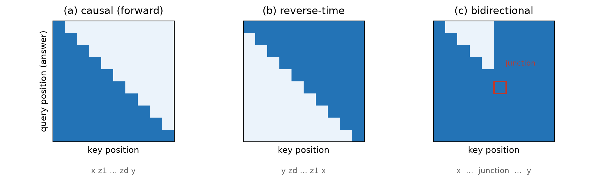

*그림 1. 세 가지 마스크. 질의(행)가 볼 수 있는 키(열)를 진하게 표시했다. (a) 인과 마스크에서 각 걸음은 자기보다 앞만 본다. (b) 시간역전 마스크에서 각 걸음은 자기보다 뒤만 본다. (c) 양방향에서 앞 절반은 뒤를, 뒤 절반은 앞을 보며, 가운데 접합점(빨강)은 양쪽이 공유한다.*


**정의 4 (접힘 과제).** 모수 (m, d, k_d)에 대해 층 t의 상태 수를 K_t = k_d·m^(d−t)로 두고, 각 층의 사상을 정확히 m대1인 무작위 전사로 잡는다. 모든 상태가 앞 층에서 도달 가능하므로 궤적 집합은 m^d개의 잎을 가진 완전한 m진 나무이고, 궤적은 유일하다. 이 과제에서 b^g = b^l = 1(순방향), m(역방향)이며 Δ = d log₂m이다. 정보 축만 켜고 계산 축을 끈 통제 과제다.

# 4. 이론

## 4.1 정보는 언제나 역방향에 불리하다

**정리 1 (조건부 정보 비대칭).** 궤적 Z가 문제 X와 정답 Y를 모두 결정하고(π_X, π_Y가 Z의 함수), X가 Z를 결정한다고 하자. 그러면

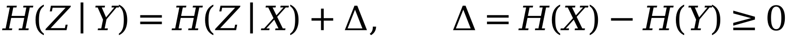


이며, Δ = 0인 것은 궤적 집합 위에서 Y가 X를 결정할 때, 즉 과제가 궤적 위에서 전단사일 때뿐이다.

*증명.* Z가 X와 Y를 결정하므로 H(X|Z) = H(Y|Z) = 0이다. 사슬 법칙 H(Z,X) = H(Z) + H(X|Z) = H(X) + H(Z|X)에서 H(Z|X) = H(Z) − H(X)를 얻고, 같은 방식으로 H(Z|Y) = H(Z) − H(Y)를 얻는다. 두 식을 빼면 결론이 나온다. X → Y가 함수이므로 H(Y) ≤ H(X)이고 등호는 Y가 X를 결정할 때다. □

정리 1은 사슬 법칙의 재배열에 불과하지만, 그 함의가 통념을 뒤집는다. **역방향 조건화는 정보를 더할 수 없다.** 조건화는 언제나 엔트로피를 줄이지만, 역방향이 조건화하는 Y는 순방향이 이미 가진 X의 함수이므로 새로운 정보가 아니다. 잃는 양 Δ는 '정답이 문제에 관해 잃은 정보'이고, 다대일 과제에서 Δ = log₂(충돌도)다. 접힘 과제(m=2, d=6)에서 Δ = 6비트, 즉 역방향은 순방향보다 정확히 64배 넓은 궤적 집합을 상대한다.

사슬 법칙을 걸음별로 쓰면 같은 사실이 더 유용한 형태로 나온다.

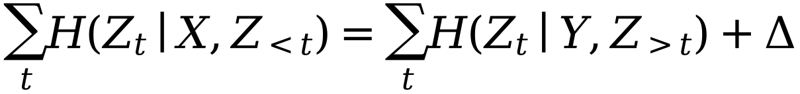


두 방향의 걸음당 불확실성의 **합**이 Δ만큼 다르다. 방향은 총량을 바꾸지 않고 분포만 바꾸는 것이 아니다. 총량 자체가 Δ만큼 다르다. 반대로 Δ=0이면 두 방향의 총량은 같고, 오직 분포만 다르다. 이 경우에만 '순서'가 순수한 계산 문제가 된다.

## 4.2 정보와 폭의 분리

**정리 2 (정보–폭 분리).** 길이 d의 궤적과 그 위의 최대 국소 분기 B^l에 대해

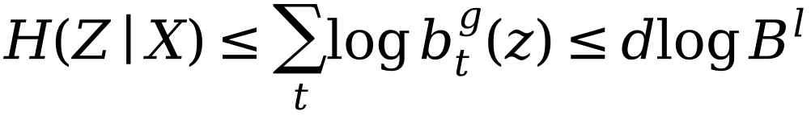


이다. 따라서 B^l ≥ 2^(H(Z|X)/d)이고, 역방향에 대해서는 B^l_r ≥ 2^((H(Z|X)+Δ)/d)다.

*증명.* 조건화는 엔트로피를 줄이므로 H(Z_t|X,Z_(<t)) ≤ H(Z_t|Z_(<t))이고, 후자의 지지집합은 완결 가능한 후속의 집합이므로 크기가 b^(g)_t다. 이산 확률변수의 엔트로피는 지지집합 크기의 로그 이하다. 첫 부등식이 나오고, b^g ≤ b^l에서 둘째가 나온다. 총 엔트로피가 걸음별 합이므로 나머지는 정리 1과 결합하면 된다. □

정리 2의 두 부등식 사이의 간격이 이 논문의 핵심이다.

- 첫 부등식은 **정보**다. 엔트로피는 전역 분기 아래로 내려갈 수 없다. 이 하한은 과제가 정한다.
- 첫째와 둘째 사이, 즉 d log(B^l/B^g)가 **탐색**이다. 국소 분기는 전역 분기보다 클 수 있고, 그 초과분은 '완결성을 검사하지 않으면 보이는 갈래'다. 폭을 키우거나 되돌아가기를 하면 갚을 수 있는 몫이다.

따라서 방향 전환의 이득은 두 가지로 정확히 분해된다. (i) 정보 이득은 Δ만큼 **손해**다. (ii) 탐색 이득은 순방향의 탐색 프리미엄에서 역방향의 탐색 프리미엄을 뺀 값이다. 접힘 과제는 두 프리미엄이 모두 0이므로(그림 6) 정보 축만 남고, 나무 과제는 정보가 0이고 프리미엄이 d log b이므로 계산 축만 남는다.

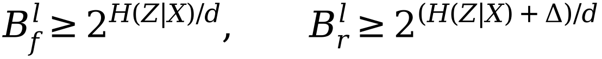


두 하한은 모두 정보가 정하며, 정보가 0이면(유일 궤적) 하한이 자명해져 분기가 무엇이든 자유로워진다. 이것이 '정보 없는 어려운 탐색'에서 방향이 지수적 차이를 만드는 이유다.

## 4.3 역방향 단방향 디코더의 환각 하한

이제 학습된 역방향 디코더가 실제로 무엇을 하는지 본다. 핵심 가정은 대칭성이다.

**정의 5 (교환 가능한 전임자).** 걸음 t에서 궤적의 상태 z_t의 전임자 집합 P_t(z) = w : (w, z_t) ∈ E, w가 x에서 도달 가능의 크기를 m_t라 하자. 주어진 접미사 z_(>t)와 정답 y 아래에서 P_t의 원소들이 교환 가능하면, 즉 어느 것이 참 전임자인지에 대한 사후분포가 P_t 위의 균등분포이면 그 걸음을 **대칭 걸음**이라 한다.

**정리 3 (환각 하한).** 모든 걸음이 대칭이고 디코더가 접미사와 정답만 쓰는 국소 디코더라면, 어떤 (무작위화된) 결정 규칙도 걸음당 정확도 1/m_t를 넘지 못한다. 따라서 궤적 전체의 충실도는

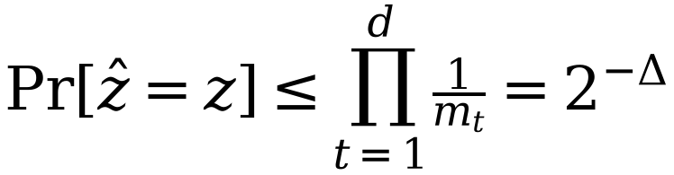


이며, 배출된 궤적은 확률 1로 정답과 일관한다(타당하다). 즉 틀린 궤적의 비율은 1 − 2^(−Δ)이고, 그 궤적들은 전부 '답은 맞히는' 궤적이다.

*증명.* 대칭 걸음에서 참 전임자는 P_t 위의 균등분포를 따르므로, 접미사와 정답에만 의존하는 어떤 결정 규칙의 적중 확률도 1/m_t다(무작위화는 볼록 결합이므로 개선되지 않는다). 걸음들이 궤적의 사슬 구조에 의해 조건부 독립이므로 곱이 된다. 타당성은 구성을 본다. 디코더가 매 걸음 P_t에서 원소를 고르므로, 배출된 사슬 w_d, w_(d−1), …, w_0은 정의상 (w_(t), w_(t+1)) ∈ E를 만족하고 w_d = y다. 그러므로 순방향으로 재생하면 정답에 도달한다. □

이 정리가 불충실한 CoT의 구조를 설명한다. 역방향으로 쓴 추론은 **검증 가능한 것처럼 보인다.** 각 걸음이 정답과 일관하고, 사슬이 끊기지 않으며, 마지막에 문제에 도달한다. 그러나 문제에 도달하는 것은 임의의 전임자를 골라도 되는 일이므로, 그 도달이 '참'이라는 보장은 없다. 정리 3은 그 보장의 크기를 2^(−Δ)로 못박는다.

## 4.4 폭은 로그만큼만 갚는다

정리 3은 폭 1의 디코더에 대한 것이다. 폭 w의 빔을 쓰면 얼마나 회복되는가.

**정리 3' (폭-환각 법칙).** 대칭 걸음 m_t = m이 모든 걸음에서 같고 역방향 전선이 걸음 t에서 최대 min(m^t, w)개의 서로 다른 후보를 유지한다면, 참 궤적이 폭 w의 빔에 남을 확률은

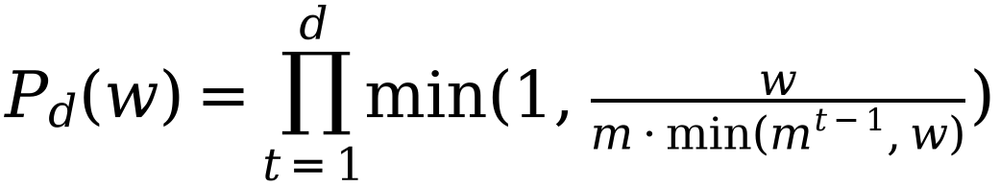


이며, w ≥ m^d일 때만 1이다.

*증명.* 참 접두사가 살아 있다고 조건화하자. 걸음 t에서 전선의 크기는 min(m^(t−1), w)이고, 그 각각이 m개의 전임자를 낳으므로 후보 수는 m·min(m^(t−1), w)다. 폭 w는 그중 w개를 남기므로 참 후보가 남을 확률은 min(1, w/(m·min(m^(t−1),w)))다. 조건부 독립으로 곱한다. w ≥ m^d이면 모든 항이 1이고, w < m^d이면 마지막 항이 1보다 작다. □

정리 3'의 내용을 말로 하면 이렇다. 폭은 **누적 모호성의 로그만큼**을 갚는다. w = 2^k이면 k비트까지이고, 그 너머는 완전 열거(m^d)뿐이다. 5절의 측정은 이 법칙과 세 자리까지 맞는다(표 3).

## 4.5 양방향 접합은 지수를 절반으로 줄인다

**정리 4 (접합에 의한 지수 반감).** 정리 3'의 조건에서, 순방향 전선을 h보 전진시키면 그 경로는 x에 의해 유일하게 결정되므로 접합 상태가 정확히 주어진다. 역방향 전선을 d−h보 전진시켜 접합하면 필요한 폭은 m^(d−h)가 아니라 m^(h)이며, h = ⌈d/2⌉에서 임계 폭이 m^(⌈d/2⌉)로 떨어진다.

*증명.* 순방향은 결정적이므로 접합 상태 s = z_h가 공짜로 주어진다. 역방향 전선이 걸음 d−h에서 상태 s를 포함하면 나머지 앞부분은 순방향으로 재생되어 정확하다. 역방향이 h보 동안 s를 유지할 확률은 정리 3'에서 d를 h로 바꾼 것이고, 그 값이 1이 되는 최소 폭은 m^h다. □

이 정리는 만나기(meet-in-the-middle)의 고전적 이득을 CoT에 옮긴 것이지만, 차이가 하나 있다. 고전적 만나기에서 두 전선은 같은 상태 공간을 공유하므로 접합은 자동이다. 언어모델의 두 방향은 서로 다른 조건화를 배우므로 **접합이 확률적 사건**이고, 그 실패는 두 가지다. 빈 접합(두 전선이 만나지 않음)과 겹친 접합(여러 상태가 만나 어느 것이 참인지 모름)이다.

## 4.6 임계 깊이와 접합의 비용

**정리 5 (임계 깊이).** 후보 생성 하나의 비용을 1, 접합 검사 한 번의 비용을 κ라 하자. 역방향 단독의 비용은 m^d, 접합의 비용은 2m^(⌈d/2⌉) + κ다. 접합이 이기는 것은

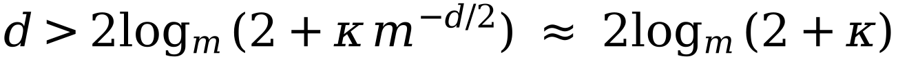


일 때이며, 따라서 임계 깊이는 d* = ⌈2 log_m(2+κ)⌉이다.

*증명.* 부등식 2m^(d/2) + κ < m^d를 m^(d/2)로 나누면 2 + κm^(−d/2) < m^(d/2)이고, 로그를 취해 정리한다. 큰 d에서 m^(−d/2) 항은 사라진다. □

κ=3일 때 d*는 m=2에서 4, m=4에서 2, m=8에서 2다. 얕은 문제에서는 접합이 손해다. 이 정리는 "양방향이 언제나 낫다"는 통념을 기각한다.

**정리 6 (접합의 모호성).** 층 폭 L의 무작위 겹침 그래프에서 두 반쪽 전선이 각각 크기 F, B인 무작위 부분집합이면, 교집합의 크기는 근사적으로 평균 FB/L인 푸아송 분포를 따르고, 유일 접합의 확률은 (FB/L)e^(−FB/L), 빈 접합의 확률은 e^(−FB/L)이다.

*증명.* 각 원소가 두 부분집합에 독립적으로 포함될 확률이 F/L, B/L이므로 포함 사건은 근사적으로 독립이고, 기대 개수는 FB/L다. 희귀 사건의 합은 푸아송으로 근사된다. □

정리 6은 접합의 실패가 **깊이와 함께 급격히 커진다**는 것을 말한다. F와 B는 깊이의 지수로 자라므로(층 폭에서 포화하기 전까지), 평균 교집합은 b^(2h)/L로 자란다. 평균이 1을 넘으면 유일 접합의 확률이 급락한다. 6절의 측정이 이를 확인한다.

# 5. 실험 A: 표본 복잡도의 역전

## 5.1 설계

접힘 과제(정의 4)를 쓴다. 층 수 d와 역방향 분기 m을 바꾸어 Δ = d log₂m을 통제하고, 문제 수는 층 0의 상태 수와 같다(m=1: 64, m=2: 512, m=4: 2048, m=8: 4096). 두 가지 측정을 한다.

- **계산 학습기.** N개의 궤적에서 상태별 조건부를 세어(다수결, 동점은 무작위) 순방향·역방향으로 궤적을 복원한다. 이는 국소 디코더의 **Bayes 최적**이며, 어떤 학습기도 이보다 나을 수 없다. 20개 시드 평균, 시험 궤적 300개.
- **신경 학습기.** 상태 임베딩(16차원) + 걸음 원-핫(8) → ReLU 96 → 상태 로짓의 소형 모형(5만~12만 모수). F, R, R+를 같은 구조·같은 예산·같은 걸음 수(900)로 학습하고 탐욕 디코딩한다. 이는 상한에 실제 최적화기가 닿는지의 확인이다.

## 5.2 결과

**표 1. 접힘 과제의 표본 복잡도(계산 학습기). N은 학습 궤적 수, F/R은 궤적 전체 정확도, R_x는 역방향이 복원한 시작 상태가 참인 비율, 타당은 배출 궤적이 정답과 일관하는 비율.**

| 과제 | Δ(비트) | N | F | R | R_x | 타당 |
|---|---|---|---|---|---|---|
| m=1, d=6 | 0 | 64 | 1.000 | 1.000 | 1.000 | 1.000 |
| m=2, d=6 | 6 | 16 | 0.031 | 0.014 | 0.015 | 0.898 |
| m=2, d=6 | 6 | 256 | 0.502 | 0.015 | 0.015 | 1.000 |
| m=2, d=6 | 6 | 512 | 1.000 | 0.019 | 0.019 | 1.000 |
| m=4, d=4 | 8 | 512 | 0.249 | 0.005 | 0.005 | 1.000 |
| m=4, d=4 | 8 | 2048 | 1.000 | 0.004 | 0.004 | 1.000 |
| m=8, d=3 | 9 | 2048 | 0.501 | 0.003 | 0.003 | 1.000 |
| m=8, d=3 | 9 | 4096 | 1.000 | 0.002 | 0.002 | 1.000 |


표 1과 그림 2가 보여주는 것은 세 가지다.

첫째, **전단사(m=1)에서 두 방향은 구별되지 않는다.** F와 R의 곡선이 모든 N에서 일치하고, 둘 다 N=64(문제 수와 같은 값)에서 1.000이 된다. 정리 1의 Δ=0인 경우이며, 이때 순서는 정보적으로 무의미하다.

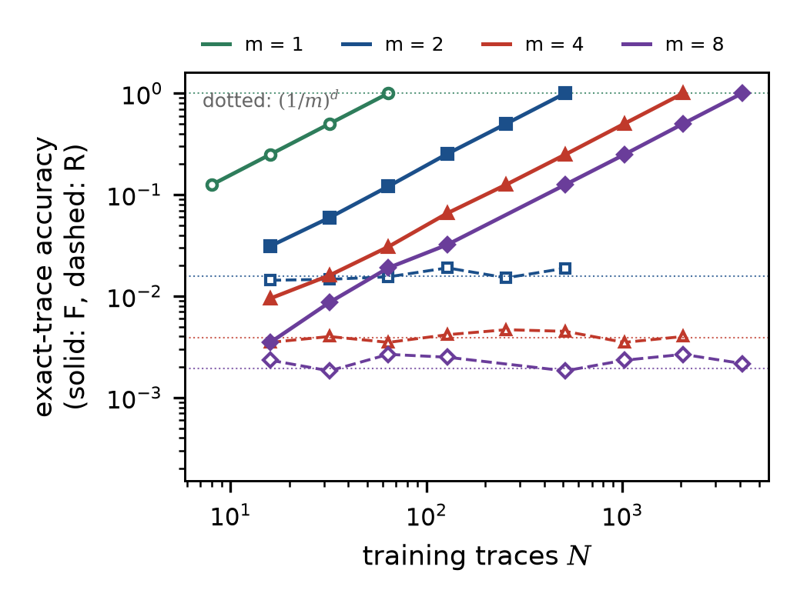

*그림 2. 표본 복잡도. 실선(F)은 커버리지가 차면 1.000에 도달하고, 파선(R)은 데이터를 늘려도 상한에 붙는다. 점선은 (1/m)^d다. m=1(전단사)에서는 두 곡선이 겹친다.*


둘째, **다대일에서 순방향은 커버리지로, 역방향은 상한으로 결정된다.** 순방향은 각 시작 상태를 한 번씩만 보면(m=2: N=512, m=4: N=2048, m=8: N=4096) 1.000이 된다. 정확히 문제 수에서 포화한다. 역방향은 데이터를 32배 늘려도(m=2에서 16→512) 0.0143에서 0.0190 사이에 머문다. 이 값은 정리 3의 상한 (1/2)^6 = 0.0156 근처이고, m=4에서는 0.0040 대 (1/4)^4 = 0.0039, m=8에서는 0.0022 대 (1/8)^3 = 0.00195로 세 자리까지 맞는다.

셋째, **역방향의 오류는 타당하다.** R_x와 R이 거의 같고(복원한 시작 상태가 참인 비율 = 궤적 정확도), 타당은 N ≥ 32에서 1.000이다. 역방향이 내놓는 궤적은 하나도 빠짐없이 정답과 일관하며, 그중 참인 것은 1.5%뿐이다. 정리 3이 예측한 '타당하지만 틀림'의 정확한 실물이다.

**표 2. 신경 학습기의 학습 적합도(자기 학습 궤적에 대한 정확도). 같은 구조·같은 예산, 걸음 수 900, 시드 0.**

| 과제 | 디코더 | N=64 | N=256 | N=512 |
|---|---|---|---|---|
| m=1 | F | 1.000 | 1.000 | 1.000 |
| m=1 | R | 1.000 | 1.000 | 1.000 |
| m=2 | F | 1.000 | 1.000 | 1.000 |
| m=2 | R | 0.100 | 0.075 | 0.000 |
| m=2 | R+ | 1.000 | 1.000 | 1.000 |
| m=2 | R+, 키 절제 | 0.000 | — | 0.000 |


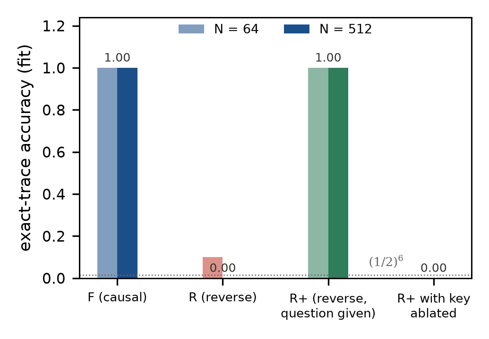

*그림 3. 신경 학습기의 적합도(m=2, d=6). F와 R+는 1.000이지만 R은 (1/2)^6 근처에 머문다. R+의 1.000은 문제 키를 절제하면 0.000이 된다. 즉 암기다.*


표 2의 마지막 두 행이 이 절의 핵심이다. R+(문제를 조건에 함께 준 역방향)는 학습 데이터에 대해 **완벽하게** 맞힌다. 그러나 조건에서 문제 키만 다른 문제의 것으로 바꾸면 정확도가 0.000으로 떨어진다(걸음 정확도 0.196에서 0.208). 완벽한 적합은 역추론이 아니라 **암기**였다. 문제 키는 궤적 하나를 통째로 저장하는 주소였고, 주소가 바뀌면 저장된 것이 없다.

이 대비가 '표본 복잡도 역전'의 정확한 위치를 말한다. 역방향은 순방향보다 **적은** 표본으로 학습되는 것이 아니라, 표본을 아무리 늘려도 상한에 붙는다. 그리고 문제를 조건에 넣어 그 상한을 우회하는 유일한 방법은 문제당 궤적 하나를 저장하는 것이며, 그것은 표본 효율이 아니라 암기다.

# 6. 실험 B: 폭, 깊이, 접합

## 6.1 폭

**표 3. 역방향 빔의 임계 폭(측정)과 정리 3'의 예측. 성공은 참 궤적이 모든 층에서 빔에 남은 비율(300 궤적).**

| 과제 | w=8 | w=16 | w=32 | w=48 | w=64 | 임계 |
|---|---|---|---|---|---|---|
| m=2, d=4 (m^d=16) | 0.477 | 1.000 | 1.000 | 1.000 | 1.000 | 16 |
| m=2, d=6 (m^d=64) | 0.130 | 0.237 | 0.510 | 0.697 | 1.000 | 64 |
| m=4, d=4 (m^d=256) | 0.047 | 0.057 | 0.147 | 0.157 | 0.247 | 256 |


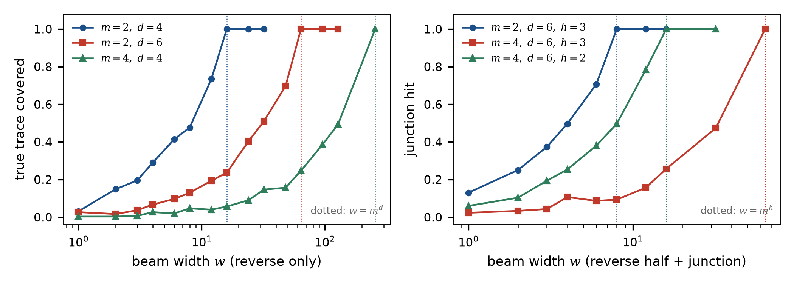

*그림 4. 폭과 접합. 왼쪽: 역방향 단독의 성공률은 w = m^d에서만 1이 된다(점선). 오른쪽: 중간층 접합을 붙이면 h보만 돌므로 임계가 m^h로 내려간다.*


그림 4의 왼쪽과 표 3이 정리 3'를 확인한다. 임계 폭은 정확히 m^d이고, 그 아래에서 성공률은 법칙의 예측과 맞는다. m=2, d=6에서 w=32의 예측은 1/2이고 측정은 0.510, w=48의 예측은 3/4이고 측정은 0.697이다. m=4, d=4에서 w=64의 예측은 1/4이고 측정은 0.247이다.

여기서 중요한 것은 폭이 **정보를 사지 못한다**는 점이다. w=32는 5비트를 갚았고, 남은 1비트는 갚지 못했다. 폭을 두 배로 늘려 6비트를 갚으면 성공률이 1이 된다. 즉 폭의 효용은 로그이고, 필요한 폭은 지수다.

## 6.2 양방향 접합

그림 4의 오른쪽은 접합의 효과를 보여준다. m=4, d=6에서 역방향 단독은 w=4096(= 4^6)에서야 1.000이 되는데(w=1024에서 0.267, w=2048에서 0.533), 중간층(h=3)에서 접합하면 w=64(= 4^3)에서 1.000이 된다. 지수가 6에서 3으로 절반이 되었다(정리 4).

접합의 깊이도 조절 변수다. 같은 과제에서 h=2로 접합하면 w=16(= 4²)에서 1.000이 되고, h=3이면 w=64(= 4³)가 필요하며, h=5에서는 w=64로 0.050에 그친다. 필요한 폭이 정확히 m^h라는 정리 4의 예측과 일치한다. 접합을 얕게 잡으면 더 많은 폭을 내야 하고, 깊게 잡으면 접합 자체가 어려워진다(6.3절).

## 6.3 접합의 실패

**표 4. 겹침 그래프에서 두 반쪽 전선의 접합 통계(200회). L은 층 폭, b는 노드당 간선 수.**

| L | b | d | 평균 교집합 | 유일 | 빈 접합 |
|---|---|---|---|---|---|
| 64 | 3 | 4 | 1.15 | 0.380 | 0.300 |
| 64 | 3 | 6 | 7.29 | 0.040 | 0.045 |
| 64 | 4 | 6 | 24.64 | 0.000 | 0.020 |
| 128 | 4 | 8 | 81.59 | 0.000 | 0.000 |
| 32 | 2 | 10 | 9.53 | 0.000 | 0.185 |


표 4는 접합이 공짜가 아님을 보여준다. 층 폭 64, 분기 3의 그래프에서 깊이 4의 접합은 38.0%에서 유일하고 30.0%에서 비어 있으며, 나머지 32.0%에서 두 개 이상이 만난다. 깊이 6이면 유일한 접합은 4.0%로 떨어진다. 정리 6의 예측대로 평균 교집합이 1을 넘는 순간 유일성은 사라진다. 언어모델의 두 방향 전선이 서로 다른 조건화를 배운다는 점을 생각하면, 실제 접합은 이보다 더 나쁠 것이다. 두 전선이 같은 상태를 가리키려면 두 방향의 표현이 **같은 좌표계**를 써야 하는데, 이를 보장하는 것은 학습 목표에 없다.

## 6.4 나무 탐색: 역방향이 압도하는 경우

**표 5. 유일해를 가진 b진 나무에서 목표 정보 없는 순방향 빔의 성공률. 역방향은 부모 포인터를 따라 d보, 폭 1로 항상 성공한다.**

| b | d | 잎 수 | w=1 | w=64 | w=256 |
|---|---|---|---|---|---|
| 2 | 4 | 16 | 0.025 | 1.000 | 1.000 |
| 2 | 6 | 64 | 0.000 | 1.000 | 1.000 |
| 3 | 6 | 729 | 0.005 | 0.065 | 0.330 |
| 4 | 4 | 256 | 0.000 | 0.290 | 1.000 |
| 4 | 8 | 65536 | 0.000 | 0.000 | 0.000 |


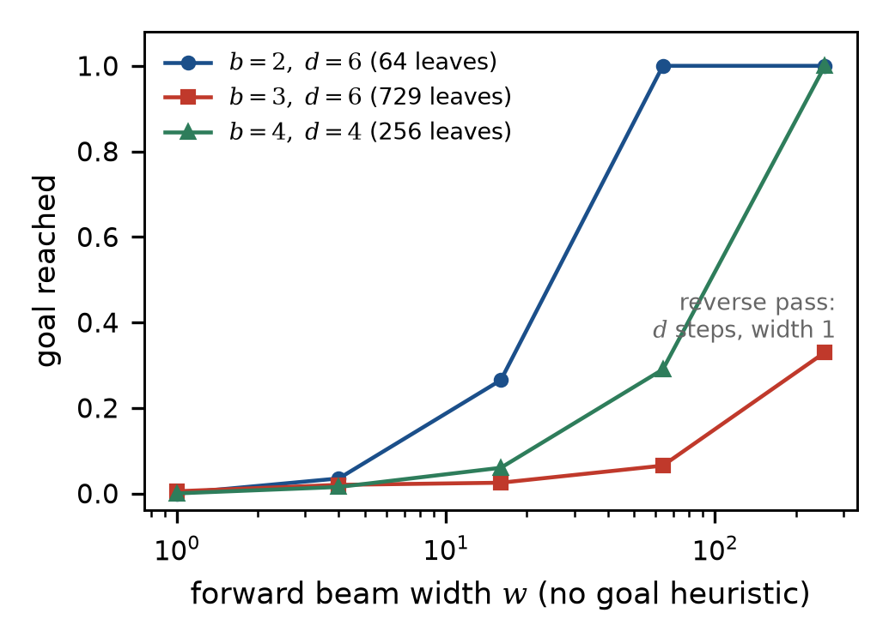

*그림 5. 나무 과제. 잎의 수가 폭의 임계다. 역방향은 같은 과제를 d보, 폭 1로 푼다. 정보 차이는 0이다.*


표 5는 반대 방향의 극단이다. b=4, d=8인 나무에서 잎은 65,536개이고, 목표를 모르는 순방향 빔은 폭 256으로도 한 번도 목표에 닿지 못한다(0.000, 200회). 같은 과제의 역방향은 부모 포인터를 따라 8보, 폭 1로 항상 성공한다. 그리고 이 과제의 Δ는 0이다. 정보는 완전히 같고, 차이는 전부 국소 분기(순방향 b, 역방향 1)다. 정리 2의 '탐색 프리미엄'이 d log₂b = 16비트인 경우다.

# 7. 반례와 기각된 가설

## 7.1 두 개의 반례

**반례 1: "추론은 항상 순방향이 자연스럽다."** 표 5의 나무 과제가 반례다. 순방향은 폭 256으로도 성공률 0.000이고 역방향은 폭 1로 성공률 1.000이다. 더구나 두 방향의 정보량은 같다(Δ=0). 그러므로 "순방향이 자연스럽다"는 명제는 최소한 정보와 무관한 계산 축에서 거짓이다. 자연스러움은 방향의 성질이 아니라 과제의 성질이다.

**반례 2: "역방향이 항상 더 적은 분기를 가진다."** 접힘 과제가 반례다. 역방향의 분기는 걸음마다 m이고 순방향은 1이다. 표 1에서 순방향이 1.000에 도달하는 동안 역방향은 0.019에 머문다. m=8, d=3에서는 0.002다. 두 반례를 나란히 두면 규칙이 보인다. **방향은 분기의 위치를 바꾸고, 어느 쪽이 유리한지는 과제가 정한다.**

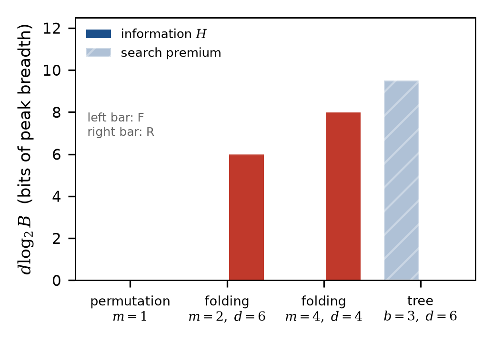

*그림 6. 최대 분기의 비트 수 d log₂B를 정보(채움)와 탐색 프리미엄(빗금)으로 나눈 것. 접힘 과제는 전부 정보, 나무 과제는 전부 프리미엄이다. 두 축이 직교한다.*


그림 6이 두 경우를 한 그림에 둔다. 막대의 높이는 d log₂B(최대 분기의 비트), 채운 부분이 정보 H, 빗금이 탐색 프리미엄이다. 접힘 과제는 막대가 전부 정보이고, 나무 과제는 전부 프리미엄이다. 두 축이 직교한다는 것이 이 그림의 주장이다.

## 7.2 기각된 가설

우리가 먼저 세우고 실험이 기각한 가설을 기록한다.

1. **"역방향은 정보가 같거나 많다."** 기각(정리 1). Δ만큼 **적다.** 조건화 대상이 순방향 조건화의 함수이므로 새 정보가 없다.
2. **"폭을 키우면 역방향의 결핍이 비례해서 메워진다."** 기각(정리 3', 표 3). 폭 w는 log₂w 비트만 갚는다. m=2, d=6에서 w=32는 5비트를 갚고 1비트를 남겨 0.510에 머문다.
3. **"문제를 조건에 함께 주면 역방향이 순방향을 따라잡는다."** 조건부 기각(표 2). 학습 데이터 안에서는 1.000이지만, 문제 키를 절제하면 0.000이다. 따라잡은 것이 아니라 암기했다.
4. **"양방향 접합은 어떤 깊이에서도 이긴다."** 기각(정리 5). κ=3에서 d*는 m=2일 때 4다. d ≤ 3에서는 접합의 고정 비용이 이득을 넘는다.
5. **"중간층 접합은 대개 유일하다."** 강하게 기각(표 4). 층 폭 64, 분기 3, 깊이 6에서 유일 접합은 4.0%다.
6. **"구조 없는 m대1 지도에서도 역방향은 데이터가 늘면 개선된다."** 기각(표 1). m=2에서 N을 16에서 512로 32배 늘리는 동안 0.0143에서 0.0190으로 움직였고, 그 값은 상한 (1/2)^6 근처다.

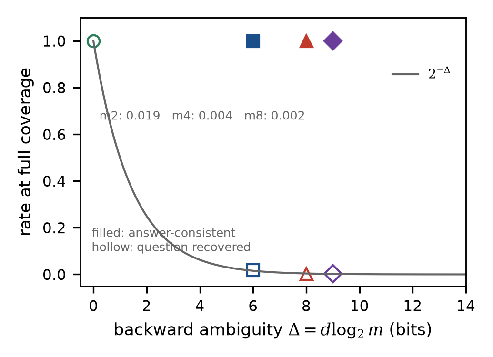

*그림 7. Δ에 대한 충실도(속 찬 표식)와 시작 상태 복원률(빈 표식). 충실도는 어느 과제에서도 1에 가깝고, 복원률은 2^(−Δ)를 따른다. 역방향 궤적은 타당하지만 틀리다.*


한 가지 설계상의 실패도 기록한다. 우리는 처음에 멱사상 z → z^e mod p를 과제로 썼다. 이 과제에서 역방향 정확도가 0.72까지 올라가 정리 3을 반박하는 것처럼 보였다. 원인은 주기 구조였다. 멱사상의 상은 작은 부분군으로 수축하고 그 위에서 순환이 생기므로, 순환의 전임자가 빈도로 예측된다. 즉 그 과제는 대칭 걸음이 아니었다. 우리는 순환이 없는 층별 접힘 과제로 교체했고, 그때 정리 3이 세 자리까지 맞았다. 이 실패는 정리 3의 가정(교환 가능성)이 얼마나 본질적인지를 보여주는 사례로 남긴다. 실제 과제의 구조가 역방향을 국소적으로 결정해 주면 역방향은 잘 작동하며, 그 조건을 확인하지 않고 '방향'만 비교하면 잘못된 결론에 이른다.

# 8. 논의

## 8.1 왜 역방향 자기설명은 그럴듯한가

정리 3의 결론을 다시 쓰면 이렇다. 역방향 궤적은 **정답과의 일관성**이라는 검사를 언제나 통과하고, **문제와의 일관성**이라는 검사를 2^(−Δ)의 확률로만 통과한다. 사람이 읽을 때 하는 검사는 대개 전자다. 답이 맞는가, 각 단계가 앞 단계와 맞는가. 그러므로 역방향 설명은 읽기에 완벽하고 참이 아닐 수 있다. Turpin 등[2]이 관찰한 '그럴듯하지만 오해를 부르는' 설명은 이 구조의 필연적 결과다.

이 진단은 처방도 준다. 역방향 추론을 신뢰하려면 **문제 쪽 끝에서의 접합**을 명시적으로 검사해야 한다. 즉 답에서 출발한 궤적이 마지막에 주어진 문제와 정확히 만나는지, 만난다면 그 접합이 유일한지를 확인해야 한다. 전자는 정리 4의 조건이고 후자는 정리 6의 조건이다.

## 8.2 역전 저주에 대한 재해석

"A는 B다"로 학습한 모델이 "B는 A다"를 못하는 현상[1]은 이 틀에서 자연스럽다. 학습 데이터는 정방향 조건부 p(B|A)만 제공하며, 그 조건부는 A가 B를 결정하지 못하는 정도 Δ를 담지 않는다. 역방향을 배우려면 모델은 Δ비트를 **데이터 밖에서** 만들어야 한다. 문맥 안에 A는 B다가 있으면 만들 수 있다는 관찰은 접합의 효과로 설명된다. 양 끝이 주어지면 Δ는 접합에서 갚아진다(정리 4).

우리 실험의 R+는 이 재해석에 경고를 더한다. 문제를 조건에 넣으면 역방향은 학습 분포에서 완벽해지지만, 그 완벽함은 암기다(표 2). 언어모델이 문맥 안에서 역방향을 잘하는 것은 접합이 실제로 작동하는 경우와, 표면 패턴을 암기한 경우를 구별하지 못한다. Δ를 갚았는지 확인하는 유일한 방법은 **학습 분포 밖의 문제**에서 접합이 성립하는지 보는 것이다.

## 8.3 설계에 대한 함의

이 논문의 결과를 실무 규칙으로 옮기면 네 줄이다.

1. **답을 먼저 쓰게 하려면 검증을 붙여라.** 답 → 역추론은 그 자체로 불충실하다(정리 3). 문제로 돌아오는 접합을 명시적 단계로 넣고, 접합의 유일성을 확인하라(정리 4, 6).
2. **폭은 로그를 산다.** 빔 폭을 두 배로 늘리면 1비트를 더 갚는다. 지수적 결핍을 폭으로 갚으려 하지 말고, 조건을 늘리거나(접합) 과제를 바꿔라(Δ를 줄여라).
3. **양방향은 얕은 문제에서 손해다.** d* = ⌈2 log_m(2+κ)⌉ 아래에서는 단방향이 낫다.
4. **방향을 바꾸기 전에 Δ를 재라.** Δ=0(전단사)이면 방향은 정보적으로 무의미하고, 남는 것은 계산 축뿐이다. 이때는 어느 방향이 국소 분기가 작은지가 유일한 기준이다.

## 8.4 한계

첫째, 우리의 실험은 합성 과제와 소형 모형에 한정된다. 정리들은 궤적의 조합 구조에 대한 것이므로 모형 크기와 무관하지만, **측정된 상수**(예: 접합 비용 κ=3)는 과제와 구현에 의존한다. 둘째, 우리는 궤적이 주어졌다고 가정하고 궤적의 **선택** 문제(어떤 추론 경로가 좋은가)를 다루지 않았다. 셋째, 정리 3의 교환 가능성 가정은 강하다. 실제 과제는 대개 비대칭이며, 7.2절의 멱사상 사례처럼 구조가 역방향을 국소적으로 결정하면 역방향은 잘 작동한다. 비대칭 걸음에 대한 일반화, 즉 주어진 접미사 아래 전임자 분포의 엔트로피로 Δ를 대체하는 형태가 다음 과제다. 넷째, 접합의 두 방향이 같은 좌표계를 쓴다는 보장이 없으므로, 정리 4와 6은 '같은 상태를 가리킬 수 있는' 이상적 접합에 대한 것이다. 실제 접합 오류율은 표 4보다 클 것이다.

# 부록 A. 재현

모든 수치는 다음 파일에서 재현된다.

- src/folding.py: 접힘 과제 생성기(정의 4).
- src/tasks.py: 궤적 생성, 디코더 뷰, 채점.
- src/lm.py: 상태 임베딩 + MLP 소형 모형, Adam, 빔 디코딩.
- src/expA.py: 표 1, 2의 표본 복잡도와 키 절제.
- src/expB.py: 표 3, 4, 5의 폭·접합·나무 탐색.
- src/figs.py, src/eqs.py, build-pdf 스크립트: 그림 7장, 표시수식 7개, 조판.
- results/*.json: 원시 측정값.

```
python3 src/expA.py counting
python3 src/expA.py neural
python3 src/expB.py
python3 src/figs.py && python3 src/eqs.py
python3 src/build_pdf.py paper/paper_build.md paper/paper.pdf TITLE
```


계산 환경은 CPU 2코어, NumPy 2.5, SciPy 1.18, Matplotlib 3.11, ReportLab 5.1이다. 모든 시드는 0부터 고정했고, 표 1의 값은 시드 20개, 표 3~5의 값은 궤적 300개(나무는 200회)의 평균이다. 계산 학습기의 동점 처리는 무작위이며, 그 무작위성까지 시드로 고정했다.

# 부록 B. 기호

**표 6. 기호와 뜻.**

| 기호 | 뜻 |
|---|---|
| X, Y, Z | 문제, 정답, 궤적 |
| d | 궤적의 길이(층 수) |
| m | 역방향 분기, 즉 이미지 점의 전임자 수 |
| Δ | 정보 결손 H(X) − H(Y). 대칭 과제에서 d log₂m |
| b^g, b^l | 전역(완결 가능)·국소(완결 무시) 분기 |
| B, B_f, B_r | 궤적 위 최대 분기, 순방향·역방향 |
| F, R, R+ | 순방향, 역방향, 양끝 역방향 디코더 |
| w | 빔 폭 |
| h | 접합 층 |
| κ | 접합 검사 비용 |
| d* | 접합이 이기는 임계 깊이 ⌈2 log_m(2+κ)⌉ |
| P_d(w) | 폭 w 빔의 궤적 보존 확률(정리 3') |


# 참고문헌

[1] L. Berglund, M. Tong, M. Kaufmann, M. Balesni, A. Stickland, T. Korbak, O. Evans. The Reversal Curse: LLMs trained on "A is B" fail to learn "B is A". ICLR 2024. arXiv:2309.12288.

[2] M. Turpin, J. Michael, E. Perez, S. Bowman. Language Models Don't Always Say What They Think: Unfaithful Explanations in Chain-of-Thought Prompting. NeurIPS 2023. arXiv:2305.04388.

[3] J. Wei, X. Wang, D. Schuurmans, M. Bosma, B. Ichter, F. Xia, E. Chi, Q. Le, D. Zhou. Chain-of-Thought Prompting Elicits Reasoning in Large Language Models. NeurIPS 2022. arXiv:2201.11903.

[4] G. Feng, B. Zhang, Y. Gu, H. Ye, D. He, L. Wang. Towards Revealing the Mystery behind Chain of Thought: A Theoretical Perspective. NeurIPS 2023 (Oral). arXiv:2305.15408.

[5] W. Merrill, A. Sabharwal. The Expressive Power of Transformers with Chain of Thought. ICLR 2024. arXiv:2310.07923.

[6] Z. Li, H. Liu, D. Zhou, T. Ma. Chain of Thought Empowers Transformers to Solve Inherently Serial Problems. ICLR 2024. arXiv:2402.12875.

[7] I. Pohl. Bi-directional Search. Machine Intelligence 6, 127–140, 1971.

[8] E. Horowitz, S. Sahni. Computing Partitions with Applications to the Knapsack Problem. Journal of the ACM 21(2), 277–292, 1974.

[9] W. Diffie, M. Hellman. Exhaustive Cryptanalysis of the NBS Data Encryption Standard. Computer 10(6), 74–84, 1977.

[10] L. R. Rabiner. A Tutorial on Hidden Markov Models and Selected Applications in Speech Recognition. Proceedings of the IEEE 77(2), 257–286, 1989.

[11] B. D. O. Anderson. Reverse-Time Diffusion Equation Models. Stochastic Processes and their Applications 12(3), 313–326, 1982.

[12] J. Sohl-Dickstein, E. Weiss, N. Maheswaranathan, S. Ganguli. Deep Unsupervised Learning using Nonequilibrium Thermodynamics. ICML 2015. arXiv:1503.03585.

[13] J. Ho, A. Jain, P. Abbeel. Denoising Diffusion Probabilistic Models. NeurIPS 2020. arXiv:2006.11239.

[14] N. Dziri, X. Lu, M. Sclar, X. L. Li, L. Jiang, B. Y. Lin, P. West, S. Welleck, C. Bhagavatula, R. Le Bras, J. D. Hwang, S. Sanyal, Y. Choi. Faith and Fate: Limits of Transformers on Compositionality. NeurIPS 2023 (Spotlight). arXiv:2305.18654.

[15] S. Ross, G. Gordon, J. A. Bagnell. A Reduction of Imitation Learning and Structured Prediction to No-Regret Online Learning. AISTATS 2011.

[16] A. Barak, B. Edelman, A. Kalai, T. Kalai. Hidden Progress in Deep Learning: SGD Learns Parities Near the Computational Limit. NeurIPS 2022.

[17] A. Blum, M. Furst, M. Kearns, R. Lipton. Cryptographic Primitives and the Hardness of Learning. Journal of Computer and System Sciences 47(2), 1993.

[18] A. Power, Y. Burda, H. Edwards, I. Babuschkin, V. Misra. Grokking: Generalization Beyond Overfitting on Small Algorithmic Datasets. arXiv:2201.02177, 2022.

[19] Z. Ji, N. Lee, R. Frieske, T. Yu, D. Su, Y. Xu, E. Ishii, Y. Bang, A. Madotto, P. Fung. Survey of Hallucination in Natural Language Generation. ACM Computing Surveys 55(12), 2023.

[20] R. M. Karp. Reducibility Among Combinatorial Problems. In Complexity of Computer Computations, 85–103, 1972.

[21] J. Yao, D. Yu, Z. Zhao, I. Shafran, T. Griffiths, Y. Cao, K. Narasimhan. Tree of Thoughts: Deliberate Problem Solving with Large Language Models. NeurIPS 2023. arXiv:2305.10601.

[22] S. Hao, Y. Gu, H. Ma, J. Hong, Z. Wang, D. Wang, Z. Hu. Reasoning with Language Model is Planning with World Model. EMNLP 2023. arXiv:2305.14992.

[23] X. Wang, J. Wei, D. Schuurmans, Q. Le, E. Chi, S. Narang, A. Chowdhery, D. Zhou. Self-Consistency Improves Chain of Thought Reasoning in Language Models. ICLR 2023. arXiv:2203.11171.

[24] D. Zhou, N. Schärli, L. Hou, J. Wei, N. Scales, X. Wang, D. Schuurmans, C. Cui, O. Bousquet, Q. Le, E. Chi. Least-to-Most Prompting Enables Complex Reasoning in Large Language Models. ICLR 2023. arXiv:2205.10625.

[25] J. Pearl. Causality: Models, Reasoning, and Inference. 2nd ed., Cambridge University Press, 2009.

