# 다중 에이전트 공유 메모리의 자기복제 프롬프트 기생 바이러스 역학과 흉선 면역 어텐션

### 자기-비자기 구분은 왜 복제를 볼 수 없는가 — R_0, 변이, 그리고 위험 신호

허태혁 (Taehyeok Heo) · 2026년 11월

## 초록

여러 에이전트가 하나의 공유 컨텍스트 풀을 읽고 쓰기 시작하면, 그 풀은 더 이상 저장소가 아니라 **숙주 집단**이 된다. 자기복제하는 패턴은 읽힌 자리에서 자신을 다시 쓰고, 쓰인 자리는 다시 읽힌다. 이 논문은 그 순환을 전염병 역학으로 정식화하고, 지금 쓰이는 방어—문자열 블랙리스트—가 원리적으로 무엇을 볼 수 없는지를 정량화한다. 실제 공격 페이로드는 한 줄도 쓰지 않는다. 토큰 배열과 어텐션 가중치만으로 된 추상 모형에서, 기생 패턴의 기본감염재생산수 R_0는 R_0 = N p v/(Wργ) (v=(1-μ)^(n_c)) 꼴로 유도되고, 공유 풀이 포화되는 상전이는 R_0=1에서 일어난다.

첫째, **상전이는 연속이 아니다.** 어텐션이 기생 패턴의 밀도에 따라 더 강하게 끌리는 경우(주파수 점화), 같은 모형에 접힘 분기(saddle-node)가 생겨 R_0=0.77부터 R_0=1까지의 구간에서 두 개의 안정 상태가 공존한다. 이 구간에서 확산 여부는 R_0가 아니라 **초기 접종량**이 결정한다. 이론이 예측한 임계 접종 f_c W = 24개 블록에서 측정값이 정확히 갈렸고(n_0=16 이하 전멸, n_0=64 이상 100% 발병), 히스테리시스 고리도 같은 풀을 이어 돌려 확인했다.

둘째, **정적 서명은 변이 앞에서 무너진다.** 서명 집합 m개, 허용 반경 r의 필터가 임의 변종을 놓칠 확률은 1 - m V_q(w,r)/q^w 이상이며, w=6, r=1에서 ε=1%를 유지하려면 서명이 44,121개 필요하다. 더 결정적으로, 프롬프트 공간의 변이는 대부분 **동의어 치환**이어서 치명률이 0이다. 생물학의 오류 임계(error catastrophe)가 공격자를 막아 주지 못한다. 모형에서 서명 필터는 문장 단위 변이율 0.10 이하에서만 발병을 억제했고, 0.20에서는 방어가 없는 것과 같은 수준(f_∞=0.43)으로 무너졌다.

셋째, **흉선 음성선택은 국소적으로만 작동한다.** 자기 분포로만 학습한 창 단위 판별기는 L_c > θ W_d/(1-1/q)인 삽입만 본다. 측정에서 창 기반 점수는 3토큰 삽입부터 검출했고(검출률 0.88), 같은 오탐 예산의 블록 전체 거리 점수는 6토큰이 되어서야 검출했다(0.99). 그러나 자기 언어로 쓰인 프로그램—운반체와 코어가 모두 자기 표본인 웜—에는 두 점수 모두 **검출률 0**이었다. 자기/비자기 경계는 유해/무해 경계가 아니다.

넷째, **유일하게 완전한 신호는 복제 사건 자체다.** 복제는 위장할 수 없는 행동이다. 카피 충실도 φ인 웜이 생존하려면 R_0^(-1/n_c) < φ여야 하므로, 출처 감시 임계값 θ_p를 그 아래로 잡으면 모든 생존 웜을 잡는다. R_0=7.14, n_c=2에서 예측한 φ_(min)=0.374에서 측정된 발병은 전 변이율에서 0이었고, θ_p=0.90에서는 모든 변이율에서 발병했다.

다섯째, **방어는 양쪽 끝에서 손해다.** 민감도를 자연 변이 규모 아래로 내리면 정상 작업의 71.5%가 격리되어 처리량이 0.285로 떨어졌다—방어하지 않을 때의 0.547보다 나쁘다. 반대로 문턱을 올리면 발병이 돌아온다. 그리고 컨텍스트 창을 키우면 경보는 로그적으로 늦어지지만 피해는 선형으로 커진다(W를 32배로 늘리면 경보까지 24→100스텝, 소모된 감염 블록-스텝 102→5,342).

## Abstract

When several agents read and write one shared context pool, the pool stops being storage and becomes a host population. A self-replicating pattern copies itself wherever it is read, and what is written is read again. This paper formalises that cycle as an epidemic and quantifies what the current defence -- string blacklists -- can and cannot see. No attack payload appears anywhere; the model is integer token arrays and attention weights. Within that model the basic reproduction number is R_0 = N p v/(Wργ) with v=(1-μ)^(n_c), and the shared pool saturates at R_0=1.

First, the transition is not continuous. When attention is pulled more strongly to a pattern as its density grows (frequency priming), the same model acquires a saddle-node fold, and two stable states coexist for R_0 between 0.77 and 1. In that band the outcome is decided by the initial inoculum, not by R_0. The predicted critical seed of 24 blocks separated the measurements exactly (all seeds of 16 or fewer died; seeds of 64 or more always broke out), and a hysteresis loop was reproduced by carrying one pool through a ramp.

Second, a static signature collapses under mutation. A filter with m signatures and Hamming radius r misses a random variant with probability at least 1 - m V_q(w,r)/q^w; at w=6, r=1 this demands 44,121 signatures for a one-percent miss rate. More decisively, most mutation in prompt space is synonymous and carries no fitness cost, so the error catastrophe that limits biological viruses does not protect the defender: the filter contained the strain only below a paraphrase rate of 0.10 and collapsed to the undefended endemic level (0.43) at 0.20.

Third, thymic negative selection works only locally. A window-level discriminator trained on self alone sees an insertion only if L_c > θ W_d/(1-1/q): measured, the windowed score detects a three-token insertion (0.88) while a pooled block distance at the same false-positive budget needs six (0.99). But a program written in the self language -- carrier and core both drawn from self -- is detected by neither, at rate zero. The self/non-self boundary is not the harmful/harmless boundary.

Fourth, the only complete signal is the replication event. Copying is behaviour that cannot be disguised. A replicator of fidelity φ needs φ > R_0^(-1/n_c) to persist, so a provenance threshold below that floor catches every viable worm: at the predicted φ_(min)=0.374 the measured outbreak was zero at every mutation rate, while at a threshold of 0.90 it broke out at every rate.

Fifth, defence is worse than none at both ends. Below the natural variation scale of legitimate work, 71.5% of normal writes are quarantined and throughput falls to 0.285 against an undefended 0.547; above the scale, the epidemic returns. And enlarging the context window delays the alarm logarithmically while multiplying the damage linearly: growing the pool 32-fold moved the alarm from 24 to 100 steps but the burned infected block-steps from 102 to 5,342.

# 1. 서론

한 에이전트가 읽고 쓰는 컨텍스트는 그 에이전트의 기억이다. 여러 에이전트가 같은 컨텍스트를 공유하면 그 기억은 사적인 것이 아니게 되고, 한 번 쓰인 것은 다른 에이전트에 의해 다시 읽힌다. 이 구조가 만드는 위험은 "나쁜 문장이 들어왔다"가 아니라 **"쓰인 것이 다시 쓰인다"**는 것이다. 자기복제 프롬프트 웜은 정확히 이 순환을 이용한다[8,9,10]. 웜은 읽힌 자리에서 자신을 복사해 공유 기억에 다시 쓰고, 그 사본은 다음 에이전트에게 읽힌다. 저장소가 감염 경로가 되는 순간, 문제의 성격은 필터링에서 **역학**으로 바뀐다.

역학으로 문제를 보면 즉시 세 가지 질문이 생긴다. 첫째, 어떤 조건에서 한 번의 주입이 유행이 되는가. 둘째, 그 조건을 문자열 검사로 낮출 수 있는가. 셋째, 낮출 수 없다면 무엇을 보아야 하는가. 이 논문은 세 질문에 각각 정리, 정리, 정리로 답하고, 모든 답을 직접 만든 시뮬레이터로 검증한다.

답의 요지는 다음과 같다. **침투 조건은 R_0로 요약되고, 그 값은 어텐션·복제율·제거율·치명률의 비율이다.** 문자열 필터는 R_0를 낮추는 것이 아니라 **늦춘다**. 자기-비자기 학습은 삽입의 길이가 창 길이보다 길 때만 작동하며, 자기 언어로 쓰인 프로그램에는 원리적으로 눈이 없다. 그리고 유일하게 위장 불가능한 신호는 **복제 사건**이다. 이 마지막 결론은 생물학에서 자기-비자기 모형과 위험 모형(danger model)[18]이 갈라지는 지점과 정확히 같다.

기여는 다섯 가지다.

- **역학적 정식화(3, 4절).** 공유 풀 W, 에이전트 N, 어텐션 온도 τ, 복제율 p, 제거율 γ, 치명률 μ_(lethal)로 이루어진 모형에서 R_0 = N p v/(Wργ) (v=(1-μ)^(n_c))를 유도하고, 포화 상전이의 정확한 고정점과 그 1차/2차 성질을 보인다(정리 1).
- **정적 필터의 한계(4.2절).** 서명 예산의 지수적 요구량, 계보별 검출률 감쇠, 그리고 "지연은 예방이 아니다"를 하나의 정리로 묶는다(정리 2).
- **흉선 면역의 기하학(4.3절).** 창 단위 음성선택의 검출 임계를 삽입 길이의 함수로 주고, 자기 언어 사각지대와 레퍼토리 계산 가능성 조건을 제시한다(정리 3).
- **출처 감시의 충실도 하한(4.4절).** 복제 충실도와 생존 조건만으로 면역 임계값의 상한을 계산해 낸다(정리 4). 이것이 이 논문의 가장 실용적인 결과다.
- **두 개의 반례(5.4절).** 컨텍스트 창 역설과 자가면역 붕괴를 측정으로 확립한다. 둘 다 "방어를 강화하면 좋아진다"는 직관을 깬다.

논문이 주장하지 **않는** 것도 분명히 한다. 첫째, 실제 탈옥·주입 페이로드를 만들지 않았고 만들지 않는다. 모형의 모든 블록은 정수 배열이며, 공격자는 "복제한다"는 행동만 가진다. 둘째, 이 모형은 LLM의 실제 토크나이저나 어텐션 헤드를 재현하지 않는다. W=1024 블록, L=32 토큰, q=12 알파벳은 계산 가능한 최소 모형이고, 결론은 그 모형 안에서 정확히 참이다. 셋째, 측정된 임계값은 파라미터에 의존한다. 우리가 주장하는 것은 특정 수치가 아니라 **수치들 사이의 관계**—임계 접종량이 W f_c이고, 검출 하한이 θ W_d/(1-1/q)이며, 면역 임계값 상한이 R_0^(-1/n_c)이라는 관계—다.

# 2. 배경과 위치

## 2.1 프롬프트 주입에서 자기복제 웜까지

간접 프롬프트 주입은 검색된 문서나 도구 출력 안의 지시가 모델의 행동을 바꾸는 공격이다[7]. Perez와 Ribeiro[11]는 그 변형을 체계화했고, Zou 등[12]은 정렬된 모델에서도 보편적 적대 접미사가 전이됨을 보였으며, Wei 등[13]은 안전 학습이 실패하는 두 가지 이유를 제시했다. Hubinger 등[14]은 훈련 중에 심어진 행동이 안전 훈련을 통과해 남는 현상을 보고했다. 이 문헌들이 공통으로 다루는 것은 **한 모델 안의 한 번의 실패**다.

다중 에이전트로 시야를 넓힌 결과는 더 최근이다. Greshake 등[7]이 지적한 "연결된 응용 프로그램"의 위험은 Cohen 등[8]에서 RAG 기반 응용 생태계를 타고 퍼지는 제로클릭 웜(Morris II)으로 구체화됐다. Lee와 Tiwari[9]는 에이전트 사이의 프롬프트 감염을, Gu 등[10]은 한 장의 이미지가 백만 에이전트로 지수적으로 퍼지는 현상을 보고했다. 세 결과 모두 전파가 **연결 구조**를 탄다는 것을 보여 주지만, 전파의 조건을 재생산수로 요약하거나 방어의 정보적 한계를 계산하지는 않는다. 이 논문은 그 자리를 채운다.

## 2.2 전염병 역학과 준종

R_0의 정의는 Diekmann 등[2]의 다음 세대 연산자 고유값으로 정리되어 있다. Kermack–McKendrick[1]의 질량작용 모형은 포화 상전이의 원형이고, Anderson–May[3]와 Nowak–May[4]는 바이러스 역학에서 같은 구조를 다룬다. 이 논문의 정리 1은 이 표준 결과를 어텐션 가중 경합이 있는 풀에 옮긴 것이며, 새로운 것은 어텐션 비율 ρ가 감염력에 곱해진다는 점이다.

바이러스 쪽에서 더 중요한 것은 Eigen의 준종(quasispecies) 이론[5]이다. 돌연변이율이 임계값을 넘으면 유전 정보가 붕괴한다—오류 임계(error catastrophe)다. 우리 모형에서 이 임계는 μ_c = 1-2^(-1/n_c)로 나타나고(n_c는 기능에 필수인 코어 위치 수), n_c=4일 때 μ_c=0.159다. 측정에서 방어가 없는 발병은 μ=0.25에서 0이 되었다. 그런데 **프롬프트 공간에서는 이 임계가 방어자의 편이 아니다.** 동의어 치환은 문자열을 바꾸지만 기능을 바꾸지 않으므로 치명률이 0이고, 공격자는 오류 임계에 닿지 않고 서명을 피할 수 있다. 5.2절이 이 비대칭을 측정한다.

후진 분기(backward bifurcation)는 역학에서 오래 알려진 현상이다. Hadeler와 van den Driessche[6]는 치료 포화가 R_0<1에서도 풍토병 상태를 남긴다는 것을 보였다. 이 논문의 정리 1(b)는 같은 수학을 어텐션 점화에서 얻는다.

## 2.3 인공 면역: 자기-비자기와 위험

Forrest 등[15]은 바이러스 탐지를 자기 문자열과 일치하지 않는 검출기를 생성하는 문제로 바꿨다. Hofmeyr와 Forrest[16]는 이를 분산 침입 탐지 시스템으로 구현했고, Stibor 등[19]은 해밍 공간 위의 음성선택이 이상 탐지기로서 적절한지 비판적으로 검토했다. Perelson과 Weisbuch[17]는 면역계의 계산적 모형을 정리했다.

이 계열의 핵심 가정은 "자기 = 안전, 비자기 = 위험"이다. Matzinger[18]의 위험 모형은 이 가정을 거부한다. 면역계는 외부성(foreignness)이 아니라 조직 손상에서 나오는 위험 신호에 반응한다는 것이다. 이 논문의 4.4절과 5.6절은 그 주장을 계산으로 옮긴다. 자기 언어로 쓰인 웜은 비자기가 아니므로 자기-비자기 판별기는 침묵하고, 복제라는 **행동**만이 위험 신호로 남는다.

## 2.4 어텐션과 끌림

어텐션은 쿼리와 키의 내적으로 가중치를 만들고 온도 τ가 그 분포의 날카로움을 정한다[20]. 현대 홉필드 네트워크로서의 해석[21]은 어텐션을 연상 기억의 검색으로 읽고, Amit 등[22]의 스핀글라스 결과는 저장된 패턴이 얼마나 많은 잡음을 견디는지를 말해 준다. 이 논문이 쓰는 것은 그 이론이 아니라 가장 단순한 사실 하나다. **어떤 패턴의 점수가 다른 패턴보다 Δ만큼 높으면, 그 패턴의 어텐션 점유율은 밀도의 함수가 된다.** 기생 패턴은 정확히 이 점유율을 통해 복제한다.

# 3. 모형

## 3.1 풀, 에이전트, 블록

공유 컨텍스트 풀은 W개의 블록으로 이루어지고, 각 블록은 길이 L의 토큰 배열이다. 토큰은 크기 q의 알파벳에서 뽑는다. 정상 작업 블록("자기")은 K개의 템플릿 중 하나에 토큰별 잡음 ν를 더해 만든다. 잡음은 문장이 조금씩 달라지는 정상적 변이를 뜻한다. 확률 π로 정상 블록은 템플릿 없이 자유 형식으로 만들어진다—사용자가 붙여 넣은 인용, 새 과제, 표와 코드 조각이 여기에 해당한다. 이 π는 뒤에서 자가면역 비용의 원천이 된다.

N개의 에이전트가 매 스텝 풀에서 블록 하나를 읽는다. 읽힌 블록이 기생 블록이면 확률 p로 자식을 하나 쓴다. 쓰기는 임의의 슬롯을 덮어쓴다. 동시에 정상 작업의 쓰기가 매 스텝 γ W개 슬롯을 새 정상 블록으로 갱신한다. γ는 풀의 회전율이며, 기생 블록의 기대 수명은 1/γ다.

표 1에 기호와 기준값을 모았다. 기준 R_0는 N p v/(Wργ) = 3.29다(v=(1-μ)^(n_c)=0.922).

**표 1. 모형의 기호와 기준값 (달리 적지 않은 실험은 이 값을 쓴다)**

| 기호 | 값 | 의미 |
|---|---|---|
| W | 1024 | 풀 크기(블록 수) |
| L | 32 | 블록 길이(토큰) |
| q | 12 | 토큰 알파벳 크기 |
| K | 32 | 자기 템플릿 수 |
| ν | 0.04 | 토큰별 정상 변이율 |
| π | 0.05 | 자유 형식 정상 블록의 비율 |
| L_c, c_(pos) | 8, 12 | 코어 길이와 위치 |
| n_c | 4 | 치명 위치 수(코어 앞 4개) |
| N | 64 | 에이전트 수 |
| p | 1.0 | 읽힘당 복제 확률 |
| ρ | 0.35 | 어텐션 이점 비율 |
| b | 0 또는 8 | 밀도 점화 계수 |
| γ | 0.05 | 회전율(제거율) |
| μ | 0.02 | 토큰별 파괴적 변이율 |
| μ_(syn) | 0 또는 변수 | 토큰별 동의어 변이율 |
| θ | 0.30 | 창 기반 판별 임계값 |
| θ_p | 0.75 | 출처(복제 충실도) 임계값 |

## 3.2 기생 블록: 운반체와 코어

기생 블록은 **운반체**와 **코어**로 이루어진다. 운반체는 정상 분포에서 뽑은 토큰이고, 코어는 길이 L_c의 프로그램 토큰이며 고정된 위치 c_(pos)에 삽입된다. 이 분해는 실제 현상의 최소 표현이다. 주입 문장은 대부분 정상적인 맥락 속에 짧은 지시로 숨어 있다. 운반체는 매 세대 자기 분포에서 다시 그려지고, 코어만 유전된다. 즉 웜이 전달하는 것은 문장이 아니라 **프로그램**이다.

복제는 코어를 부모에서 복사하며 토큰마다 확률 μ로 다른 토큰으로 바뀐다. 코어 앞 n_c개 위치는 기능에 필수다. 그중 하나라도 바뀌면 자식은 복제 능력을 잃고 불활성 쓰레기가 된다. 따라서 치명률은 μ_(lethal) = 1-(1-μ)^(n_c)이고, 생존 확률은 v=(1-μ)^(n_c)다. 동의어 변이율 μ_(syn)은 문자열만 바꾸고 기능은 유지한다—자연어의 바꿔 쓰기, 즉 **기능이 보존되는 변이**의 추상이다. 이 채널이 있는 한 오류 임계는 방어자의 무기가 되지 못한다.

## 3.3 어텐션과 점화

에이전트는 스텝마다 블록 하나를 어텐션 분포에서 뽑는다. 정상 블록의 점수는 평균 0, 분산 1이고 기생 블록은 Δ만큼 높다. 온도 τ의 소프트맥스에서 기생 블록의 점유율은

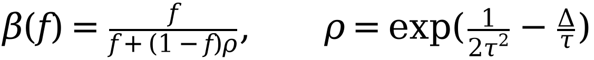

이다. ρ는 "같은 수의 블록이 있을 때 정상 블록 하나가 기생 블록 하나보다 받는 가중치의 비"다. ρ<1이면 기생 패턴이 어텐션에서 이기고 있고, τ → ∞(균등 어텐션)이면 ρ → 1이다. Δ=2일 때 ρ=0.35는 τ ≈ 1.6에 해당한다. 주목할 것은 **어텐션을 뜨겁게 하면 R_0가 1/ρ에 비례해 내려간다**는 것이다. 어텐션 온도는 미적 취향이 아니라 역학 파라미터다.

여기에 밀도 점화를 넣는다. 반복 노출이 그 패턴의 현저성을 키우는 효과—같은 문장이 문맥에 여러 번 나오면 모델이 그 문장을 이어 쓸 가능성이 올라가는 현상—를 점수 보너스 b f로 모형화하면 β(f) = f/(f+(1-f)ρ e^(-bf))가 된다. b=0이면 선형 어텐션이고, b>0이면 밀도가 높을수록 그 패턴이 더 끌린다. 4.1절이 보이듯 이 하나의 항이 상전이의 차수를 바꾼다.

## 3.4 세 층의 면역

이 논문은 세 가지 방어를 같은 풀 위에서 비교한다.

**정적 서명(선천 면역).** 초기 균주 코어의 창 하나를 서명으로 저장하고, 쓰이는 블록의 모든 창을 훑어 해밍 거리 r 이내면 차단한다. 실제 블랙리스트 필터의 최선의 경우다—정확한 서명, 자기 블록에 대한 오탐 0.

**창 기반 음성선택(적응 면역).** 자기 표본만 보고 각 오프셋 o마다 자기 창 집합을 만든다. 점수는 블록의 어느 창이 자기 창과 가장 다른 정도다.

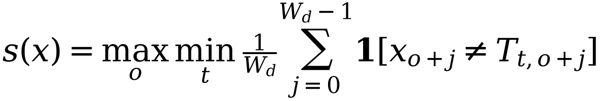

s(x)>θ면 격리한다. 창 W_d가 "에피토프"이고, 판별기는 자기 창만으로 학습되므로 훈련 자기에는 오탐이 없다. 비교를 위해 창을 쓰지 않는 **블록 전체 거리** 판별기도 같은 실험에 넣는다.

**출처 감시(위험 모형).** 쓰인 블록이 읽힌 블록과 얼마나 같은지를 본다. 자식과 부모의 최고 창 일치율이 θ_p 이상이면 복제 사건으로 판정한다. 내용은 보지 않는다.

모든 실험은 시드 2~5개를 평균하며, 각 조건은 1,200~4,000 스텝을 돌린다. 코드와 원자료는 재현을 위해 함께 배포된다(부록 A).

# 4. 이론

## 4.1 정리 1 — R_0와 상전이

**정리 1.** 기생 블록 수 n, f=n/W에 대해 평균장 방정식은

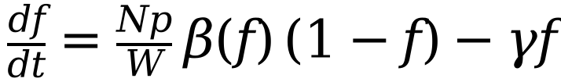

이고 다음이 성립한다. (a) R_0 = N p v/(Wργ), v=(1-μ)^(n_c)이며 R_0 ≤ 1이면 f=0이 전역 안정이다. (b) b=0일 때 양의 고정점은 유일하고

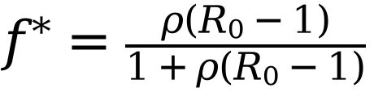

이며 R_0=1에서 연속적으로 태어난다(transcritical). df^(∗)/dR_0|_(R_0=1) = ρ. (c) b>0이면 f의 함수

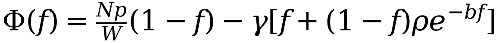

가 비단조가 되어 접힘이 생긴다. Φ(f_c)=Φ'(f_c)=0인 R_c<1이 존재하고, R_c<R_0<1에서 f=0과 f^(∗)>f_c가 동시에 안정이다. 초기 접종이 Wf_c보다 작으면 전멸하고 크면 발병한다.

*증명.* (a) β(f)/f → 1/ρ (f→0)이므로 침투율은 Np/(Wρ)이고 제거율은 γ다. 비율이 R_0다. f>0에서 df/dt < 0임을 보이려면 β ≤ f와 1-f≤ 1을 쓰면 충분하다. (b) f>0에서 정상상태 조건은 R_0ρ(1-f) = f+(1-f)ρ이고 정리하면 f^(∗)를 얻는다. f^(∗)는 R_0=1에서 0이고 미분계수는 ρ이므로 2차 상전이다. (c) Φ(0)=γρ(R_0-1)<0, Φ(1)=-γ<0이고 b가 크면 중간에서 Φ>0이 된다. 연속함수의 부호 변화가 두 번 일어나므로 근이 두 개이고, 작은 근에서 Φ'>0(불안정), 큰 근에서 Φ'<0(안정)이다. 두 근이 만나는 접힘에서 R_c가 정해진다. □

기준 파라미터(ρ=0.35, γ=0.05, b=8)에서 접힘은 R_c=0.767, f_c=0.102다. 즉 R_0가 0.77까지 내려가도 풀의 10%를 먹는 안정 상태가 남는다. R_0=0.90에서 두 근은 f_c=0.023과 f^(∗)=0.194이고, 임계 접종량은 Wf_c = 23.5개 블록이다. 5.1절의 측정이 이 값을 그대로 확인한다.

정리 1은 "재생산수를 1 아래로 내려라"는 통상 처방에 두 가지 단서를 붙인다. 첫째, 1 아래로 내리는 것만으로는 부족하고 R_c 아래로 내려야 한다. 둘째, R_0<1에서도 초기 접종량이 임계를 넘으면 발병한다. 다중 에이전트 시스템에서 "초기 접종"은 한 번의 주입이 아니라 **한 세션에서 같은 패턴이 몇 번 반복되는가**다. 같은 지시를 여러 번 붙여 넣는 것이 단일 주입보다 위험한 이유가 여기에 있다.

## 4.2 정리 2 — 정적 서명의 한계

**정리 2.** 알파벳 크기 q, 창 길이 w, 해밍 반경 r의 서명 m개로 이루어진 필터를 생각하자. (a) 균등 임의 변종이 검출될 확률은 m V_q(w,r)/q^w 이하이고, 따라서 놓칠 확률은 1-mV_q(w,r)/q^w 이상이다. ε 이하의 놓침률을 얻으려면 m ≥ (1-ε)q^w/V_q(w,r)이 필요하다. (b) 세대 g의 계보에 대한 검출률은 [1-(1-F_r(w,1-(1-μ)^g))^(L_c-w+1)]로 근사되고, 검출률이 절반이 되는 세대는 g^(∗) ≈ r/(wμ)다. (c) 필터는 R_0를 낮추지 않는다. 반경 r을 넘은 사본은 완전한 적합도를 가지므로, 필터가 하는 일은 발병을 T ≈ 1/(Npβ p_(esc))만큼 늦추는 것이다.

*증명.* (a) 반경 r의 해밍 공은 V_q(w,r)=∑_(i≤ r)C(w,i)(q-1)^i개 점을 덮는다. 서명 m개의 합집합은 mV_q개를 넘지 않으므로 합집합 상계가 성립한다. (b) g세대 뒤 토큰 하나가 조상과 다를 확률은 p_g=1-(1-μ)^g이고, 창 하나가 검출될 확률은 F_r(w,p_g)다. 창 L_c-w+1개를 독립으로 근사하면 주어진 식이 나온다. F_r ≈ 1에서 멀어지는 조건 wp_g ≈ r에서 g^(∗) ≈ r/(wμ)다. (c) 검출은 쓰기 시점에만 일어나므로 이미 쓰인 사본은 계속 읽힌다. 반경을 넘은 사본의 자식도 반경을 넘으므로 그 계보의 R_0는 필터 이전과 같다. 필터는 새 계보의 출현률 p_(esc)를 곱할 뿐이다. □

정리 2(a)의 수치는 방어 설계에서 곧바로 쓰인다. w=6, r=1이면 V_q=1+6·11=67이고 q^w=12^6=2.99×10^6이므로, 놓침률 1%를 유지하려면 서명이 44,121개 필요하다. 기준 모형의 필터는 서명이 하나이므로 그 예산의 4만 분의 1이다.

정리 2(b)는 5.2절 그림 3(a)에서 이론과 측정이 5% 이내로 일치한다. 정리 2(c)는 이 논문에서 가장 오해되기 쉬운 부분을 정확히 한다. 정적 필터는 "막는다"가 아니라 "늦춘다". 그리고 늦추는 시간은 p_(esc)에 반비례하므로, 변이율이 조금만 올라가도 지연은 사라진다. 5.2절의 붕괴 곡선이 그 소실을 보여 준다.

## 4.3 정리 3 — 창이 보는 것과 보지 못하는 것

**정리 3.** 자기 창 집합 {T_t}에 대한 점수 s(x)를 쓰자. (a) 운반체가 자기 표본이고 길이 L_c의 코어가 삽입된 블록에 대해, 코어가 어떤 자기 창과도 다르면

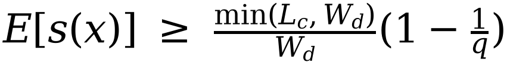

이므로 min(L_c,W_d) > θ W_d/(1-1/q)일 때 검출된다. (b) x가 자기 블록 자체이면 s(x)=0이고 어떤 θ>0에서도 검출되지 않는다. 자기 분포가 지시문을 포함하는 한, 지시문으로 표현된 복제 프로그램은 (a)의 조건을 만족해도 자기와 구별되지 않는다. (c) 허용 반경 θ W_d의 공으로 창 공간 q^(W_d)를 덮으려면 q^(W_d)/V_q(W_d,⌊θ W_d⌋)개의 검출기가 필요하다. W_d=8, q=12, θ=0.3이면 약 1.2×10^5개로 계산 가능하지만, 블록 전체 L=32에서는 12^(32)≈10^(34)로 불가능하다.

*증명.* (a) 코어와 겹치는 창은 m=min(L_c,W_d)개 위치에서 자기 토큰과 다르고, 각 위치가 우연히 같은 확률은 1/q다. 기대 불일치 비율은 m(1-1/q)/W_d이고 s는 창에 대한 최댓값이므로 기대값이 그 이상이다. (b) 정의상 s는 자기 창과의 최소 거리이므로 자기 블록에서 0이다. (c) 공 하나가 덮는 점의 수는 V_q이고, 전체를 덮으려면 점 수를 공 크기로 나눈 만큼 필요하다. □

정리 3의 세 부분은 서로 다른 처방을 낳는다. (a)는 창을 국소화하라는 것이고—블록 전체를 평균하면 짧은 삽입이 희석된다. (b)는 국소화로도 해결되지 않는 잔여 구멍이 있다는 것이고, (c)는 창을 충분히 짧게 잡아야 레퍼토리가 계산 가능해진다는 것이다. 세 조건이 만나는 폭이 W_d≈8이다. 창이 이보다 길면 (a)의 검출 하한이 커지고, 짧으면 (c)의 검출기 수가 줄지만 정상 변이와의 구별이 어려워진다.

## 4.4 정리 4 — 출처 감시의 충실도 하한

**정리 4.** 복제 충실도 φ=1-μ인 웜이 기본 재생산수 R_0^((0))(방어 없음)에서 생존하려면 φ^(n_c) R_0^((0)) > 1, 즉 φ > φ_(min) = (R_0^((0)))^(-1/n_c)이어야 한다. 출처 감시의 임계값이 θ_p ≤ φ_(min)이면 생존 가능한 모든 웜이 모든 변이율에서 검출된다. 반대로 θ_p > φ_(min)이면 n_c < ln R_0^((0))/ln(1/θ_p)인 웜은 생존하면서 통과한다.

*증명.* 생존 조건은 vR_0^((0))>1이고 v=φ^(n_c)다. 생존하는 웜의 사본은 부모의 프로그램 창과 적어도 φ 비율로 일치하므로, 감시 점수는 φ 이상이다. θ_p≤φ이면 임계를 넘어 검출된다. 역으로 n_c가 작으면 φ_(min)이 작아져 θ_p보다 낮은 충실도로도 생존할 수 있고, 그 사본은 임계 아래에 있으므로 통과한다. □

정리 4는 면역 임계값을 **웜의 프로그램 길이와 기본 재생산수에서 계산**하게 해 준다. R_0^((0))=7.14, n_c=2이면 φ_(min)=0.374이고, n_c=4이면 0.727이다. 즉 프로그램이 길수록 더 높은 충실도가 필요하고, 따라서 더 쉽게 잡힌다. "웜이 길면 눈에 띈다"는 통상 직관과는 다른 방향의 논거다—길면 **문자열**로도 눈에 띄지만, 무엇보다 **복제 충실도**에서 눈에 띈다. 5.6절의 측정이 θ_p=0.375에서 전 변이율 0, θ_p=0.75에서 변이율 0.15 이상 발병을 보여 이 상한을 확인한다.

## 4.5 명제 — 밀도 학습이 지지집합보다 강하다

**명제 1.** 자기 분포 P_S와 오탐 예산 α가 주어졌을 때, P_S에서 α 이하로 발동하는 어떤 판별기의 검출력도 우도비 검정을 넘지 못한다. 지지집합만 아는 판별기는 자기 지지집합의 내부에 예산을 쓰지 않으므로, 자기 분포가 비균등할 때 같은 α에서 더 낮은 검출력을 얻는다.

*증명.* Neyman–Pearson 보조정리에 의해 검정력은 우도비의 단조 변환이다. 지지집합 판별기는 자기 내부에서 점수가 0이므로 내부의 확률 질량을 전혀 구별하지 못하고, 그만큼 비자기 쪽에 쓸 수 있는 임계 여유를 잃는다. □

이 명제는 실험이 아니라 정의에서 나오지만, 5.4절의 자가면역 곡선이 그대가를 정량화한다. 자기 내부를 전혀 구별하지 못하는 판별기는 자연 변이와 삽입을 구별하지 못하므로, 민감도를 올리는 유일한 방법이 정상 변이까지 격리하는 것이다.

## 4.6 명제 — 컨텍스트 창 역설

**명제 2.** 밀도 θ_a에서 발동하는 경보를 쓰면, 초기 접종 n_0, 성장률 λ에 대해 경보까지의 시간은 T_(inc) = λ^(-1)ln(θ_a W/n_0)이고, 그때까지 소모된 감염 블록-스텝은 ∫ n dt ≈ θ_a W T_(inc)/2다. 따라서 W를 키우면 경보는 로그적으로 늦어지고 피해는 선형으로 커진다.

*증명.* n(t)=n_0e^(λ t)이고 n(T)=θ_a W에서 T를 풀면 첫 식이다. 적분은 지수 함수의 적분으로 θ_a W/λ 규모이며 W에 선형이다. □

이 명제는 "문맥을 많이 주면 더 잘 지킨다"는 감각을 뒤집는다. 밀도 경보는 **상대적**이므로 풀이 커질수록 더 많은 절대량이 감염된 뒤에야 울린다. 5.4절은 W를 32배로 늘렸을 때 경보가 24→100 스텝으로 늦어지고 소모가 102→5,342 블록-스텝으로 커지는 것을 측정한다.

# 5. 결과

## 5.1 상전이와 임계 접종

그림 1(a)는 p를 0.05에서 1.0까지 스윕하며 측정한 풍토병 수준과 정리 1(b)의 곡선을 겹친 것이다. R_0>2.5에서는 차이가 0.02 이내이고, 문턱 근처에서는 측정값이 이론보다 낮다. 그 이유는 그림 1(b)에 있다. R_0가 1을 조금 넘는 구간에서 발병은 확률적이다. R_0=1.15에서 5회 중 2회, R_0=1.32에서 3회, R_0=2.14에서 4회가 발병했고, 나머지는 전멸했다. 평균만 보고하면 "문턱 근처에서 발병이 약하다"고 오독하게 되지만 실제로는 **발병 아니면 전멸**의 두 갈래다. 실무적 함의는 분명하다. R_0가 1을 살짝 넘는 시스템은 "조금 위험한" 것이 아니라 "동전 던지기"다.

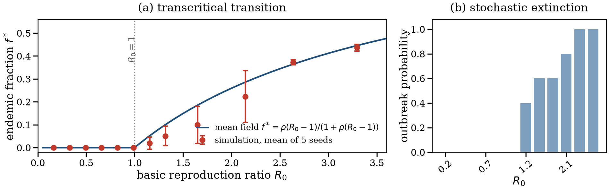

*그림 1. (a) R_0에 대한 풍토병 수준. 파란 선은 정리 1(b)의 f^(∗), 점은 5시드 평균과 표준편차다. (b) 문턱 근처 발병은 확률적이다—같은 조건에서 발병과 전멸이 갈린다.*

표 2에 수치를 정리했다. R_0=0.99에서 발병은 0/5, R_0=3.29에서 f^(∗)=0.445와 측정 0.437이 일치한다.

**표 2. R_0 스윕 (W=1024, N=64, ρ=0.35, γ=0.05, 5시드)**

| p | R_0 | f^(∗) (이론) | f_∞ (측정) | 생존율 |
|---|---|---|---|---|
| 0.10 | 0.33 | 0.000 | 0.000 ± 0.000 | 0/5 |
| 0.20 | 0.66 | 0.000 | 0.000 ± 0.000 | 0/5 |
| 0.30 | 0.99 | 0.000 | 0.000 ± 0.000 | 0/5 |
| 0.35 | 1.15 | 0.051 | 0.020 ± 0.027 | 2/5 |
| 0.40 | 1.32 | 0.100 | 0.051 ± 0.043 | 3/5 |
| 0.50 | 1.65 | 0.185 | 0.099 ± 0.081 | 3/5 |
| 0.65 | 2.14 | 0.285 | 0.223 ± 0.114 | 4/5 |
| 0.80 | 2.64 | 0.364 | 0.373 ± 0.011 | 5/5 |
| 1.00 | 3.29 | 0.445 | 0.437 ± 0.014 | 5/5 |

그림 2는 정리 1(c)를 검증한다. (a)에서 초기 접종 n_0를 1에서 128까지 늘리면 발병 확률이 n_0≈24에서 계단처럼 바뀐다. 이론값 Wf_c=23.5와 일치한다. n_0≤16은 3시드 모두 전멸했고 n_0≥64는 모두 발병해 f_∞≈0.18에 도달했으며, 이는 R_0=0.90의 안정 근 0.194와 맞는다. (b)는 같은 풀을 램프 위로 올렸다가 아래로 내리며 측정한 히스테리시스다. 작은 접종으로 올라가는 가지만 보면 R_0=0.90까지 발병이 없지만, 감염된 풀을 끌고 내려오는 가지는 R_0=0.79에서도 f_∞=0.133을 유지한다. R_0=0.69에서야 둘 다 0이 된다. 이것이 접힘의 실체다.

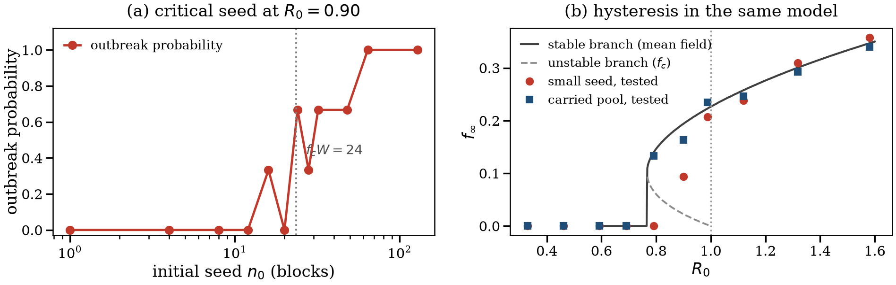

*그림 2. (a) R_0=0.90에서 초기 접종량의 임계. 점선은 Wf_c=24. (b) 히스테리시스. 회색 실선은 안정 가지, 점선은 불안정 가지(f_c), 점은 측정이다.*

## 5.2 정적 서명이 무너지는 방식

그림 3(a)는 한 계보의 검출률이 세대에 따라 떨어지는 것을 보여 준다. μ=0.02에서 20세대까지 0.81, 40세대에서 0.18이고, μ=0.08에서는 11세대에 0.13까지 떨어진다. 이론 곡선은 창의 독립 근사를 쓰기 때문에 초기 감쇠를 조금 빠르게 예측하지만(최대 0.08 차이), g^(∗) ≈ r/(wμ) 스케일은 그대로다.

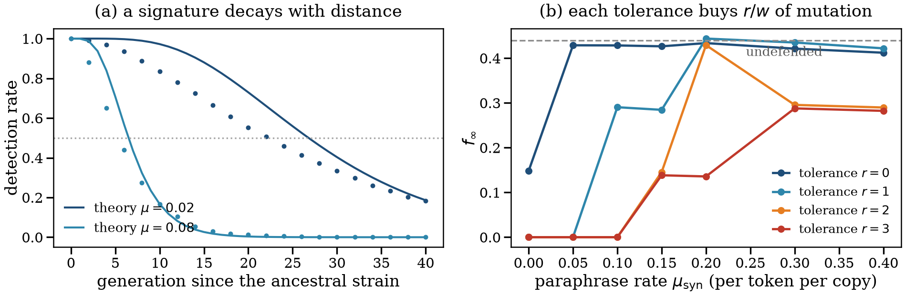

*그림 3. (a) 조상 균주로부터의 세대에 따른 정적 필터 검출률. 선은 정리 2(b)의 근사, 점은 계보 4,000개의 몬테카를로. (b) 동의어 변이율에 대한 풍토병 수준. 허용 반경 r마다 붕괴 문턱이 한 칸씩 밀린다.*

그림 3(b)가 이 절의 핵심이다. 서명 필터를 최선의 조건—정확한 서명 하나, 정상 블록 오탐 0—으로 두고 동의어 변이율만 올리면, 발병은 r=0에서 0.05, r=1에서 0.10, r=2에서 0.15, r=3에서 0.20에 갑자기 나타나고, 그 위에서는 방어가 없는 것과 같은 f_∞=0.43에 도달한다. 허용 반경 r은 정확히 r개 토큰만큼의 변이 여유를 사고, 그 여유가 소진되는 순간 필터는 존재하지 않는 것과 같아진다. 문턱의 간격이 약 0.05인 것은 1/w≈0.125 규모의 이산화 효과다.

여기서 생물학과의 결정적 차이가 드러난다. 생물학에서는 변이율이 올라가면 치명률이 함께 올라 오류 임계에서 바이러스가 죽는다. 프롬프트 공간에서는 바꿔 쓰기가 기능을 유지하므로 그 제동이 없다. 표 3은 허용 반경을 정할 때의 오탐 비용을 보여 준다. 창 폭 6에서 r=2는 정상 블록의 1.5%를 오탐하고 r=3은 27%를 오탐한다. 즉 실무에서 감당 가능한 r은 1~2이고, 그 여유는 그림 3(b)에서 0.10~0.15의 변이율에 해당한다.

**표 3. 정적 필터의 허용 반경과 정상 블록 오탐률 (자기 표본 6,000개)**

| 창 폭 | r=0 | r=1 | r=2 | r=3 | r=4 |
|---|---|---|---|---|---|
| w=6 | 0.0000 | 0.0002 | 0.0152 | 0.2717 | 0.9197 |
| w=8 | 0.0000 | 0.0000 | 0.0000 | 0.0045 | 0.0682 |

## 5.3 눈은 국소적이어야 한다

그림 4(a)는 같은 시험 집합에서 세 판별기의 작동 곡선을 비교한다. 시험 집합은 조상 균주에서 5세대 변이한 코어 1,500개(양성)와 정상 블록 5,000개(음성)다. 곡선 아래 면적은 블록 전체 거리 0.976, 창 기반 0.975, 정적 서명 0.841로 앞의 둘이 비슷하다. 차이는 **작동 구간의 폭**과 **짧은 삽입**에서 나온다. 창 기반은 θ∈[0.15,0.60] 전체에서 검출률 0.99 이상을 유지하는 반면, 블록 전체 거리는 θ∈[0.15,0.20]의 좁은 구간에서만 그 수준에 닿는다. 임계값을 4배 범위에서 아무렇게나 잡아도 되는 판별기와 1.3배 안에서만 맞는 판별기는 운영에서 다르다.

더 근본적인 차이는 그림 4(b)다. 삽입 길이 L_c를 1에서 16까지 늘리며 검출률을 재면, 창 기반(θ=0.30)은 3토큰에서 0.88, 4토큰에서 0.98로 올라가고, 블록 전체 거리(θ=0.15, 오탐 5.2%로 맞춤)는 5토큰에서 0.88, 6토큰에서 0.99가 된다. 정리 3(a)의 예측 경계 L_c=θ W_d/(1-1/q)=2.6과 4.4가 각각의 상승 위치와 맞는다. 블록 전체를 평균하면 8토큰짜리 삽입이 32토큰 블록에서 0.25의 거리로 희석되고, 그 0.25는 정상 자유 형식 블록의 거리와 겹친다. **어텐션이 긴 구간을 평균할수록 면역은 짧은 프로그램을 못 본다.**

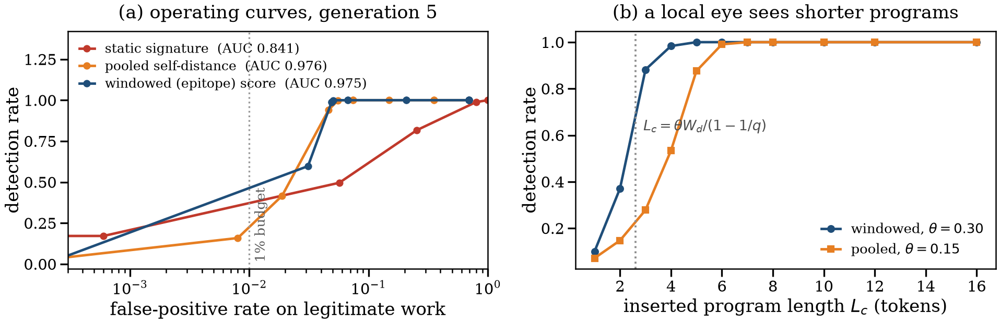

*그림 4. (a) 세 판별기의 작동 곡선. 세로 점선은 1% 오탐 예산. (b) 삽입 길이에 대한 검출률과 정리 3(a)의 경계.*

## 5.4 두 반례

### 컨텍스트 창 역설

W를 256에서 8,192까지 32배 늘리되 블록당 감염 압력이 일정하도록 에이전트 수를 비례해 늘렸다(N=64· W/1024). 그러면 R_0와 성장률은 변하지 않는다. 밀도 2%에서 발동하는 경보까지의 시간은 24, 44, 40, 43, 70, 100 스텝이었고, 로그 맞춤은 19ln W-85다(그림 5a). 명제 2의 예측대로 로그적이다. 그러나 그때까지 소모된 감염 블록-스텝은 102, 246, 492, 901, 2,305, 5,342로 W에 거의 선형으로 커진다(그림 5b). W가 32배가 되는 동안 시간은 4배, 피해는 52배가 됐다.

더 나쁜 것은 경보 시점의 균주 다양성이다. 경보 시점의 구별되는 균주 수는 W=256에서 1, W=8192에서 평균 19.3이었고, 최빈 균주의 점유율은 1.00에서 0.72로 떨어졌다(표 4). 즉 큰 풀에서는 경보가 울릴 때 이미 28%가 최빈 균주가 아니다. 경보 시점에 학습한 서명 하나로 잡을 수 있는 비율이 72%라는 뜻이고, 나머지는 잡으려면 허용 반경을 키워야 하며, 그 허용 반경은 5.2절에서 본 대로 변이 여유를 내주는 값이다.

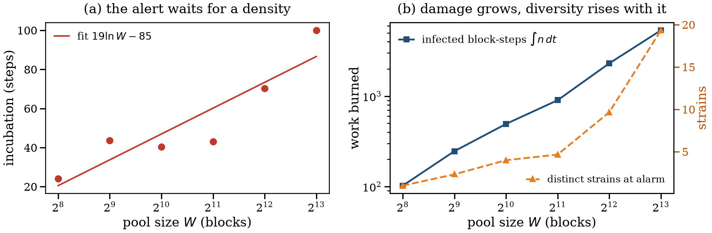

*그림 5. 컨텍스트 창을 키울 때. (a) 경보까지의 시간은 로그적으로 늘고, (b) 소모된 감염 블록-스텝은 선형으로, 경보 시점의 균주 다양성은 함께 커진다.*

**표 4. 컨텍스트 창 크기에 대한 경보 특성 (밀도 경보 2%, 3시드)**

| W | N | 경보(스텝) | 감염 블록-스텝 | 균주 수 | 최빈 점유율 |
|---|---|---|---|---|---|
| 256 | 16 | 24.0 | 102 | 1.0 | 1.00 |
| 512 | 32 | 43.7 | 246 | 2.3 | 1.00 |
| 1024 | 64 | 40.3 | 492 | 4.0 | 1.00 |
| 2048 | 128 | 43.0 | 901 | 4.7 | 0.93 |
| 4096 | 256 | 70.3 | 2,305 | 9.7 | 0.77 |
| 8192 | 512 | 100.0 | 5,342 | 19.3 | 0.72 |

### 자가면역 붕괴

창 기반 판별기의 임계값 θ를 0.02에서 0.90까지 훑었다(그림 6). θ≤0.10에서는 정상 블록의 71.5%가 격리되어 처리량 U=(1-α)(1-f)가 0.285로 떨어진다. 방어하지 않을 때의 0.547보다 **나쁘다**. θ=0.125∼0.20에서 오탐이 21.6%로 줄어 U=0.784, θ=0.40∼0.60에서 오탐 5%(자유 형식 블록의 몫)와 발병 0으로 U=0.95의 최적 지대가 나온다. θ≥0.70이면 웜이 통과해 U가 0.57로 되돌아간다.

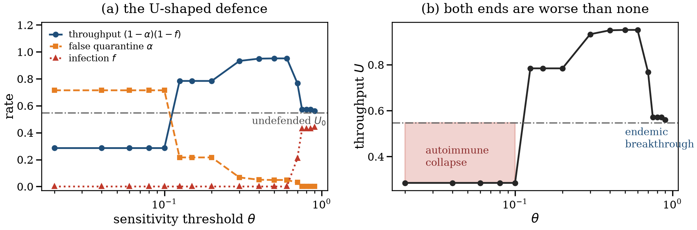

*그림 6. 민감도에 대한 처리량. (a) 오탐 α, 발병 f, 처리량 U. (b) 방어 없음(U_0=0.547)보다 나쁜 두 구간.*

이 곡선의 모양은 명제 1의 직접적 결과다. 자기 내부를 구별하지 못하는 판별기에서 민감도를 올리는 유일한 방법은 정상 변이까지 후보로 올리는 것이고, 그 비용은 선형이 아니라 계단으로 온다—창 폭 8에서 거리 격자가 1/8이므로 θ를 0.125 아래로 내리는 순간 정상 블록 한 토큰 변이까지 걸린다. 최적 지대의 폭은 4배(θ 0.15~0.60)이고, 그 폭이 이 설계의 실제 여유다.

## 5.5 변이율의 최적화와 오류 임계

웜의 변이율은 양날이다. 올리면 서명을 피하고, 내리면 기능을 지킨다. 그림 7(a)에서 방어가 없을 때 발병은 μ에 단조 감소해 μ=0.25에서 0이 된다(오류 임계 μ_c=0.159 부근에서 급감). 반면 정적 서명 아래에서는 μ≤0.05에서 0, μ=0.12에서 0.179로 **최대**, μ=0.20에서 다시 0이 된다. 공격자에게 최적인 변이율이 존재하고, 그 값은 방어의 허용 반경과 치명률의 곱으로 정해진다. 그림 7(b)는 같은 데이터를 R_0(μ)=R_0v(μ)에 대해 그린 것으로, 측정값이 평균장 곡선을 따른다.

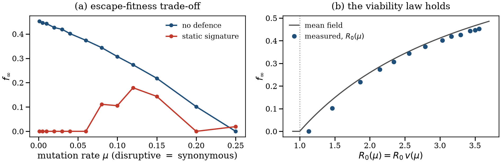

*그림 7. (a) 변이율에 대한 발병. 정적 서명 아래에서 중간 변이율이 최적이다. (b) 생존율 법칙의 검증: 측정된 풍토병 수준이 R_0(μ)의 평균장 곡선을 따른다.*

## 5.6 문자열 면역의 끝, 출처 감시

그림 8(a)가 이 논문의 전환점이다. 두 종류의 웜을 같은 방어에 걸었다. **외래 코어** 웜은 무작위 프로그램을 가지고, **자기 언어** 웜은 운반체와 코어를 모두 같은 자기 템플릿에서 가져온다. 방어가 없을 때 둘은 거의 같다(0.424 대 0.445). 창 기반 내용 면역은 외래 코어를 완전히 막지만(0.000) 자기 언어 웜에는 **전혀** 듣지 않는다(0.450). 정리 3(b)의 실측이다. 출처 감시는 둘 다 막는다(0.000, 0.000). 오탐은 각각 6.7%, 5.0%이고, 둘을 함께 쓰면 11.5%다.

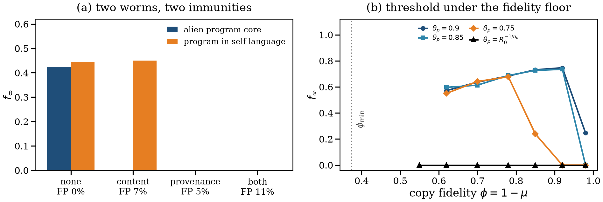

*그림 8. (a) 외래 코어와 자기 언어 코어에 대한 세 방어. 막대 아래 숫자는 정상 작업 오탐률. (b) 출처 임계값과 복제 충실도. φ_(min)=R_0^(-1/n_c) 아래로 잡으면 모든 생존 웜이 잡힌다.*

그림 8(b)는 정리 4의 검증이다. R_0^((0))=7.14, n_c=2에서 φ_(min)=0.374다. θ_p=0.375로 잡으면 복제 충실도 0.55에서 0.98까지 전 구간에서 발병이 0이었다. θ_p=0.75는 충실도 0.92 이상만 잡고, θ_p=0.90은 어떤 충실도에서도 놓친다(발병 0.25~0.75). 프로그램이 긴 경우도 같다. n_c=4, R_0^((0))=3.57이면 φ_(min)=0.727이고, θ_p=0.72에서 전 변이율 0, θ_p=0.75에서 변이율 0.15 이상 발병이었다. 표 5가 요구 검출기 수와 측정 결과를 함께 정리한다.

**표 5. 출처 임계값과 요구 프로그램 길이 (R_0^((0))=7.14)**

| θ_p | 요구 n_c > ln R_0/ln(1/θ_p) | 측정된 발병 | 판정 |
|---|---|---|---|
| 0.90 | 18.7 | 충실도 0.55~0.98 전 구간 발병 | 실패 |
| 0.85 | 12.1 | 충실도 0.98에서만 차단 | 실패 |
| 0.75 | 6.8 | 충실도 0.92 이상 차단 | 부분 |
| 0.375 | 1.98 | 전 구간 차단 | 성공 |

이 결과의 의미는 "출처 감시를 쓰자"가 아니다. 더 정확히는, **문자열 수준 면역의 실패는 취향의 문제가 아니라 정보의 문제**라는 것이다. 웜이 자기 언어로 쓰이면 문자열에는 아무 이상이 없다. 남는 정보는 "이 블록이 읽힌 블록의 복사본이다"라는 관계뿐이고, 그 관계는 위장하려면 복제 충실도를 낮추는 수밖에 없으며, 충실도를 낮추면 정리 4가 말하는 생존 하한에 걸린다. 방어자는 그 하한을 계산해 임계값을 정할 수 있다.

## 5.7 종합

표 6은 세 방어를 비용과 효과로 정리한다. 정적 서명은 오탐이 0이지만 변이 앞에서 무너지고, 창 기반 내용 면역은 외래 프로그램을 잘 잡지만 자기 언어에 눈이 멀며, 출처 감시는 두 경우 모두 잡지만 정상적인 인용까지 오탐한다(5%). 셋을 겹치면 오탐이 11.5%로 오르고, 이는 자가면역 곡선의 최적 지대(5%)를 이미 넘는다. 따라서 겹치기는 공짜가 아니며, 어느 층을 쓸지는 **오탐 예산과 웜의 프로그램 길이**로 정해진다.

**표 6. 세 방어의 비용과 효과 (기준 모형)**

| 방어 | 오탐 | 외래 코어 | 자기 언어 | 붕괴 조건 |
|---|---|---|---|---|
| 정적 서명 | 0.0% | 차단 | 차단 | 변이율 > r/w (0.05~0.20) |
| 내용(창) | 6.7% | 차단 | 0.450 | 삽입 L_c<θ W_d |
| 출처 | 5.0% | 차단 | 차단 | θ_p>φ_(min) |
| 내용+출처 | 11.5% | 차단 | 차단 | 두 조건의 교집합 |

# 6. 논의

## 6.1 설계 원칙

측정에서 바로 나오는 원칙은 여섯 가지다.

첫째, **R_0를 지표로 삼는다.** 공유 메모리의 건강 상태는 차단 건수가 아니라 R_0=Npv/(Wργ)다. 이 값이 1에 가까우면 시스템은 "조금 위험"한 것이 아니라 확률적으로 발병하는 상태다(5.1절).

둘째, **경보는 밀도가 아니라 절대 개수로 건다.** 밀도 경보는 창이 커질수록 늦는다(명제 2, 5.4절). "풀의 2%"가 아니라 "감염 블록 20개"처럼 절대량으로 걸면 창 크기와 무관해진다.

셋째, **판별기는 창 수준에서 한다.** 블록 전체를 평균하면 짧은 프로그램이 희석된다(5.3절). 창 폭은 검출 하한 θ W_d/(1-1/q)과 레퍼토리 크기 q^(W_d)의 곱으로 정해지고, 기준 모형에서 8이 그 교점이다.

넷째, **임계값은 자기 변이 규모 위에 둔다.** 자연 변이보다 민감한 판별기는 정상 작업을 격리하고, 그 비용은 방어의 이득보다 크다(5.4절).

다섯째, **복제 사건을 센다.** 문자열은 위장되지만 복사 관계는 위장되지 않는다(5.6절). 출처 감시의 임계값은 θ_p ≤ R_0^(-1/n_c)로 계산해 둘 수 있다.

여섯째, **자기 표류를 감시한다.** 자기 분포는 시간에 따라 변한다. 새 과제 유형이 들어오면 어제의 자기와 오늘의 자기 사이에 거리가 생기고, 그 거리는 자가면역 오탐으로 나타난다. 자유 형식 블록의 비율 π는 방어의 오탐 하한을 직접 정한다(기준 모형에서 5%).

## 6.2 생물학적 유비의 한계

이 논문은 역학과 면역을 은유로 쓰지 않고 계산 도구로 쓴다. 그렇기 때문에 유비가 깨지는 지점을 분명히 해야 한다.

첫째, **치명률의 구조가 다르다.** 생물학에서는 대부분의 변이가 해롭고, 그래서 오류 임계가 종의 확장을 제한한다. 프롬프트 공간에서는 바꿔 쓰기가 기능을 보존한다. 5.2절의 붕괴는 그 차이에서 나온다. 역학의 직관을 그대로 옮기면 방어자는 "변이율이 높으면 웜이 죽는다"고 기대하지만, 그 기대는 여기서 성립하지 않는다.

둘째, **자기와 지시가 겹친다.** 생물학의 자기에는 "명령"이 없다. 에이전트 시스템의 자기에는 지시문이 들어 있고, 에이전트는 지시를 따른다. 그래서 지시로 쓰인 웜은 자기와 구별되지 않는다(정리 3b). 이것은 모형의 결함이 아니라 **문제의 성질**이다. 자기-비자기 패러다임이 다중 에이전트 보안에 그대로 적용되지 않는 이유가 여기에 있다.

셋째, **세대 시간이 다르다.** 생물학의 세대는 시간 스케일이 있지만, 여기서는 읽기 한 번이 한 세대다. 그래서 변이와 확산이 같은 스텝에서 일어나고, 5.4절의 "경보 시점의 다양성"처럼 두 과정이 뒤섞인다.

## 6.3 한계

모형은 의도적으로 작다. 실제 토크나이저, 실제 어텐션 헤드, 실제 LLM의 지시 준수 성향을 재현하지 않는다. 정리들의 증명은 모형 안에서 엄밀하지만, 모형에서 실제 시스템으로의 사상은 별도의 경험 문제다.

측정의 한계도 있다. 발병 확률은 시드 3~5개의 평균이고, 문턱 근처에서는 분산이 크다(표 2). 5.2절의 붕괴 곡선에서 r=2, μ_(syn)=0.15의 값은 3회 중 1회 발병으로, 실제 문턱은 그보다 조금 높을 수 있다. 우리가 인용한 모든 임계값에는 이런 불확실성이 붙어 있고, 정확한 수치보다 경향과 스케일이 주장의 대상이다.

공격자 모형도 단순하다. 웜은 운반체를 매 세대 다시 그리지만 코어는 고정 위치에 둔다. 실제 웜은 코어를 여러 위치로 옮기거나 문장 사이에 흩을 수 있다. 그 경우 창 기반 검출은 위치를 모르므로 모든 오프셋을 봐야 하고, 오탐이 늘어난다. 이 확장은 모형에 이미 들어 있는 오프셋 스캔으로 다룰 수 있지만, 우리는 실험하지 않았다.

# 7. 결론

공유 컨텍스트를 쓰는 순간 에이전트 시스템은 하나의 숙주 집단이 된다. 그 집단의 건강은 세 숫자로 요약된다. 재생산수 R_0, 접힘의 문턱 R_c, 그리고 복제 충실도의 하한 φ_(min). 이 논문은 세 숫자를 유도하고 측정했다.

문자열 블랙리스트는 R_0를 낮추지 않는다. 그것은 시간을 살 뿐이고, 프롬프트 공간의 변이는 기능을 잃지 않으므로 그 시간은 짧다. 자기-비자기 학습은 국소적으로는 강력하지만, 자기 언어로 쓰인 프로그램 앞에서 원리적으로 침묵한다. 남는 것은 복제라는 행동이다. 복제는 위장할 수 없고, 위장하면 기능을 잃는다. 방어자가 계산해야 할 것은 문자열의 목록이 아니라 **웜이 감당할 수 있는 충실도의 하한**이다.

역학이 이 문제에 주는 가장 값진 것은 경보의 형태다. "차단 0건"은 안전의 증거가 아니다. R_0<1도, 오탐 0%도, 창을 키우는 것도 안전의 증거가 아니다. 안전은 발병의 조건이 계산되어 있고, 그 조건이 임계값보다 낮게 유지되고 있다는 사실이다.

# 부록 A. 시뮬레이터

풀은 (W,L) 정수 배열이다. 각 스텝은 다음 순서로 진행된다.

1. 기생 블록 수 n에서 β = f / (f + (1-f)ρ e^(-bf))를 계산하고, Bin(N,β p)만큼의 읽기가 복제를 일으킨다.
2. 각 복제는 부모 코어를 복사하며 μ로 파괴적 변이, μ_(syn)으로 동의어 변이를 넣는다. 필수 위치가 변이하면 자식은 버려진다. 운반체는 자기 분포에서 다시 그린다.
3. 쓰기 시점 면역이 자식을 검사해 차단한다(정적 서명: 창 스캔, 내용: 창 거리, 출처: 부모와의 창 일치).
4. γ W개 슬롯을 새 정상 블록으로 갱신한다. 자유 형식 블록은 확률 π로 만들고, 인용 쓰기는 확률 π_(quote)로 기존 블록을 복사한다.
5. 지표를 기록한다: f, 균주 수, 다양성, 차단 수, 오탐 수.

난수는 시드별로 고정되어 있고, 모든 그림과 표는 src/exp1.py에서 src/exp11.py까지의 출력 JSON에서 직접 만들어진다. 사용한 라이브러리는 NumPy와 Matplotlib뿐이다.

# 부록 B. 수치 검증

평균장 근사의 정확도는 5.1절 표 2에 있다. R_0>1.6에서 상대 오차는 3% 이내이고, 문턱 근처에서는 확률적 멸종 때문에 평균이 이론보다 낮다. 확률적 멸종은 결함이 아니라 모형의 성질이므로, 우리는 평균과 함께 생존율을 보고한다.

창 점수의 이산성은 두 곳에서 중요하다. 첫째, 거리 격자가 1/W_d이므로 θ를 그 사이에 두면 결과가 같다(5.4절의 계단). 둘째, 출처 점수도 1/W_d 격자이므로 θ_p가 0.65와 0.75 사이에 있으면 같은 판정을 낸다. 표 5의 요구 n_c는 격자를 고려하지 않은 연속 근사이므로, 실제로는 θ_p를 격자 아래로 잡아야 한다.

# 참고문헌

[1] W. O. Kermack and A. G. McKendrick, "A contribution to the mathematical theory of epidemics," Proceedings of the Royal Society A, vol. 115, no. 772, pp. 700–721, 1927.

[2] O. Diekmann, J. A. P. Heesterbeek, and J. A. J. Metz, "On the definition and the computation of the basic reproduction ratio R_0 in models for infectious diseases in heterogeneous populations," Journal of Mathematical Biology, vol. 28, no. 4, pp. 365–382, 1990.

[3] R. M. Anderson and R. M. May, Infectious Diseases of Humans: Dynamics and Control. Oxford University Press, 1991.

[4] M. A. Nowak and R. M. May, Virus Dynamics: Mathematical Principles of Immunology and Virology. Oxford University Press, 2000.

[5] M. Eigen, "Selforganization of matter and the evolution of biological macromolecules," Naturwissenschaften, vol. 58, no. 10, pp. 465–523, 1971.

[6] K. P. Hadeler and P. van den Driessche, "Backward bifurcation in epidemic control," Mathematical Biosciences, vol. 146, no. 1, pp. 15–35, 1997.

[7] K. Greshake, S. Abdelnabi, S. Mishra, C. Endres, T. Holz, and M. Fritz, "Not what you've signed up for: Compromising real-world LLM-integrated applications with indirect prompt injection," in Proceedings of the 16th ACM Workshop on Artificial Intelligence and Security (AISec), 2023. arXiv:2302.12173.

[8] S. Cohen, R. Bitton, and B. Nassi, "Here comes the AI worm: Unleashing zero-click worms that target GenAI-powered applications," arXiv:2403.02817, 2024.

[9] D. Lee and M. Tiwari, "Prompt infection: LLM-to-LLM prompt injection within multi-agent systems," arXiv:2410.07283, 2024.

[10] X. Gu, X. Zheng, T. Pang, C. Du, Q. Liu, Y. Wang, J. Jiang, and M. Lin, "Agent Smith: A single image can jailbreak one million multimodal LLM agents exponentially fast," arXiv:2402.08567, 2024.

[11] F. Perez and I. Ribeiro, "Ignore previous prompt: Attack techniques for language models," arXiv:2211.09527, 2022.

[12] A. Zou, Z. Wang, N. Carlini, M. Nasr, J. Z. Kolter, and M. Fredrikson, "Universal and transferable adversarial attacks on aligned language models," arXiv:2307.15043, 2023.

[13] A. Wei, N. Haghtalab, and J. Steinhardt, "Jailbroken: How does LLM safety training fail?" in Advances in Neural Information Processing Systems (NeurIPS), 2023. arXiv:2307.02483.

[14] E. Hubinger et al., "Sleeper agents: Training deceptive LLMs that persist through safety training," arXiv:2401.05566, 2024.

[15] S. Forrest, A. S. Perelson, L. Allen, and R. Cherukuri, "Self-nonself discrimination in a computer," in Proceedings of the IEEE Symposium on Security and Privacy, pp. 202–212, 1994.

[16] S. A. Hofmeyr and S. Forrest, "Architecture for an artificial immune system," Evolutionary Computation, vol. 8, no. 4, pp. 443–473, 2000.

[17] A. S. Perelson and G. Weisbuch, "Immunology for physicists," Reviews of Modern Physics, vol. 69, no. 4, pp. 1219–1268, 1997.

[18] P. Matzinger, "Tolerance, danger, and the extended family," Annual Review of Immunology, vol. 12, pp. 991–1045, 1994.

[19] T. Stibor, J. Timmis, and C. Eckert, "On the appropriateness of negative selection defined over Hamming shape-space as a network intrusion detection system," in Proceedings of the IEEE Congress on Evolutionary Computation (CEC), 2005.

[20] A. Vaswani, N. Shazeer, N. Parmar, J. Uszkoreit, L. Jones, A. N. Gomez, L. Kaiser, and I. Polosukhin, "Attention is all you need," in Advances in Neural Information Processing Systems (NeurIPS), 2017.

[21] H. Ramsauer et al., "Hopfield networks is all you need," in International Conference on Learning Representations (ICLR), 2021. arXiv:2008.02217.

[22] D. J. Amit, H. Gutfreund, and H. Sompolinsky, "Storing infinite numbers of patterns in a spin-glass model of neural networks," Physical Review Letters, vol. 55, no. 14, pp. 1530–1533, 1985.
