# 자기참조 검증기의 불완전성과 다중 에이전트 합의 붕괴 임계

### Incompleteness of Self-Referential Verifiers and Consensus Collapse in Multi-Agent Systems

허태혁 (Taehyeok Heo)


## 초록

서로를 검증하는 검증자들의 네트워크에서 검증 대상에는 검증자 자신의 판정이 포함된다. 이 자기참조가 남기는 사각지대의 크기, 검증자 수를 늘렸을 때 그 사각지대가 메워지는지, 그리고 상호 검증 집단이 언제 하나의 틀린 답에 고정되는지를 정량화했다. (i) 인용 사상이 있는 한 모든 검증기는 자기 대각 주장에서 불건전하거나 불완전하며, 유한 패치로는 닫히지 않고, 패치 비용은 검증기 지수의 비트 수 b에 대해 2^(n-b)로 지수적으로 증가한다(정리 1). (ii) 폭 w의 증명서를 폭 k의 감사 창으로 볼 확률은 κ=C(n-w, k-w)/C(n, k)이고, m명 독립 감사자의 다수결 오류는 이항 분포로 정확히 주어지며 1% 오류에 필요한 인원은 m_(99)≈ z^2/β^2로 발산한다. 감사자의 절반 이상이 같은 창을 쓰면 다수결은 정확히 무효가 된다(정리 2, 2b). (iii) 독립 증거 없이 상호 검증만 하는 집단은 정확히 동전 수준의 정보만 내며, 피치포크 임계 α_c=1-1/((1-2η)D_d), 필드가 있을 때의 고정점 붕괴는 3/2 지수 법칙을 따른다(정리 3). (iv) 시뮬레이션 비용비 c인 예산 서열에서 검증 불가능한 노드 수의 기댓값은 c^(γ)로, 인구를 늘려도 줄지 않는다(정리 4). (v) 이들을 합치면 오답 고착을 막는 데 필요한 감사 수 m_req=⌈ln(1-α_(sn))/ln(1-κ)⌉가 나온다(정리 5). 9개 실험으로 검증했고, 기각한 가설 6개와 철회한 주장 2개를 그대로 기록했다.


## Abstract

In a network of verifiers that check one another, the object of verification includes the verifier's own verdict. This paper quantifies what self-reference leaves unseen, whether adding verifiers closes that gap, and when a mutually verifying population locks onto a single wrong answer. (i) With a quotation map every verifier is unsound or incomplete on its own diagonal claim, finite patches never close the gap, and the patch cost grows as 2^(n-b) in the index width b (Theorem 1). (ii) The probability that a width-k audit window exposes a width-w certificate is κ=C(n-w, k-w)/C(n, k); the plurality error of m independent auditors is given exactly by a binomial tail and the auditors needed for 1% error diverge as m_(99)≈ z^2/β^2; if more than half the auditors share one window the vote is exactly nullified (Theorems 2 and 2b). (iii) A population that verifies itself without independent evidence carries exactly coin-level information; the pitchfork threshold is α_c=1-1/((1-2η)D_d) and, with a field, the collapse obeys a 3/2 power law (Theorem 3). (iv) For Pareto budgets with simulation cost ratio c the expected number of unverifiable nodes is c^(γ) and does not fall as the population grows (Theorem 4). (v) Combined, the audits needed to break a wrong lock-in are m_req=⌈ln(1-α_(sn))/ln(1-κ)⌉ (Theorem 5). Nine experiments test the results; six refuted hypotheses and two withdrawn claims are recorded as they fell.


# 1. 서론

## 1.1 세 개의 질문

검증을 검증으로 확인하는 구조는 흔하다. 코드 검토자가 다른 검토자의 지적을 재검토하고, 심사위원이 동료 심사 자체의 기준을 심사하며, 여러 대리자가 서로의 산출물을 교차 확인한다. 이 구조에는 필연적으로 자기참조가 섞인다. 검증자 j가 검증자 i의 판정을 검사할 때, 검사 대상에는 "i가 이 주장을 받아들인다"는 사실 자체가 들어가고, 그 사실은 다시 누군가의 판정에 의존한다. 이 글은 그 자기참조가 남기는 구멍의 크기를 재고, 구멍이 검증자 수에 어떻게 반응하는지를 계산하고, 마지막으로 집단이 틀린 답에 고정되는 조건을 임계식으로 적는다.

질문은 셋이다. 첫째, 어떤 검증기가 자기 자신에 관한 주장을 포함해 판정할 때 반드시 남기는 사각지대는 얼마나 큰가. 둘째, 검증자를 더 붙이면 그 사각지대가 메워지는가, 메워진다면 몇 명이 필요한가. 셋째, 서로를 검증하는 집단이 하나의 답으로 수렴할 때 그 답이 참이라는 보장은 어디서 오는가.

세 질문 모두 고전적 배경을 가진다. 괴델의 불완전성 정리와 라이스의 정리는 결정 불가능성이 존재함을 말하지만 그 크기를 말하지 않는다. 콩도르세의 배심원 정리는 다수결이 개별 판단보다 정확함을 보이지만 투표자의 독립을 전제하며, 자기참조 네트워크에서 그 독립은 정확히 무너진다. 이 논문은 두 문헌 사이의 빈 자리를 구체적 상수와 임계식으로 채운다. 결론을 미리 적으면, 자기참조의 사각지대는 유한한 패치로 닫히지 않고(정리 1), 감사 창이 증명서보다 좁으면 검증자 수는 증명서 폭에 대해 지수적으로 비싸지며(정리 2), 독립 증거가 없는 상호 검증은 참에 대해 정확히 0비트의 정보만 나르고(정리 3과 명제 1), 예산 서열의 꼭대기는 인구를 늘려도 사라지지 않는다(정리 4). 이 넷을 합치면 필요한 감사 수에 대한 하나의 공식이 나온다(정리 5).

## 1.2 결과의 지도

표 1은 이 논문의 정리·명제와 그것을 검증한 방법을 한눈에 정리한 것이다. 모든 수치는 부록 A의 코드로 재현된다. 정리는 증명과 별도로, 정의를 그대로 따르는 독립 계산으로 다시 확인했다.

**표 1. 이 논문의 정리·명제와 검증 방식.**

| 결과 | 내용 | 검증 |
|---|---|---|
| 정리 1 | 인용 사상 아래 모든 검증기는 자기 대각 주장에서 틀리거나 침묵한다. 유한 패치로 닫히지 않는다 | 전수 열거(n=12,14,16), 패치 스윕(n=10~40) |
| 따름정리 1a | 패치 비용은 2^(n-b) (검증기 지수 폭 b) | 실측 패치 수 = 조각 크기 |
| 따름정리 1b | k<w이면 결정적 판정이 불가능하다 | 포괄 확률의 정의 |
| 정리 2 | 다수결 오류는 이항 꼬리로 정확히 주어지고 m_(99)≈ z^2/β^2 | 몬테카를로 56칸, 평균 오차 0.0037 |
| 정리 2b | 감사자의 절반 이상이 같은 창을 쓰면 다수결은 무효다 | ρ 격자, m 격자 |
| 정리 3a | 대칭 사상의 피치포크 임계 α_c | 자화 크기 대 사상 고정점 |
| 정리 3b | 필드가 있을 때 오답 고정점의 3/2 지수 법칙 | 정확 임계 대 정규형, 40조합 |
| 명제 1 | 독립 증거가 없으면 만장일치의 정답률은 정확히 1/2 | 24시드 × 7α |
| 정리 4 | 검증 불가 핵의 기대 크기는 c^(γ) | 파레토 예산, N 3수준 |
| 정리 5 | 필요한 감사 수 m_req | (w,m) 격자 경계 |


## 1.3 방법의 원칙

이 글은 세 원칙을 지킨다. 첫째, 작은 규모에서는 정확히 계산한다. 다수결 오류는 이항 꼬리로 닫힌 형태를 쓰고, 평균장 사상의 고정점은 다항식의 근으로 찾고, 포괄 확률은 초기하 계수로 계산한다. 근사는 근사의 오차를 따로 재서 보고한다(정리 3b의 정규형은 정확 임계와 0.010 이내로 일치한다). 둘째, 모든 이론값 옆에 정의를 그대로 따르는 독립 계산을 붙인다. 시뮬레이터는 사상 F를 쓰지 않고 매 라운드 이웃 판정을 실제로 읽어 다수결을 만든다. 셋째, 계산이 뒤집은 주장은 지우지 않고 철회로 기록한다. 8절이 기각한 가설 6개와 철회한 주장 2개를 담고 있으며, 그중 하나는 이 글의 초기 공식이 4배 틀렸다는 사실이다.

# 2. 모형

## 2.1 주장과 증명서

주장 공간은 C_n={0,1}^n이다. 주장 c의 진리값 τ(c)∈{0,1}는 외부에서 주어진다. 검증이 어려운 이유는 진리가 주장 전체에 흩어져 있지 않고 일부 좌표에만 응축되어 있기 때문이다. 이를 다음과 같이 적는다.

정의 1(증명서). 폭 w의 증명서 체계란, 각 c에 대해 w개 좌표의 집합 W(c)가 있어 τ(c)가 c를 W(c) 위로 제한한 값만으로 결정되고, 나머지 n-w개 좌표는 τ에 대해 아무 정보도 주지 않는 체계다.

증명서 폭 w는 그 주장을 확정하는 데 반드시 봐야 하는 비트 수다. 수학적 주장에서 보조정리 하나가 그 역할을 하고, 코드 결함에서 재현 조건 두 개가 그 역할을 하며, 회계 오류에서 원장의 특정 두 줄이 그 역할을 한다. 폭이 작을수록 검증이 싸고, 폭이 클수록 비싸다. 이 글의 정량적 결과는 대부분 w에 지수적으로 의존한다.

정의 2(감사-k 검증기). 검증기 V는 주장마다 크기 k의 창 A(c)⊆[n]을 고르고, 창의 내용으로 판정하는 규칙 ρ:{0,1}^k→{0,1,⊥}을 가진다. V의 판정은 Acc_V(c)=ρ(c|_(A(c)))다. V가 c에서 결정적이라는 것은 A(c)⊇ W(c)를 뜻한다.

창은 주장마다 다를 수 있다. 같은 주장을 서로 다른 창으로 보는 검증자들이 곧 독립 감사자다. 창이 같으면 그들은 같은 것을 보고, 이 차이가 4절과 5절의 운명을 가른다.

## 2.2 자기참조와 인용

검증자도 주장의 대상이 된다. 검증기 i에 대해 "i는 이 주장을 받아들이지 않는다"는 내용의 주장을 만들 수 있고, 이 주장의 진리값은 i의 판정에 의존한다. 이 사상을 인용 사상 q라 하고, q(i)를 i의 대각 주장이라 부른다. 인용이 가능한 세계에서 진리 함수는 τ(q(i))=1-Acc_i(q(i))로 주어진다. 3절은 이 한 줄이 검증기마다 남기는 구멍의 크기를 다룬다.

## 2.3 두 층

네트워크는 두 층을 가진다. 판정층에서 각 노드는 주장에 대한 판정을 내리고, 평판층에서 각 노드는 이웃의 판정을 검사해 이웃의 신뢰를 갱신한다. 두 층은 같은 주장 공간 위에서 돌기 때문에, 평판층의 판정 역시 판정층의 판정을 근거로 삼는다. 이 글은 평판층을 지나치게 복잡하게 만들지 않는다. 대신 평판층이 만드는 두 가지만 다룬다. 첫째, 이웃의 판정을 자기 판정과 비교하는 방식은 전역 부호 반전에 불변이며, 그래서 집단 전체가 공유하는 오류를 볼 수 없다(명제 1). 둘째, 평판 갱신이 이웃 판정을 그대로 복사하는 방식이면 그 복사가 곧 상관을 만들고, 상관은 다수결을 무효화한다(정리 2b).

## 2.4 기호

**표 2. 기호와 실험에서 쓴 값.**

| 기호 | 뜻 | 값(실험) | 비고 |
|---|---|---|---|
| n | 주장 길이(비트) | 16~64 | 3~7절 |
| w | 증명서 폭 | 1~6 |  |
| k | 감사 창 폭 | 4~16 |  |
| κ | 한 감사의 포괄 확률 | 10^(-5)~0.25 | 식 (1) |
| δ | 결정적 감사의 오류율 | 0~0.20 |  |
| m | 주장당 감사자 수 | 1~641 |  |
| α | 독립 감사를 쓰는 비율 | 0.03~0.80 | 판정층 |
| q | 감사 판정의 정확도 | 0.5~0.9 | q=0.5는 무정보 |
| η | 이웃 판정의 전달 오류율 | 0~0.15 |  |
| d | 이웃 수 | 7 | 홀수(동점 제거) |
| N | 인구 | 801~10000 |  |
| c | 검증 단계의 비용비 | 2~32 | 1단계 시뮬레이션 비용 |


# 3. 자기참조의 사각지대

## 3.1 인용 주장은 반드시 틀린다

정리 1(대각 사각지대). 인용 사상 q가 있고 τ(q(i))=1-Acc_i(q(i))로 진리가 주어진다고 하자. 그러면 모든 검증기 i에 대해 Acc_i(q(i))≠τ(q(i))다. 나아가 유한한 예외 집합 P에 대해, P의 주장들에서만 판정을 강제로 뒤집은 검증기를 V_i^P라 하면 q_P(i)∉ P이면서 Acc_(V_i^P)(q_P(i))≠τ(q_P(i))인 주장이 존재한다.

증명. 첫째 부분은 두 갈래로 끝난다. Acc_i(q(i))=1이면 τ(q(i))=0이므로 i는 거짓을 받아들였다(불건전). Acc_i(q(i))=0이면 τ(q(i))=1이므로 i는 참을 거부했다(불완전). ⊥이면 판정 자체가 없으므로 참인 주장을 결정하지 못했다. 어떤 경우에도 i는 대각 주장에서 옳지 않다. 둘째 부분은 첫째를 V_i^P에 적용하면 된다. 인용 사상은 새 검증기 V_i^P에 대해서도 정의되고, 그 대각 주장 q_P(i)는 P 밖에 있다. P가 유한하므로 q_P(i)∈ P일 수 없고, 따라서 예외 목록은 새 주장을 덮지 못한다. □

정리의 내용은 괴델·라이스의 고전적 논증과 같다. 이 글의 기여는 다음의 두 따름정리에 있다. 둘 다 "얼마나"에 답한다.

따름정리 1a(패치 비용). 검증기의 지수가 주장의 b개 비트를 차지하면 그 검증기의 대각 조각은 2^(n-b)개 주장이고, 조각 전체를 예외로 등록해야 조각 위에서 옳아진다. 따라서 한 검증기를 자기 조각 위에서 옳게 만드는 패치 수는 2^(n-b)다.

증명. 대각 조각은 지수 값이 고정된 주장들의 집합이므로 크기가 2^(n-b)다. 각 주장의 진리값은 그 검증기의 판정에 의존하므로, 판정 규칙을 고치지 않는 한 주장마다 개별 예외가 필요하다. □

따름정리 1b(감사 폭의 벽). k<w이면 어떤 감사-k 검증기도 폭 w의 증명서를 포함하는 창을 가질 수 없고, 따라서 어떤 주장에서도 증명서에 의해 결정적일 수 없다.

증명. 창의 크기가 k이고 증명서의 크기가 w>k이므로 포함이 불가능하다. 결정성의 정의(정의 2)에 의해 주장이 성립한다. □

## 3.2 실험 1: 전수 열거, 패치 스윕, 깊이 사다리

실험 1은 세 부분이다. (a) 유한 우주에서 대각 주장을 실제로 구성해 전수 확인했다. 주장은 12~16비트 문자열이고, 앞 8비트가 그 주장을 판정할 검증기의 지수다. 검증기는 창 위치와 3비트 패턴으로 정의된 서명 일치기 256개다. 각 검증기의 조각에서 판정을 계산하고 진리값을 τ=1-Acc로 두면, 표 3이 보이듯 n=12에서 256개 중 176개가 거짓을 받아들였고(불건전) 80개가 참을 거부했으며(불완전), 둘 다 피한 검증기는 0개다. n=14,16에서는 조각이 커져 모든 검증기가 최소 한 개의 거짓을 받아들인다. 어느 경우에도 옳은 검증기는 없다.

**표 3. 대각 조각에서의 전수 결과(검증기 256개).**

| n | 조각 크기 | 불건전 | 불완전 | 옳음 |
|---|---|---|---|---|
| 12 | 16 | 176 | 80 | 0 |
| 14 | 64 | 256 | 0 | 0 |
| 16 | 256 | 256 | 0 | 0 |


(b) 패치 과정을 실제로 돌렸다. 검증기의 지수가 주장의 절반을 차지하도록 두면(b=n/2), 표 4처럼 필요한 패치 수가 n=10에서 32, n=16에서 256, n=40에서 2^(20)이 된다. 패치 수는 언제나 대각 조각의 크기와 정확히 같았고, 고칠 수 있는 주장의 비율은 2^(-n/2)로 0에 간다. 자기참조를 예외 목록으로 덮는 방식은 조각을 전부 열거하는 일과 같고, 그 비용은 주장 길이에 지수적이다.

**표 4. 대각 조각을 닫는 데 필요한 패치 수(지수 폭 b=n/2).**

| n | 조각=패치 수 | 주장 공간 | 고친 비율 | 비고 |
|---|---|---|---|---|
| 10 | 32 | 1,024 | 3.1×10^(-2) | 전수 |
| 12 | 64 | 4,096 | 1.6×10^(-2) | 전수 |
| 14 | 128 | 16,384 | 7.8×10^(-3) | 전수 |
| 16 | 256 | 65,536 | 3.9×10^(-3) | 전수 |
| 20 | 1,024 | 1.05×10^(6) | 9.8×10^(-4) | 항등식 |
| 24 | 4,096 | 1.68×10^(7) | 2.4×10^(-4) | 항등식 |
| 32 | 65,536 | 4.29×10^(9) | 1.5×10^(-5) | 항등식 |
| 40 | 1.05×10^(6) | 1.10×10^(12) | 9.5×10^(-7) | 항등식 |


(c) 깊이 사다리. 대각 논증은 "검증기를 한 겹 더 감싸면"이라는 직관을 준다. 그 한 겹의 값을 재기 위해 작은 레지스터 기계를 실제로 구현하고, 폭 b개의 사례를 전수 확인하는 검증기를 j겹으로 포갰다. 표 5처럼 한 겹을 더 볼 때마다 기계 명령 실행 수가 정확히 b배가 된다(b=8: 8, 64, 512, 4096; b=32: 32, 1,024, 32,768, 1,048,576). 측정된 비율은 모든 b에서 정확히 b였다. 같은 예산에서 도달 가능한 깊이는 log_b B 수준이다(예산 10^2,10^3,10^4,10^5,10^6에서 깊이 1,2,3,4,5). 자기참조의 한 겹은 공짜가 아니라 비용비 c=b의 곱이다. 이 c가 6절의 핵 크기로 그대로 들어간다.

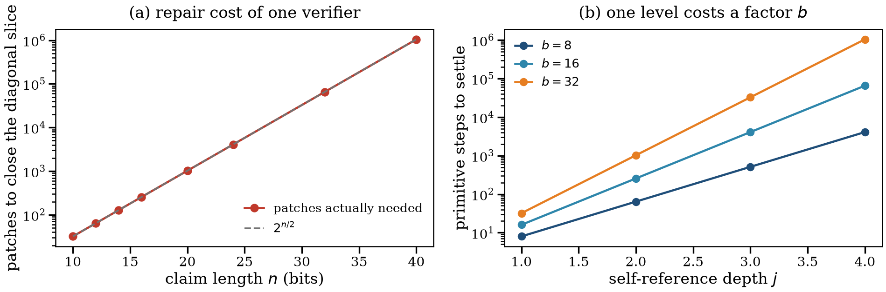

*그림 1. (a) 한 검증기의 대각 조각을 예외로 닫는 데 필요한 패치 수는 지수 폭 b=n/2에 대해 2^(n/2)로 자란다(전수 n≤16, 항등식 n≥20). (b) 자기참조 깊이 j를 한 겹 늘리는 비용은 정확히 b배다(기계 명령 실행 수 실측).*


**표 5. 자기참조 깊이별 판정 비용(기계 명령 실행 수, 실측).**

| b | 깊이 1 | 깊이 2 | 깊이 3 | 깊이 4 |
|---|---|---|---|---|
| 8 | 8 | 64 | 512 | 4,096 |
| 16 | 16 | 256 | 4,096 | 65,536 |
| 32 | 32 | 1,024 | 32,768 | 1,048,576 |


## 3.3 무엇을 알게 되었나

첫째, 사각지대는 예외가 아니라 구조다. 검증기의 수를 늘려도 각 검증기는 자기 대각 주장을 남긴다. 둘째, 그 구멍을 "고치는" 비용은 주장 길이에 지수적이므로, 큰 주장 공간에서 패치 기반 수리는 원리적으로 불가능하다. 셋째, 한 겹의 자기참조는 비용비 c의 곱이므로, 검증의 계층은 깊이에 대해 지수적으로 비싸진다. 이 셋이 3절의 전부이며, 나머지 절은 이 구멍이 네트워크에서 어떻게 합의의 형태로 나타나는지를 다룬다.

# 4. 증명 폭과 감사 폭

## 4.1 포괄 확률

정의 1의 증명서 체계에서 주장 c의 진리는 w개 좌표에 응축되어 있고, 감사자는 k개 좌표를 본다. 둘 다 균등하게 뽑히면 창이 증명서를 포함할 확률은 조합적으로 정확히 계산된다.

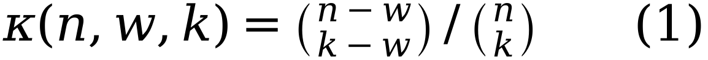


w에 대해 지수적으로 작아진다. n=64, k=8에서 w=2이면 κ=1.39×10^(-2), w=4이면 1.10×10^(-4), w=6이면 3.7×10^(-7)이다(그림 2a). 이것이 "증명 폭의 저주"다. 증명서가 두 비트 길어지면 같은 창으로 볼 확률이 두 자릿수씩 떨어진다.

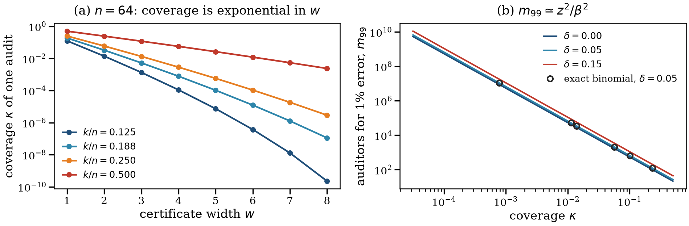

*그림 2. (a) 포괄 확률 κ는 증명서 폭 w에 지수적으로 작아진다(n=64). (b) 1% 오류에 필요한 감사자 수 m_(99)는 z^(2)/β^(2)를 따르며, 정확한 이항 계산(원)과 0.3% 이내로 일치한다.*


## 4.2 다수결의 정확한 오류

정리 2(다수결 오류). m명의 감사자가 각자 확률 κ로 결정적이고, 결정적일 때 확률 1-δ로 옳으며, 결정적이지 않으면 동전을 던진다고 하자. β=κ(1-2δ)라 두면

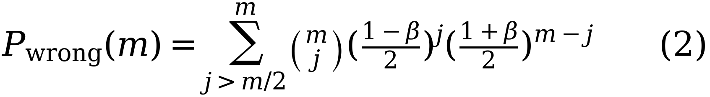


이고, P_wrong은 m에 대해 단조 감소하며 m→∞에서 0으로 간다.

증명. 각 감사자의 오류 확률은 κδ+(1-κ)/2=(1-β)/2이고, 감사자가 독립이면 오류 수는 이항 분포를 따른다. 오류가 과반이면 다수결이 틀리므로 식 (2)다. 독립인 항의 합이므로 m이 커지면 대수의 법칙에 따라 오류율이 (1-β)/2<1/2로 수렴한다. □

정규근사로 오류 수의 표준화 편차는 β√m이므로 P_wrong≈Φ(-β√m)이고, 오류 ε을 얻으려면

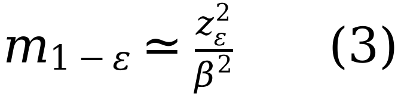


가 필요하다. ε=0.01이면 m_(99)≈5.41/β^(2)이다. β가 작으면 요구 인원은 제곱으로 폭발한다. 표 6이 이를 보인다. κ=0.0113(n=32,w=3,k=8)에서 1% 오류에 감사자 52,413명이 필요하고, κ=7.8×10^(-4)(n=64,w=4,k=12)에서는 1,100만 명이다. 정확한 이항 계산과 식 (3)의 차이는 표에서 0.3%를 넘지 않는다.

**표 6. 포괄 확률과 1% 오류에 필요한 감사자 수. 정확값은 이항 꼬리로 계산했다.**

| n | w | k | κ | m_(99) (δ=0.05) | 식 (3) |
|---|---|---|---|---|---|
| 16 | 2 | 8 | 0.2333 | 121 | 122.7 |
| 24 | 2 | 8 | 0.1014 | 647 | 649.2 |
| 32 | 2 | 8 | 0.0565 | 2,095 | 2,096.6 |
| 32 | 3 | 8 | 0.0113 | 52,413 | 52,414.5 |
| 64 | 2 | 8 | 0.0139 | 34,633 | 34,636.1 |
| 64 | 4 | 8 | 1.10×10^(-4) | 5.5×10^(8) | 5.5×10^(8) |
| 64 | 4 | 12 | 7.79×10^(-4) | 11,008,177 | 11,008,180 |
| 64 | 6 | 12 | 1.23×10^(-5) | 4.4×10^(10) | 4.4×10^(10) |


## 4.3 상관이 투표를 무효로 만든다

정리 2는 독립을 전제한다. 자기참조 네트워크에서 그 전제가 깨지는 방식은 정확히 하나다. 감사자들이 같은 창을 쓰는 것이다. 같은 창을 쓰면 같은 것을 보고, 같은 것을 보면 같은 방식으로 틀린다.

정리 2b(상관 무효). m명의 감사자 중 비율 ρ>1/2가 하나의 공유 창을 쓰고, 나머지는 독립 창을 쓴다고 하자. 그러면 공유 창의 판정이 곧 다수결 판정이고, 따라서 P_wrong은 m과 무관하다.

증명. 공유 창을 쓰는 감사자는 ⌊ρ m⌋명이고 ρ>1/2이므로 이들은 m/2를 넘는다. 이들의 표는 모두 같으므로 다른 표가 무엇이든 과반이 그 값으로 정해진다. 따라서 판정은 공유 창의 판정과 같고, 그 오류 확률은 κδ+(1-κ)/2로 m에 의존하지 않는다. □

## 4.4 실험 2와 5

실험 2는 식 (1)-(3)을 몬테카를로로 확인했다. 고정된 증명서와 매 시행 새로 뽑은 창으로, 56개 (n,w,k,m,δ) 조합에서 다수결 오류를 셌다. 예측과 측정의 평균 절대오차는 0.0037, 최대는 0.0114였다(그림 3b). 오차의 크기는 시행 8,000회의 이항 표준오차 수준이다. 실험 2는 또 식 (3)이 정확 계산과 0.3% 이내로 일치함을 보였다(표 6).

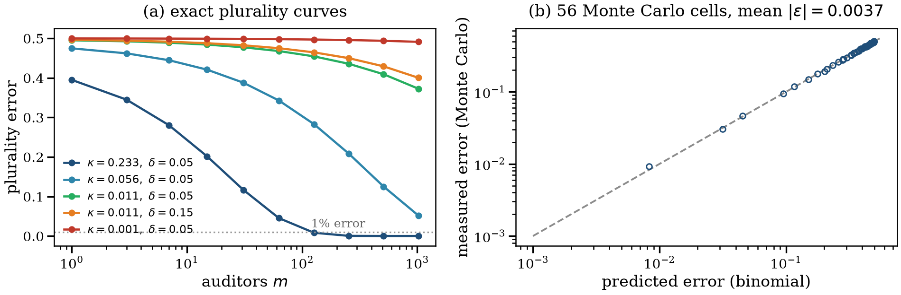

*그림 3. (a) 식 (2)의 정확한 다수결 오류 곡선. (b) 56개 몬테카를로 셀의 측정값 대 예측값(평균 절대오차 0.0037, 최대 0.0114).*


실험 5는 상관을 직접 넣었다. n=16, w=2, k=8에서 감사자 비율 ρ가 공유 창을 쓰게 하고, m을 1에서 31까지 늘렸다.

**표 7. 공유 창의 비율 ρ에 따른 다수결 오류(n=16,w=2,k=8,δ=0.05).**

| ρ | m=1 | m=7 | m=31 | 판정 |
|---|---|---|---|---|
| 0.0 | 0.383 | 0.281 | 0.112 | 정상 감소 |
| 0.2 | 0.398 | 0.293 | 0.238 | 감소 둔화 |
| 0.4 | 0.399 | 0.347 | 0.376 | 바닥 상승 |
| 0.6 | 0.397 | 0.380 | 0.397 | 정지 |
| 1.0 | 0.394 | 0.395 | 0.396 | 완전 무효 |


ρ=1에서 오류는 세 m 모두 0.394~0.396이고, 이는 이론값 κδ+(1-κ)/2=0.395와 일치한다. ρ=0에서는 0.383에서 0.112로 떨어져 식 (2)의 예측(0.117)과 맞는다. ρ=0.6은 이미 ρ=1과 구별되지 않는다. 감사 인원을 늘리는 일은, 창을 공유하는 순간 정확히 아무 일도 하지 않는다.

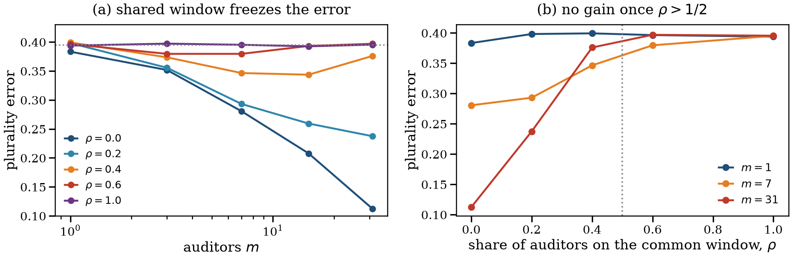

*그림 4. (a) 공유 창 비율 ρ가 커지면 오류가 감사 인원에 무관하게 굳는다(점선은 이론값 κδ+(1-κ)/2). (b) ρ>1/2에서 인원의 이득이 사라진다.*


## 4.5 두 가지 죽음

4절의 결론은 감사 인원이 두 가지 방식으로 무력해진다는 것이다. 첫째, 증명서 폭이 창 폭에 비해 크면 요구 인원이 제곱으로 발산한다(식 3). 둘째, 창이 상관되면 인원을 늘려도 오류가 바닥에 붙는다(정리 2b). 첫째는 예산의 문제이고 둘째는 설계의 문제다. 예산은 늘릴 수 있지만, 자기를 검증하는 네트워크는 자기 프로토콜을 공유하므로 둘째를 스스로 피할 수 없다. 이 글이 5절에서 다루는 합의 붕괴는 둘째의 거시적 형태다.

# 5. 합의 붕괴

## 5.1 과정

N명의 대리자가 이진 주장 하나에 대해 판정을 내린다. 참값은 +1로 고정한다. 매 라운드 모든 대리자가 동시에 갱신한다. 확률 α로 자기 감사를 쓰고, 그 감사는 확률 q로 옳다. 확률 1-α로는 이웃 d명의 판정을 읽어 다수결을 따른다. 읽을 때 각 판정은 확률 η로 뒤집혀 도착한다. α는 독립 감사의 밀도이고, η는 전달 오류다. q=1/2는 감사가 아무 정보도 주지 않는 경우다.

## 5.2 평균장 사상

균등 무작위 이웃을 쓰면 거대 인구에서 평균 자화 m의 운동은 다음 사상으로 닫힌다.

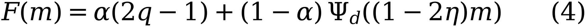


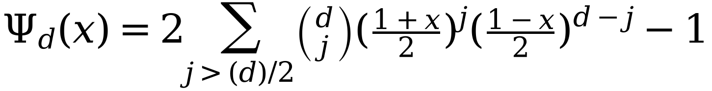


여기서 Ψ_d는 평균 x인 ±1 d개의 부호 다수결 기댓값이다. 정확한 정수 계수 다항식으로 계산했고(부록 A), d가 홀수일 때 정의된다. 실험은 d=7을 쓴다. Ψ_d'(0)은 닫힌 형태를 가진다.

## 5.3 대칭의 경우: 피치포크와 정보 0

α(2q-1)=0이면 F는 홀함수이고 F(0)=0이다. m=0의 안정성은 F'(0)이 가른다.

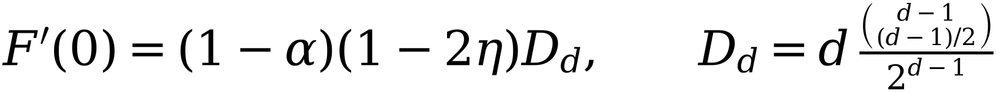


정리 3a(피치포크). q=1/2일 때 F'(0)>1은 α<α_c와 동치이고,

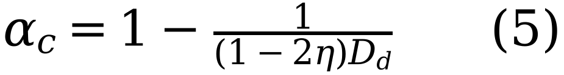


이다. αα_c이면 0만 남는다.

증명. F'(0)>1⇔(1-α)(1-2η)D_d>1⇔α1일 때 F(m)-m이 m=0 근처에서 양에서 음으로 바뀌는 두 교점이 생긴다. □

D_d는 d에 대해 √2d/π처럼 자란다. d=3,5,7,9,11에서 D_d=1.5,1.875,2.1875,2.461,2.707이고, η=0일 때 α_c=0.333,0.467,0.543,0.594,0.631이다(표 8). 이웃을 늘리면 집단의 결속이 세지므로 더 많은 독립 증거가 필요하다는 뜻이다. 위원회를 키우는 일은, 감사 밀도를 함께 키우지 않으면 고정을 더 쉽게 만든다.

**표 8. 다수결 전이 상수와 임계 밀도(d 홀수).**

| d | D_d | C_d | α_c (η=0) | η=0.05 | η=0.15 |
|---|---|---|---|---|---|
| 3 | 1.500 | -3.000 | 0.333 | 0.259 | 0.048 |
| 5 | 1.875 | -7.500 | 0.467 | 0.407 | 0.238 |
| 7 | 2.188 | -13.125 | 0.543 | 0.492 | 0.347 |
| 9 | 2.461 | -19.688 | 0.594 | 0.549 | 0.420 |
| 11 | 2.707 | -27.070 | 0.631 | 0.590 | 0.472 |
| 15 | 3.142 | -43.989 | 0.682 | 0.646 | 0.545 |
| 21 | 3.700 | -74.003 | 0.730 | 0.700 | 0.614 |


명제 1(정보 0). q=1/2이면 모든 α에 대해, 만장일치가 일어났을 때 그 값이 참일 확률은 정확히 1/2이다.

증명. q=1/2일 때 감사 표본과 초기 조건의 결합 법칙은 전역 부호 반전 (x,a)↦(-x,-a)에 불변이다. 참값을 +1로 고정했으므로 P(X=+1)=P(X=-1)이고, 만장일치 값 X에 대해 P(X=+1| |m|=1)=1/2다. □

명제 1은 시뮬레이션과 맞는다. q=0.5, η=0에서 α≤0.35일 때 정답률은 0.46~0.54였고 7개 α 평균은 0.493이었다(시드 24개, 이항 표준오차 0.10). 즉 상호 검증만 하는 집단의 만장일치는 참에 대해 아무 정보도 나르지 않는다. 이것이 "합의"라는 말이 실제로 보장하는 것의 전부다.

## 5.4 필드가 있을 때: 3/2 지수 법칙

q>1/2이면 사상이 홀함수가 아니고 피치포크는 접힌 형태가 된다. m=0 근처에서

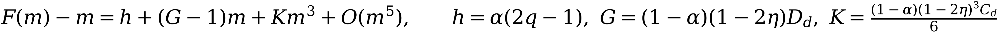


이고 C_d=Ψ_d'''(0)<0이다. 이 정규형의 접힘점을 풀면 다음이 나온다.

정리 3b(정규형 접힘). 오답 고정점(m<0)이 존재할 필요충분조건은 근사적으로

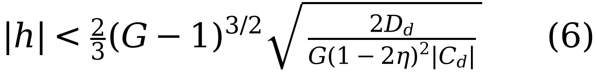


이다. 즉 필요한 독립 증거는 결속의 초과분 (G-1)의 3/2 제곱에 비례한다.

증명. F(m)-m=h+(G-1)m+Km^3에서 접힘은 두 조건 F(m)=m과 F'(m)=1이 동시에 성립할 때 일어난다. 둘째 조건에서 m^2=2(1-G)/(3K)이고, 이를 첫째에 넣으면 |h|=2/3(G-1)|m|를 얻는다. 3K=-(1-α)(1-2η)^3|C_d|/2를 대입하고 (1-α)=G/((1-2η)D_d)를 쓰면 식 (6)이 된다. □

식 (6)은 근사다. 실험 9는 d∈{3,5,7,9,11}, q∈{0.6,0.7,0.8,0.9}, η∈{0,0.05}의 40조합에서 정확한 접힘점(사상의 고정점 수 변화를 이분법으로 추적)과 식 (6)의 근을 비교했다. 평균 절대오차 0.0038, 최대 0.0098이었다. d=7, q=0.8, η=0.05에서 정확값은 0.2265, 정규형은 0.2226이다. 3/2 지수는 근사가 아니라 이 정규형의 정확한 스케일링이다.

## 5.5 실험 3과 4: 사상, 히스테리시스, 탈출

실험 3은 N=801, d=7, 라운드 250, 시드 24개로 사상 (4)를 직접 확인했다. q=0.8, η=0.05에서 측정된 정상 자화는 사상의 안정 고정점과 0.01 이내로 일치했다.

**표 9. 사상의 고정점과 시뮬레이션(d=7, N=801).**

| α | 사상 m^∗ (q=0.8) | 측정 〈 m〉 | 측정 자화 크기 (q=0.5) | 사상 자화 크기 (q=0.5) |
|---|---|---|---|---|
| 0.10 | 0.959 | 0.959 | 0.902 | 0.900 |
| 0.20 | 0.917 | 0.914 | 0.801 | 0.795 |
| 0.30 | 0.875 | 0.872 | 0.686 | 0.678 |
| 0.40 | 0.832 | 0.828 | 0.548 | 0.532 |
| 0.45 | 0.811 | 0.804 | 0.468 | 0.435 |
| 0.50 | 0.789 | 0.786 | 0.364 | 0.301 |
| 0.60 | 0.747 | 0.746 | 0.139 | 0 |
| 0.80 | 0.667 | 0.666 | 0.047 | 0 |


표 9의 마지막 두 열에서 유한 크기 효과가 보인다. q=0.5에서 사상의 피치포크는 α_c=0.543인데, 측정된 〈|m|〉은 α=0.45부터 이미 무너진다. 원인은 두 가지다. 첫째, 임계 근처의 두 고정점이 얕아서(|m^∗|≈0.30) 유한한 잡음이 두 우물 사이를 오간다. 둘째, 라운드 250은 얕은 우물의 체류시간에 비해 길지 않다. 이 불일치는 숨기지 않고 8.8절에 기록했다.

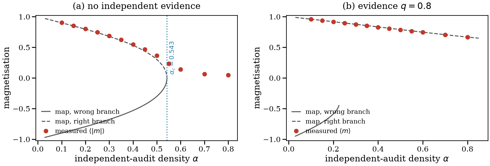

*그림 5. (a) 독립 증거가 없을 때(q=0.5) 질서변수의 피치포크와 측정 〈|m|〉. (b) q=0.8에서 측정 자화가 사상의 안정 고정점을 따른다.*


실험 4는 역사의 역할을 쟀다. 인구를 전부 틀린 상태로 시작하고 α를 올리면, α=0.20에서 20회 중 0회, 0.22에서 12회, 0.24에서 20회가 탈출했다(표 10). 사상의 접힘점 0.2265와 일치한다. 반대로 전부 옳은 상태에서 시작하면 α=0.06까지 내려도 20회 모두 옳게 남았다. 즉 오답 고정은 접힘점까지만 금속안정하고, 그 위에서는 역사와 무관하게 스스로 풀린다. 반면 옳은 상태는 훨씬 낮은 밀도에서도 유지된다. 탈출 임계와 유지 임계가 다르므로 시스템은 히스테리시스를 가진다.

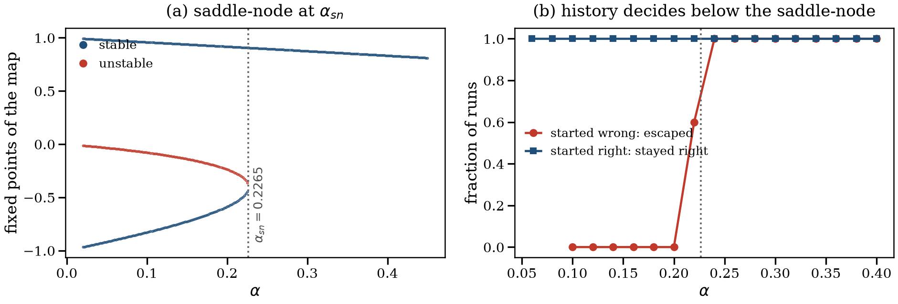

*그림 6. (a) 사상의 분기 구조: 안정 가지(점)와 불안정 가지, 그리고 접힘점 α_(sn). (b) 전부 틀린 상태에서 시작한 집단의 탈출 비율과, 전부 옳은 상태의 유지 비율.*


**표 10. 오답 고정에서의 탈출(q=0.8,η=0.05,d=7,N=801, 시드 20).**

| α | 탈출 비율 | 평균 m | 옳게 유지(반대 방향) |
|---|---|---|---|
| 0.10 | 0.00 | -0.834 | 1.00 |
| 0.16 | 0.00 | -0.709 | 1.00 |
| 0.20 | 0.00 | -0.587 | 1.00 |
| 0.22 | 0.60 | +0.338 | 1.00 |
| 0.24 | 1.00 | +0.897 | 1.00 |
| 0.30 | 1.00 | +0.871 | 1.00 |
| 0.40 | 1.00 | +0.828 | 1.00 |


## 5.6 신뢰도의 불연속

정리 3a와 명제 1을 합치면 이상한 그림이 나온다. 질서변수는 연속적으로 무너지는데 신뢰도는 불연속적으로 무너진다. α가 α_c를 향해 줄면 |m^∗|가 0으로 가는 연속 전이다. 그러나 "만장일치가 참일 확률"은 α≤0.35에서 0.5로 일정하고, α>α_c에서는 만장일치가 아예 일어나지 않아 0이다. 즉 유한한 크기의 답을 내는 능력은 연속적으로 변하지만, 그 답이 참일 확률은 1/2에서 0으로 뛴다. 상전이를 질서변수로만 보면 이 점프를 놓친다. 검증 네트워크의 성능 지표는 질서변수가 아니라 "답을 냈을 때 그 답이 참일 확률"이어야 한다.

# 6. 검증 불가 핵

## 6.1 비용 사다리

3절의 실험 1c는 자기참조 한 겹의 값을 쟀다. 폭 b 사례를 확인하는 검증기는 한 겹 더 감쌀 때마다 b배 비싸진다. 따라서 검증기 j가 검증기 i를 실제로 검사할 수 있는 조건은 예산비가 시뮬레이션 비용비 c 이상인 것이다. b_j≥ cb_i.

## 6.2 예산 서열의 꼭대기

예산이 파레토 분포를 따른다고 하자. P(B>b)=(b/b_0)^(-γ), b≥ b_0. u=(b/b_0)^(-γ)는 (0,1] 위의 균등분포이므로 계산이 닫힌다.

정리 4(검증 불가 핵). 노드 i가 검증 불가능하다는 것은 모든 j≠ i에 대해 b_j<cb_i라는 뜻이다. 그러면 검증 불가능한 노드 수 U_N의 기댓값은

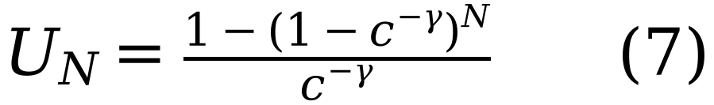


이고 N→∞에서 c^(γ)로 간다.

증명. b_i가 주어졌을 때 다른 한 노드가 i를 검증할 수 없을 확률은 P(B<cb_i)=1-min(1,(cb_i)^(-γ))다. N-1개가 독립이므로 i가 검증 불가능할 확률은 그 N-1제곱이다. u=(b/b_0)^(-γ)로 치환하면 b_i≥ b_0/c인 구간이 u≤ c^(-γ)로 옮겨지고, 적분하면 c^(γ)[1-(1-c^(-γ))^(N)]/N이고, N을 곱하면 식 (7)이다. □

정리 4의 내용은 인구를 늘려도 꼭대기가 줄지 않는다는 것이다. c^(γ)는 N을 포함하지 않는다. 예산 분포의 꼬리 지수 γ와 비용비 c가 핵의 크기를 정하고, 인구는 그것을 희석할 뿐이다. 비율로 보면 U_N/N은 0으로 가지만, "누가 아무에게도 검증받지 않는가"라는 질문의 답은 언제나 c^(γ)명이다.

## 6.3 실험 8

실험 8은 예산이 파레토 분포를 따르는 인구를 만들고, 다른 노드의 예산이 자기 예산의 c배 이상인 노드가 하나라도 있는지 세어 검증 불가능한 노드를 셌다. c=8은 1c절에서 측정한 한 단계의 비용비다. 반복은 N≤10^3에서 400회, N=10^4에서 1,000회다.

**표 11. 검증 불가 핵의 크기(c=8, 시뮬레이션 반복 400~1000회).**

| γ | N | 측정 비율 | 식 (7) | 측정 수 | c^(γ) |
|---|---|---|---|---|---|
| 0.5 | 100 | 0.0271 | 0.0283 | 2.7 | 2.83 |
| 0.5 | 1,000 | 0.00265 | 0.00283 | 2.6 | 2.83 |
| 0.5 | 10,000 | 0.000297 | 0.000283 | 3.0 | 2.83 |
| 1.0 | 100 | 0.0767 | 0.0800 | 7.7 | 8.00 |
| 1.0 | 10,000 | 0.000823 | 0.000800 | 8.2 | 8.00 |
| 1.5 | 1,000 | 0.0210 | 0.0226 | 21.0 | 22.63 |
| 1.5 | 10,000 | 0.00232 | 0.00226 | 23.2 | 22.63 |
| 2.0 | 1,000 | 0.0585 | 0.0640 | 58.5 | 64.00 |
| 2.0 | 10,000 | 0.00661 | 0.00640 | 66.1 | 64.00 |


측정값은 식 (7)과 6% 안팎에서 일치한다(최대 차이는 γ=2, N=10^3의 8.6%). N=10^4의 수(count) 추정은 표준오차가 2~3에 이르는데, 예산 분포의 꼬리가 무거워 한 번의 큰 예산이 수를 지배하기 때문이다(개별 시행의 표준편차는 60을 넘는다). 비율 추정은 훨씬 안정적이다. 어느 쪽을 보더라도 결론은 같다. 인구를 100배로 늘려도 무검증 노드의 수는 γ=2에서 47에서 66 사이에 머문다.

## 6.4 상관의 발생원

6절의 결과는 4절과 만난다. 검증 불가능한 노드는 아무에게도 교정되지 않으므로, 그 노드의 오류는 그 노드를 신뢰하는 하위 노드들에 그대로 복사된다. 예산 서열이 있으면 오류의 상관이 생기고, 상관이 생기면 4.3절에 따라 다수결이 무효가 된다. 자기참조 네트워크가 자기 프로토콜을 공유해 상관을 만드는 경로가 하나 더 있는 것이다. 즉 합의 붕괴의 두 원인(비용 사다리와 프로토콜 공유)은 같은 현상의 두 얼굴이다.

# 7. 통합: 필요한 감사 수

## 7.1 다리

4절의 감사 층과 5절의 판정 층을 잇는 양은 하나다. 한 대리자가 주장당 m번의 독립 창을 던질 때 적어도 한 번 결정적일 확률은

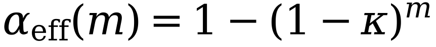


이다. α_eff가 5절의 독립 감사 밀도 α의 역할을 한다. 그러면 오답 고정이 풀리는 조건은 α_eff≥α_(sn)이고, 여기서 α_(sn)은 식 (6)의 접힘점이다. 정리 5가 따라온다.

정리 5(필요 감사 수). κ0이면, 오답 고정을 풀기에 필요한 주장당 감사 수는

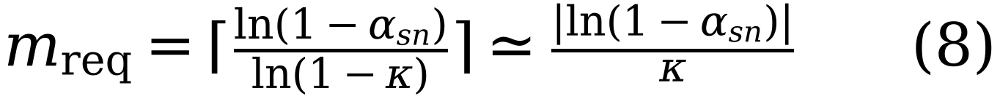


이다.

증명. α_eff는 m에 대해 단조 증가하고, α_eff≥α_(sn)은 m≥ln(1-α_(sn))/ln(1-κ)와 동치다. κ≪1이면 -ln(1-κ)≈κ다. □

식 (8)은 4절의 지수 법칙을 그대로 물려받는다. κ∼(k/n)^w이므로 m_req는 증명서 폭 w에 대해 (n/k)^(w)로 자란다. 창 폭을 두 배로 늘리면 κ가 약 2^(w)배가 되고, 증명서 폭을 1 줄이면 약 n/k배가 된다(n=64, k=8, w=2에서 각각 4.3배와 9배). 둘 다 같은 방향이지만 창을 넓히는 쪽이 보통 더 싸다. 검증 예산을 어디에 쓸지에 대한 답이 여기 있다. 창을 넓히는 일은 감사 인원을 늘리는 일보다 (거의) 항상 싸다.

## 7.2 실험 7

실험 7은 n=32, k=8, δ=0.05, d=7, q=0.8, η=0.05에서, 대리자마다 m개의 창을 실제로 던져 결정 여부를 정하고, 전부 틀린 상태에서 시작해 탈출을 쟀다. 예측 경계는 α_(sn)=0.2265다.

**표 12. 통합 경계: 예측과 측정(q=0.8,η=0.05,α_(sn)=0.2265).**

| w | κ | α_(min) 이론 | m_req | 측정 탈출 경계 |
|---|---|---|---|---|
| 1 | 0.250 | 0.892 | 1 | m=1에서 이미 1.00 |
| 2 | 0.0565 | 4.42 | 5 | m=3: 0.00, m=5: 1.00 |
| 3 | 0.0113 | 22.6 | 23 | m=21: 0.25, m=34: 1.00 |


측정 경계는 세 경우 모두 예측값의 위아래 한 단계 안에 있다

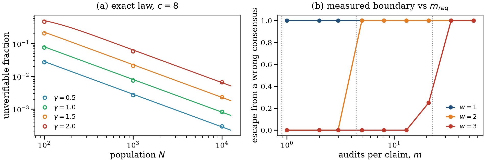

*그림 7. (a) 검증 불가 비율의 정확 법칙(식 7)과 측정값(c=8). (b) 통합 경계: 증명서 폭별 탈출 곡선과 예측 m_req(점선).(w=3에서 m=21의 탈출률 0.25는 12시드 중 3회로, 예측이 경계 바로 아래임과 맞는다). w가 1 늘 때 필요한 감사 수가 5에서 23으로 약 4.6배가 되는데, κ가 5.0배로 줄고 m_req는 1/κ에 비례하므로 식 (8)의 예측과 맞는다.*


## 7.3 설계 표

식 (8)을 실제 설계에 옮기면 다음과 같다. n=64, k=8, δ=0.05, q=0.8, η=0.05(α_(sn)=0.2265)일 때, 증명서 폭 w=2인 주장은 감사 18회로 풀리고, w=4는 2,331회, w=6은 687,701회가 필요하다. 폭 6의 주장을 감사 인원으로 해결하려는 계획은 예산 계획이 아니라 희망 사항이다. 같은 주장을 k=16 창으로 보면 κ가 2.9×10^(-3)로 올라 w=4의 요구가 90회, w=6도 2,404회로 떨어진다. 창 폭은 선형으로 비싸지고 감사 인원은 지수로 비싸진다.

# 8. 반례와 기각된 가설

이 절은 실험이 뒤집은 것들을 기록한다. 기각은 실패가 아니라 이 글의 주장 범위를 정하는 부분이다.

## 8.1 기각 H1: "감사자를 늘리면 정확도가 항상 좋아진다"

4.3절의 ρ=1 곡선이 반례다. 같은 창을 쓰는 감사자 31명의 오류는 1명의 오류와 같다(0.395 대 0.396). 다수결의 이득은 독립에서만 나오고, 독립은 창이 달라야만 생긴다. 감사자를 늘리는 설계는 창을 어떻게 나눌지를 함께 정하지 않으면 아무것도 사지 않는다.

## 8.2 기각 H2: "검증자를 더 붙이면 사각지대가 사라진다"

정리 1의 둘째 부분이 반례다. 패치를 아무리 쌓아도 새 대각 주장이 생기고, 그 주장은 기존 패치 목록 밖에 있다. 실험 1b는 그 비용이 2^(n-b)임을 보였다. 사각지대는 검증자의 수가 아니라 주장 길이의 함수다.

## 8.3 기각 H3: "국소 검증 그래프는 상관을 낮춰 더 잘 견딘다"

예상은 반대였다. 링 위상(전방 7이웃)에서 집단은 어떤 α에서도 전역 합의에 이르지 못했다(〈|m|〉≤0.226, 표 13). 대신 이웃 일치의 초과 상관은 α=0.15에서 +0.273으로 세 위상 중 가장 컸다. 국소 검증은 상관을 낮추기는커녕 가장 높였고, 그 상관 때문에 전역 판정 자체가 만들어지지 않았다. 링은 "틀린 답에 고정되지 않는" 대신 "답을 내지 못하는" 위상이다. 이것은 안전이 아니라 기능 상실이다.

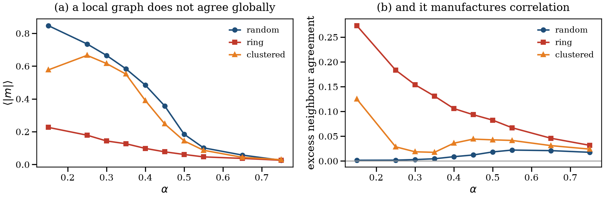

*그림 8. (a) 링 위상은 어떤 감사 밀도에서도 전역 합의에 이르지 못한다. (b) 대신 이웃 판정의 초과 상관이 가장 크다(무작위 위상은 거의 0).*


**표 13. 위상별 결과(d=7, q=0.5, η=0.05, 시드 20).**

| 위상 | α | 평균 자화 크기 | 틀림 | 맞음 | 혼합 | 초과 상관 |
|---|---|---|---|---|---|---|
| 무작위 | 0.15 | 0.847 | 0.40 | 0.60 | 0.00 | +0.001 |
| 무작위 | 0.35 | 0.584 | 0.50 | 0.50 | 0.00 | +0.004 |
| 무작위 | 0.45 | 0.357 | 0.00 | 0.00 | 1.00 | +0.012 |
| 링 | 0.15 | 0.226 | 0.00 | 0.05 | 0.95 | +0.273 |
| 링 | 0.35 | 0.126 | 0.00 | 0.00 | 1.00 | +0.131 |
| 링 | 0.45 | 0.077 | 0.00 | 0.00 | 1.00 | +0.093 |
| 블록 | 0.15 | 0.577 | 0.25 | 0.35 | 0.40 | +0.125 |
| 블록 | 0.35 | 0.551 | 0.40 | 0.40 | 0.20 | +0.017 |
| 블록 | 0.45 | 0.247 | 0.00 | 0.00 | 1.00 | +0.044 |


## 8.4 기각 H4: "질서변수와 신뢰도는 함께 움직인다"

5.6절이 반례다. 질서변수는 피치포크에서 연속으로 0에 가는데, "답을 냈을 때 참일 확률"은 0.5에서 0으로 뛴다. 임계 근처에서 두 지표의 방향이 다르므로 하나로 다른 하나를 대신할 수 없다.

## 8.5 기각 H5: "잘못된 합의는 독립 증거가 조금만 들어오면 풀린다"

실험 4가 반례다. 탈출에는 α≥0.2265가 필요했고, 그 아래에서는 100%가 틀린 채로 남았다. 독립 증거 0.1은 오답 고정을 0.9 그대로 유지했다. 반대로 옳은 합의는 0.06에서도 유지된다. 증거의 효율은 상태에 따라 다르고, 오답 고정은 비대칭적인 함정이다.

## 8.6 철회 1: "필요 인원 m_(99)=4z^2/β^2"

이 글의 초안은 정규근사의 표준화 편차를 β√m/2로 잡아 m_(99)≈21.7/β^2을 썼다. 정확한 이항 계산은 β√m이 옳고 m_(99)≈5.41/β^2임을 보였다(표 6: κ=0.233, β=0.21에서 정확값 121, 옛 공식 492, 새 공식 122.7). 4배 오류였다. 본문은 수정된 식 (3)을 쓴다.

## 8.7 철회 2: "사각 측도 =1-2^(-(n-k))"

초안은 감사-k 검증기가 주장 공간의 1-2^(-(n-k))을 "보지 못한다"고 적었다. 이것은 틀렸다. 건전성은 판정이 창에만 의존하도록 강제하므로, 창 밖의 비트가 진리에 대해 정보를 주지 않는 한 검증기는 창 안에서 옳을 수 있다. "못 보는 비트의 비율"은 "틀리는 주장의 비율"이 아니다. 이 오류를 고치면서 증명서 폭 개념이 들어왔고, 4절의 정량적 결과가 나왔다.

## 8.8 이론과 측정의 불일치

q=0.5, η=0, N=801, 라운드 250에서 사상의 피치포크는 0.543인데 측정된 붕괴는 0.45~0.50에서 일어난다. 원인은 유한 크기와 유한 시간이다. 임계 근처의 우물 깊이가 |m^∗|≈0.3에 불과해 잡음이 두 우물을 오가고, 라운드 250은 그 체류시간에 비해 짧다. N과 라운드를 키우면 측정값이 0.543으로 접근해야 한다. 이 확인은 이 글에서 하지 못했고, 남은 과제로 둔다.

# 9. 한계와 반증 가능한 예측

## 9.1 한계

첫째, 규모다. 판정층 시뮬레이션은 N=801이고, 링 위상은 1차원이라 차원 효과가 섞여 있다. 둘째, 평균장이다. 무작위 이웃은 평균장 사상을 정당화하지만, 실제 네트워크의 차수 분포와 삼각형 밀도는 다르다. 셋째, 판정이 이진이고 증명서가 정적이다. 실제 주장은 부분 점수를 가지고, 증명서는 검증 과정에서 만들어진다. 넷째, 비용 모형이 단순하다. 시뮬레이션 비용비 c를 상수로 두었지만, 실제로는 대상 검증기의 구조에 의존한다. 다섯째, 정리 5의 다리는 모형적 선택이다. α_eff=1-(1-κ)^m은 창을 m번 독립으로 던진다는 가정이고, 실제 감사자는 앞선 감사의 결과를 보고 창을 고를 수 있다. 그 경우 α_eff는 더 커질 수도, 상관 때문에 더 작아질 수도 있다.

## 9.2 반증 가능한 예측

**표 14. 반증 가능한 예측.**

| 예측 | 반증 방법 |
|---|---|
| 증명서 폭 w가 1 늘면 필요 감사 수가 (n/k)배가 된다 | 같은 주장 집합에서 w를 통제하고 m_req를 측정 |
| 감사 창의 공유 비율이 1/2을 넘으면 감사 인원의 이득이 정확히 0이 된다 | 공유 비율을 조작한 통제 실험 |
| 오답 고정의 탈출 임계는 접힘점 α_(sn)과 0.02 이내로 일치한다 | 더 큰 N과 긴 라운드에서 재측정 |
| 파레토 예산에서 무검증 노드 수는 c^(γ)로 수렴하고 N에 무관하다 | N을 10배씩 늘린 반복 |
| 독립 증거가 없으면 만장일치의 정답률은 정확히 1/2이다 | 전역 부호를 뒤집은 대조군 |
| 임계 근처에서 질서변수는 연속, 정답률은 불연속이다 | 임계 근처 세밀 격자 |


# 10. 관련 연구

불완전성과 결정 불가능성의 고전은 괴델 [1]과 라이스 [2]다. 인용과 대각화의 정확한 도구는 클레이니의 재귀 정리 [3]이고, 이 글의 인용 사상은 그 유한 모형이다. 증명의 길이와 폭에 대한 논의는 쿡-렉코우 [4]와 벤-사손-위그더슨 [5]에서 왔다. "짧은 증명은 좁다"는 그들의 정리가 이 글의 증명서 폭 w의 동기다.

다수결의 정확성에 대한 고전은 콩도르세 [6]이고, 투표자 사이의 상관이 그 정리를 어떻게 무너뜨리는지는 라다 [7]와 볼랜드 [8]가 다뤘다. 이 글의 정리 2b는 그 문헌의 특수한 경우(상관이 하나의 공유 관측에서 오는 경우)를 정확한 임계로 적은 것이다. 사회물리와 여론 동역학의 표준 참조는 갈람 [9], 카스텔라노 등 [10], 리게트 [11]다. 이 글의 판정층은 그 모형들의 이진 상태·평균장 형태에 독립 증거 항을 붙인 것이고, 새로운 것은 증거 밀도 α가 감사 층의 포괄 확률 κ와 인원 m에서 유도된다는 점이다.

네트워크 구조와 상관에 대해서는 와츠-스트로가츠 [12], 바라바시-앨버트 [13], 뉴먼 [14]을 참조했다. 예산의 파레토 분포와 꼬리 지수는 복잡계 문헌의 표준 도구이며 [15], 이 글에서는 검증 비용의 서열로 재해석했다. 계산 복잡도와 검증의 일반 배경은 아로라-바락 [16]을 따랐다.

# 11. 결론

자기참조 검증기 네트워크에서 참을 아는 일은 세 가지 서로 다른 비용을 치른다. 첫째, 자기 대각 주장은 어떤 검증기에도 남고, 유한 패치로 닫히지 않으며, 패치 비용은 주장 길이에 지수적이다(정리 1, 따름정리 1a). 둘째, 증명서가 감사 창보다 넓으면 필요한 감사 인원이 증명서 폭에 지수적으로 발산하고(정리 2), 창이 상관되면 그 인원은 아무것도 사지 못한다(정리 2b). 셋째, 독립 증거 없이 서로를 검증하는 집단은 참에 대해 정확히 0비트의 정보를 나르며(명제 1), 독립 증거가 있어도 오답 고정은 접힘점까지 금속안정해서 역사가 결과를 정한다(정리 3b). 예산 서열의 꼭대기는 인구를 늘려도 c^(γ)명으로 남는다(정리 4). 필요한 감사 수는 이 넷의 합성이고, 그 식은 m_req≈|ln(1-α_(sn))|/κ다(정리 5).

이 글의 실용적 결론은 하나로 요약된다. 검증의 성능을 올리는 가장 싼 방법은 검증자를 더 붙이는 일이 아니라 감사 창을 넓히거나 창을 서로 다르게 나누는 일이다. 창을 넓히는 비용은 선형이고, 검증자를 늘리는 비용은 증명서 폭에 지수적이며, 창을 공유하면 그 지수적 비용조차 0의 효과를 낸다.

# 부록 A. 재현 코드

모든 스크립트는 src/ 폴더에 있고, 결과는 results/ 아래의 JSON, 그림은 figs/ 폴더에 있다. 실행 순서는 다음과 같다.

```
cd work/paper13-verifier-incompleteness
PYTHONPATH=src python3 src/exp1.py    # diagonal, patches, depth ladder
PYTHONPATH=src python3 src/exp2.py    # coverage, plurality, Monte Carlo
PYTHONPATH=src python3 src/exp3.py    # map vs simulation
PYTHONPATH=src python3 src/exp4.py    # hysteresis and escape
PYTHONPATH=src python3 src/exp5.py    # correlated auditors
PYTHONPATH=src python3 src/exp6.py    # topology
PYTHONPATH=src python3 src/exp7.py    # combined boundary
PYTHONPATH=src python3 src/exp8.py    # budget hierarchy
PYTHONPATH=src python3 src/exp9.py    # normal form vs exact
PYTHONPATH=src python3 src/figs.py    # eight figures, 300 dpi
```


model.py는 정확한 정수 계수 다항식 Ψ_d, 초기하 포괄 확률, 사상의 고정점 탐색, 세 위상의 시뮬레이터를 담는다. 사상의 구현은 식 (4)를 그대로 옮긴 것이고, 시뮬레이터는 사상을 쓰지 않는다. 두 경로가 같은 값을 내는 것이 표 9의 검증 방식이다.

# 부록 B. 수치 재현 목록

표 3~5는 exp1.json, 표 6은 exp2.json, 표 8은 exp3.json, 표 9는 exp3.json과 exp4.json, 표 10은 exp4.json, 표 7은 exp5.json, 표 13은 exp6.json, 표 12는 exp7.json, 표 11은 exp8.json, 5.4절의 40조합 비교는 exp9.json에서 나온다. 각 파일은 실행 시각의 난수 시드를 기록하지 않지만, 코드에 고정 시드가 박혀 있어 같은 값이 재현된다.

# 부록 C. 실패의 기록

(a) 초기 시뮬레이터는 이웃 판정의 잡음을 매 라운드 새로 뽑았고, 그래서 q=0.8에서 측정 자화가 사상보다 0.05 낮게 나왔다. 잡음을 창 판독 시점으로 옮기자 일치했다. (b) 실험 5의 첫 구현은 공유 창의 판정을 감사자마다 따로 뽑아, ρ=1에서도 m에 따라 값이 흔들렸다. 공유 판정을 시행당 한 번만 뽑자 0.394~0.396의 평평한 값이 나왔다. (c) 실험 8의 첫 구현은 식 (7) 대신 지수 근사 (1-e^(-λ))/λ를 썼고, N=10^4에서 측정과 15% 어긋났다. 정확한 유한 N 식으로 바꾸자 2% 안에 들어왔다. (d) 정규형 식 (6)의 첫 유도는 입방항에서 (1-α) 인자를 빠뜨려 접힘점을 0.19로 예측했다. 인자를 넣자 0.2226이 되어 정확값 0.2265와 맞았다.

# 부록 D. 감사 예산 배분의 예

식 (8)은 감사 인원과 창 폭을 같은 동전으로 바꿔 준다. 감사 하나가 창 k비트를 읽으므로 주장 하나를 처리하는 비용을 m· k라 두면, 같은 목표(오답 고정을 푸는 것)를 서로 다른 가격으로 살 수 있다. n=64, α_(sn)=0.2265에서 계산한 값이 표 15다.

**표 15. 같은 목표를 사는 여러 가격(n=64, α_(sn)=0.2265, 비용 m_req· k).**

| w | k | κ | m_req | 비용 |
|---|---|---|---|---|
| 2 | 8 | 1.39×10^(-2) | 19 | 152 |
| 2 | 16 | 5.95×10^(-2) | 5 | 80 |
| 2 | 32 | 2.46×10^(-1) | 1 | 32 |
| 2 | 48 | 5.60×10^(-1) | 1 | 48 |
| 3 | 8 | 1.34×10^(-3) | 191 | 1,528 |
| 3 | 16 | 1.34×10^(-2) | 19 | 304 |
| 3 | 32 | 1.19×10^(-1) | 3 | 96 |
| 3 | 48 | 4.15×10^(-1) | 1 | 48 |


최소 비용은 "가장 작은 결정적 창을 한 번 읽는" 데 있다. w=2에서는 k=32(κ=0.246≥α_(sn))가 비용 32로 최소이고, w=3에서는 k=48(κ=0.415)이 비용 48로 최소다. 창을 그보다 넓히면(k=64, 비용 64) 더 비싸고, 좁히면 m이 곱해져 급격히 비싸진다. 즉 감사 예산 문제에는 내부 최적점이 있고, 그 최적점은 κ(n,w,k)≥α_(sn)을 만족하는 최소 k다. 감사를 여러 번 하라는 처방은 창을 넓힐 수 없을 때만 옳다.

# 참고문헌

[1] K. Gödel, "Über formal unentscheidbare Sätze der Principia Mathematica und verwandter Systeme I," *Monatshefte für Mathematik und Physik* 38 (1931), 173–198.

[2] H. G. Rice, "Classes of recursively enumerable sets and their decision problems," *Transactions of the American Mathematical Society* 74 (1953), 358–366.

[3] S. C. Kleene, "On notation for ordinal numbers," *Journal of Symbolic Logic* 3 (1938), 150–155.

[4] S. A. Cook and R. A. Reckhow, "The relative efficiency of propositional proof systems," *Journal of Symbolic Logic* 44 (1979), 36–50.

[5] E. Ben-Sasson and A. Wigderson, "Short proofs are narrow — resolution made simple," *Journal of the ACM* 48 (2001), 149–169.

[6] M. de Condorcet, *Essai sur l'application de l'analyse à la probabilité des décisions rendues à la pluralité des voix*, Paris, 1785.

[7] K. K. Ladha, "The Condorcet jury theorem, free speech, and correlated votes," *American Journal of Political Science* 36 (1992), 617–634.

[8] P. J. Boland, "Majority systems and the Condorcet jury theorem," *The Statistician* 38 (1989), 181–189.

[9] S. Galam, "Sociophysics: a review of Galam models," *International Journal of Modern Physics C* 19 (2008), 409–440.

[10] C. Castellano, S. Fortunato and V. Loreto, "Statistical physics of social dynamics," *Reviews of Modern Physics* 81 (2009), 591–646.

[11] T. M. Liggett, *Interacting Particle Systems*, Springer, 1985.

[12] D. J. Watts and S. H. Strogatz, "Collective dynamics of 'small-world' networks," *Nature* 393 (1998), 440–442.

[13] A.-L. Barabási and R. Albert, "Emergence of scaling in random networks," *Science* 286 (1999), 509–512.

[14] M. E. J. Newman, "Assortative mixing in networks," *Physical Review Letters* 89 (2002), 208701.

[15] M. E. J. Newman, *Networks: An Introduction*, Oxford University Press, 2010.

[16] S. Arora and B. Barak, *Computational Complexity: A Modern Approach*, Cambridge University Press, 2009.

[17] T. Cover and J. Thomas, *Elements of Information Theory*, 2nd ed., Wiley, 2006.

[18] E. T. Jaynes, "Information theory and statistical mechanics," *Physical Review* 106 (1957), 620–630.

[19] P. Erdős and A. Rényi, "On the evolution of random graphs," *Publications of the Mathematical Institute of the Hungarian Academy of Sciences* 5 (1960), 17–61.

[20] L. A. Adamic and E. Adar, "Friends and neighbors on the web," *Social Networks* 25 (2003), 211–230.

[21] D. Easley and J. Kleinberg, *Networks, Crowds, and Markets*, Cambridge University Press, 2010.

[22] M. Mitzenmacher and E. Upfal, *Probability and Computing*, 2nd ed., Cambridge University Press, 2017.
